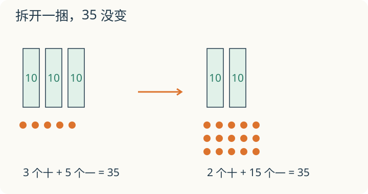

# 第 1 课：满十进一

十根小棒捆在一起，变成了一捆。小棒没有少，为什么写数时却要从 9 换成 10？

## 十个一怎么变成一个十

我们用十个数字：0、1、2、3、4、5、6、7、8、9。

每个数位只写一个数字。用个位记录散着的“一”，十个一凑齐后，就换成一个十，记到左边的十位。小棒还是十根，换的是数法。

所以：

- 9 个一，再加 1 个一，变成 1 个十、0 个一，写作 10；
- 19 个一，再加 1 个一，变成 2 个十、0 个一，写作 20；
- 99 个一，再加 1 个一，变成 10 个十；10 个十又可以捆成 1 个百，写作 100。

每满十，就向左边进一位：10 个一换成 1 个十，10 个十换成 1 个百。

## 位置决定大小

看 235：

- 2 在百位，表示 2 个百，也就是 200；
- 3 在十位，表示 3 个十，也就是 30；
- 5 在个位，表示 5 个一，也就是 5。

合起来：200+30+5=235。

同一个数字 2，放在个位是 2，放在十位是 20，放在百位是 200。数字本身没变，位置变了，表示的大小就变了。

## 例子

### 例 1：9+1

9 个一加 1 个一，是 10 个一。10 个一捆成 1 个十，所以写作 10。

### 例 2：99+1

99 是 9 个十、9 个一。再加 1 个一，个位满十，向十位进 1；十位变成 10 个十，又满十，向百位进 1。结果是 100。

### 例 3：读 305

305 是 3 个百、0 个十、5 个一。十位上的 0 不能省，它占住十位；去掉 0 就变成 35，意思完全变了。

## 易错

- 写数时，个位满十要向十位进一，不能把两个数字挤在个位上。
- 只看数字，不看位置：把 235 里的 2 当成 2，而不是 200。
- 中间或末尾的 0 被随手去掉，导致数位错乱。
- 进位时只进到前一位，忘了连续进位，比如 99+1。

## 拆开一捆，数量会少吗

3 捆小棒，每捆 10 根，另有 5 根。拆开其中一捆，现在有几捆、几根散棒？总数还是 35 吗？

看解释

现在是 2 捆和 15 根散棒，20＋15＝35。拆包没有拿走小棒；把散棒里的十根捆回去，又得到 3 个十和 5 个一。

## 练习

1. 8+1 等于多少？满十了吗？
2. 19+1 等于多少？哪一位满了十？
3. 99+1 等于多少？连续进了几次位？
4. 406 里的 4、0、6 分别表示什么？
5. 用 0、3、7 组成一个最大的三位数和一个最小的三位数。

## 答案

1. 9，没有满十。
2. 20；个位满十，向十位进 1。
3. 100；个位满十向十位进 1，十位满十再向百位进 1。
4. 4 表示 4 个百，0 表示 0 个十，6 表示 6 个一。
5. 最大 730，最小 307（最高位不能是 0）。
