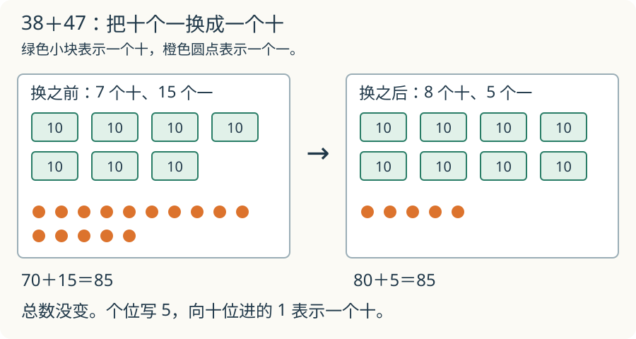

# 第 2 课：竖式的秘密

**复习衔接**：先会拆分几个十和几个一。先完成加减法例题，再选做竖式谜和错题还原。

38＋47，个位算出了 15。把 15 全写在个位下面行不行？先看看这十五个一里藏着几个十。

## 为什么必须对齐

38 是 3 个十、8 个一；47 是 4 个十、7 个一。

个位的 8 和 7 都是“几个一”，可以相加；十位的 3 和 4 都是“几个十”，可以相加。不能把十位的数字 3 和个位的数字 7 直接加成 10，就当作同一数位的结果：它们实际表示 30 和 7，合起来是 37。

所以竖式把个位对个位、十位对十位、百位对百位。这样就能把几个一和几个一相加，把几个十和几个十相加。

## 例子

### 例 1：38+47

个位：8+7=15。15 个一里的 10 个一可以换成 1 个十，个位写 5，向十位进 1。

十位：3+4+1=8。

所以 38+47=85。

写成 715，漏掉了换单位这一步：15 个一要换成 1 个十和 5 个一。换来的十和原来的 7 个十合在一起，才是 8 个十。

### 例 2：52−27

个位 2 减 7 不够，从十位借 1 个十。1 个十换成 10 个一，个位变成 12。

个位：12−7=5。

十位：原来 5 个十，借走 1 个，剩 4 个；4−2=2。

所以 52−27=25。

### 例 3：100−28

个位 0 减 8 不够；十位也是 0，不够借。先向百位借 1 个百，变成 10 个十；再从 10 个十里借 1 个十给个位。

100＝9 个十＋10 个一，换完后仍然是一百。

个位：10−8=2。

十位：9−2=7。

所以 100−28=72。

## 易错

- 忘记加进位的 1。
- 借位后十位没有减 1。
- 0 减几时直接写几，没有先借位。
- 竖式谜从高位猜；个位的信息通常更直接。

## 借走的十去了哪里

52−27 中，把 1 个十换成 10 个一后，为什么不能一边写“12 个一”，一边仍保留“5 个十”？

看解释

5 个十和 12 个一合起来是 62，平白多了 10。正确的是 4 个十和 12 个一，合起来仍是 52；再去掉 2 个十和 7 个一，留下 25。

## 练习

1. 46+37
2. 305+97
3. 100−28
4. 竖式填空：□6+3□=82，两个方框各填几？
5. 小明做加法时，把一个加数十位上的 3 看成了 8，其他数字没看错，计算本身也没错，得到 95。正确结果是多少？

## 答案

1. 83。
2. 402。
3. 72。
4. 46+36=82；两个方框分别填 4 和 6。
5. 45。十位多看了 5，多了 50；95−50=45。
