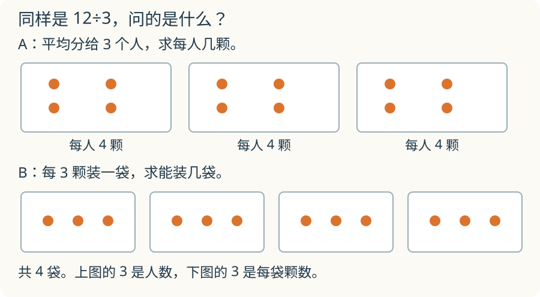

# 第 4 课：除法的两张脸

12 颗糖，平均分给几个人，可以问每人分几颗；每袋装几颗，也可以问能装几袋。这两种问题都可以用除法来算。

## 同一个算式，两种分法

12÷3=4，可以表示：

**故事 A：平均分。** 12 颗糖平均分给 3 个人，每人 4 颗。

**故事 B：包含除。** 12 颗糖，每 3 颗装一袋，能装 4 袋。

两个故事里，12、3、4 的关系都是 3×4=12。A 问“每份几个”，B 问“能装几份”；答案都是 4，但问题不一样。

## 为什么除法是乘法的逆运算

3×4=12，所以：

- 12÷3=4；
- 12÷4=3。

已知两个因数的积和其中一个因数，求另一个因数，就用除法。

## 有余数的情况

13 颗糖，每 3 颗装一袋：

13÷3=4 余 1。

能装 4 袋，还剩 1 颗。剩下的 1 颗不够再装一袋，所以余数是 1。

17÷5=3 余 2：平均分给 5 人，每人 3 颗，还剩 2 颗；每 5 颗装一袋，能装 3 袋，还剩 2 颗。

余数一定比除数小。如果余数等于或大于除数，说明还能再分一份。

## 例子

### 例 1：20÷4

20 颗糖平均分给 4 人，每人 5 颗；每 4 颗装一袋，能装 5 袋。

### 例 2：23÷5

23÷5=4 余 3。每 5 颗装一袋，装 4 袋，还剩 3 颗；3 颗不够再装一袋。

### 例 3：用乘法检查

18÷3=6，因为 3×6=18。18÷6=3，因为 6×3=18。

## 易错

- 把“平均分”和“包含除”当成两种不同的除法算法；算法相同，问法不同。
- 余数写得比除数大。
- 有余数时忘记写“余”。
- 用乘法检查时，把商和余数混在一起：被除数=除数×商+余数。

## 图里的 3 表示什么

同样画 12 个点，一幅图圈成 3 组，每组 4 个；另一幅圈成 4 组，每组 3 个。两幅图都能解释 12÷3，但这个 3 分别表示什么？

看解释

第一幅的 3 表示分成的组数，求每组几个；第二幅的 3 表示每组的个数，求有几组。总数相同，已知的条件不同，答案里的单位也不同。

## 练习

1. 12÷3 讲两个不同的故事。
2. 13÷3 等于多少？余数是多少？
3. 17÷5 等于多少？余数是多少？
4. 18÷3=6，用乘法检查。
5. 一个除法除数是 4，余数可能是 4 吗？为什么？

## 答案

1. 12 颗平均分给 3 人，每人 4 颗；12 颗每 3 颗一袋，能装 4 袋。
2. 4 余 1。
3. 3 余 2。
4. 3×6=18。
5. 不可能。余数必须比除数小；余数是 4 说明还能再分一份。
