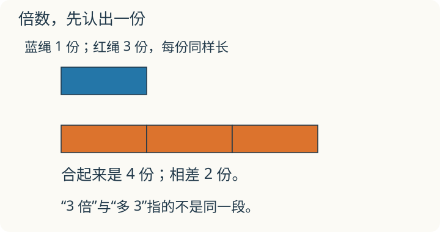

# 第 5 课：倍不是“多”

**学习安排**：先会乘除法和“几个几”。求几倍、求一个数的几倍是本课基础；和倍、差倍和年龄问题是画图提高题，可分开选做。

说一个数是另一个数的 3 倍，意思是把另一个数看作 1 份，这个数里有 3 份。

## 几倍和多几个，有什么不同




倍是用“份”来比较两个量：先选一个量作标准，把它看成 1 份；另一个量里有几个这样的 1 份，就说它是几倍。

6 厘米是 1 份，18 厘米里有 3 个 6 厘米，所以 18 厘米是 6 厘米的 3 倍。

这里比较的是“有几个 6 厘米”，不是“多出几厘米”。18 比 6 多 12 厘米，多出来的部分正好是 2 个 6 厘米；但 18 本身是 3 个 6 厘米，所以说“18 是 6 的 3 倍”。

用算式表示：

- 求一个数的几倍：这个数 × 倍数；
- 求一个数是另一个数的几倍：这个数 ÷ 另一个数。

“3 倍”和“多 3”是两件事。5 的 3 倍是 5×3=15；比 5 多 3 是 5+3=8。

## 例子

### 例 1：6 厘米和 18 厘米

```
6 厘米    [ 1 份 ]
18 厘米   [ 1 份 ][ 1 份 ][ 1 份 ]
```

18÷6=3，所以 18 厘米是 6 厘米的 3 倍。

18−6=12，多出来 12 厘米，正好是 2 个 6 厘米。题目问“多几厘米”，答 12 厘米；问“是几倍”，答 3 倍。两个答案说的不是同一件事。

### 提高选学例：和是 24，甲是乙的 3 倍

把乙看成 1 份，甲就是 3 份，一共 4 份。

24÷4=6，所以 1 份是 6。乙是 6，甲是 6×3=18。

检验：18+6=24，18÷6=3。

### 提高选学例：差是 12，甲是乙的 3 倍

甲比乙多 3−1=2 份，这 2 份对应 12。

12÷2=6，所以 1 份是 6。乙是 6，甲是 6×3=18。

检验：18−6=12，18÷6=3。

## 提高选学：年龄差不变，倍数会变

这一段会用到差倍问题的画图方法。题里的年龄都按整岁算，每年在同一天比较。小明今年 8 岁，妈妈 32 岁，妈妈比小明大 24 岁。每过一年，两人都增加 1 岁，差仍是 24 岁，倍数却会变。

问几年后妈妈年龄是小明的 3 倍：那时把小明年龄看成 1 份，妈妈是 3 份，相差 2 份。这 2 份仍对应 24 岁，所以小明那时 24÷2=12 岁，还需 12−8=4 年。检验：妈妈 32+4=36 岁，36=12×3。

**自己练一练**

哥哥 15 岁，弟弟 5 岁，几年后哥哥年龄是弟弟的 2 倍？请同时写两人的新年龄，检查两人是不是都增加了同样的年数。

答案：年龄差 10 岁。2 倍时差是弟弟的 1 份，所以弟弟那时 10 岁，需 5 年；哥哥 20 岁。不能只给弟弟加 5 岁而让哥哥停在 15 岁。

学过方程后，可在[五上 08](../../五上/L08-列方程/讲授稿.md)用“几年后”作未知数回看；现在用份数图就能解。

## 易错

- 把“3 倍”当成“多 3”。5 的 3 倍是 15，不是 8。
- 和倍问题里把总份数算成 3 份。甲 3 份、乙 1 份，一共 4 份。
- 差倍问题里把差当成 3 份。差对应的是 3−1=2 份。
- 看到“甲是乙的 3 倍”就直接乘 3。已知乙求甲才乘 3；已知甲求乙要用除法。
- 把“多多少”和“是几倍”混在一起。一个用减法，一个用除法。

## 三倍里的三份，哪份是多出的

画一条长线段，分成相同的 3 份，再画一条只有 1 份的短线段。怎样从图上找到“两条的和”和“两条的差”？

<details>
<summary>看解释</summary>

和要把长、短两条都算上，共 3＋1＝4 份。差要先对齐起点，去掉两条中同样长的 1 份，长线段还多 2 份。图中的每一份必须一样长。

</details>

## 练习

1. 6 的 4 倍是多少？比 6 多多少？
2. 24 是 6 的几倍？
3. 红花有 9 朵，黄花是红花的 3 倍。黄花有多少朵？两种花一共多少朵？
4. 【提高选做】甲、乙两数的和是 30，甲是乙的 4 倍。甲、乙各是多少？
5. 小明有 12 张卡片，是小华的 3 倍。小华有多少张？
6. 判断：一个数乘 3，就是比原来多 3。

## 答案

1. 6×4=24；24−6=18，比 6 多 18。
2. 24÷6=4，24 是 6 的 4 倍。
3. 黄花 9×3=27 朵；一共 9+27=36 朵。
4. 乙是 1 份，甲是 4 份，共 5 份。30÷5=6，乙是 6；甲是 6×4=24。检验：24+6=30，24÷6=4。
5. 12÷3=4，小华有 4 张。检验：4×3=12。
6. 错。乘 3 是变成原来的 3 倍。5×3=15，比 5 多 10，不是多 3。
