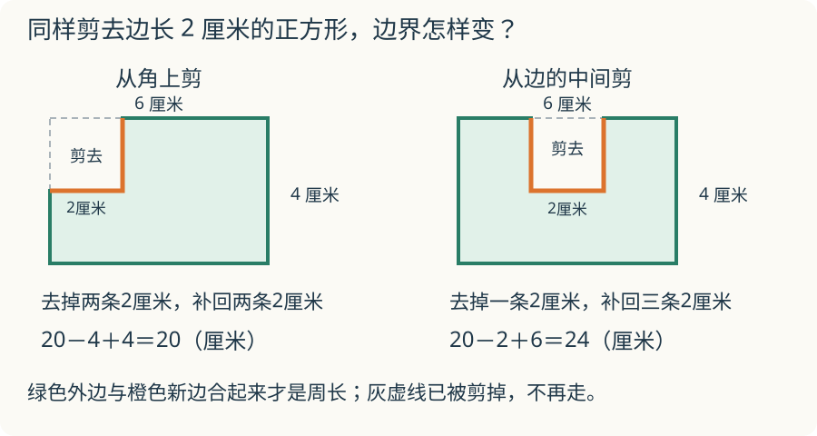

# 第 9 课：周长的边界

周长是沿图形边界走一圈的长度；图形剪开或拼合后，边界变了，周长要重新数。

## 沿着哪条边走一圈

周长量的是边界。图形里面有多大，那是面积；边有几条，也不等于周长。从一点出发，沿边走一圈回到起点，走了多长，周长就是多少。

长方形有两条长、两条宽，所以

长方形周长 =（长+宽）×2。

正方形四条边一样长，所以

正方形周长 = 边长×4。

一根绳子围成一个封闭图形，绳子的长度就是图形的周长。围成什么形状，周长都不变；形状变了，边界还是那根绳子。

剪和拼会改变边界。把两个图形拼在一起，贴合的那条边藏在里面，不再属于外边界。总周长要减去两条贴合的边，因为两个图形各少了一条。从一个图形上剪下一块，剪开的地方会变成新的边界，周长可能变长；剪在角上，也可能刚好不变。

## 例子

### 例 1：长 6 厘米、宽 4 厘米的长方形

周长 =（6+4）×2=10×2=20 厘米。

沿边界走一圈：6+4+6+4=20 厘米。

### 例 2：两个边长 3 厘米的正方形拼成一个长方形

一个正方形的周长是 3×4=12 厘米。

拼在一起后，两条 3 厘米的边贴在内部，不再算外边界。

新长方形的长是 3+3=6 厘米，宽是 3 厘米。
周长 =（6+3）×2=9×2=18 厘米。

也可以这样算：12+12−3−3=18 厘米。

比两个正方形周长之和少 6 厘米，正好少了两条贴合的边。

### 例 3：从长 6 厘米、宽 4 厘米的长方形上剪掉一个边长 2 厘米的正方形

**剪在角上。** 原来角上的两条 2 厘米边被剪掉，凹进去的两条 2 厘米边补上来。一进一出，边界总长不变，周长仍是 20 厘米。

**剪在一条边的中间。** 原来那条 6 厘米的顶边，中间少了 2 厘米；凹口添了下、横、上三条边，每条 2 厘米。

| 剪法 | 去掉的边 | 新增的边 | 周长 |
|---|---|---|---|
| 角上 | 2 条，各 2 厘米 | 2 条，各 2 厘米 | 20 厘米 |
| 边的中间 | 1 条，2 厘米 | 3 条，各 2 厘米 | 24 厘米 |

边的中间这种剪法：20−2+6=24 厘米。多出的 4 厘米来自逐条相抵，去掉 2 厘米，添上 6 厘米。

## 易错

- 把周长和面积混在一起，用长×宽算周长。
- 两个图形拼合后，直接把两个周长相加，忘记减去贴合的两条边。
- 看到“剪掉一块”就认为周长一定变小。剪在角上时，周长可能不变。
- 边中间有凹口时，只数一条边，忘记凹进去的左、右、底都要走。
- 计算长方形周长时漏乘 2，或把（长+宽）×2 算成长+宽×2。

## 贴起来的是一条边，为什么减两次

两个正方形贴在一起，只看见一条接缝。算总周长时为什么要减去两条边？

看解释

拼之前，每个正方形都有一条边在接缝的位置，两个周长各算过一次。拼好后，这两条边都藏在内部，沿外面走一圈不会经过它们，所以要各减一次。

## 练习

1. 长方形长 8 厘米、宽 5 厘米，周长是多少？
2. 正方形边长 7 厘米，周长是多少？
3. 两个长 5 厘米、宽 3 厘米的长方形，把两条 5 厘米的边拼在一起，拼成的大长方形周长是多少？
4. 一根 24 厘米的铁丝围成一个长方形，长是 7 厘米，宽是多少厘米？
5. 一个边长 4 厘米的正方形，从角上剪掉一个边长 1 厘米的小正方形，剩下图形的周长是多少？如果从一条边的中间剪掉同样的 1 厘米小正方形呢？
6. 【学过面积后选做】判断：面积越大，周长一定越长。

## 答案

1. （8+5）×2=26 厘米。
2. 7×4=28 厘米。
3. 拼成 5 厘米×6 厘米的长方形，周长（5+6）×2=22 厘米。每个小长方形周长（5+3）×2=16 厘米，16+16−5−5=22 厘米。
4. 24÷2=12 厘米，长+宽=12 厘米，宽=12−7=5 厘米。
5. 剪在角上，周长不变，仍是 4×4=16 厘米。剪在边的中间，去掉 1 厘米，添上凹口的三条 1 厘米边，周长 16−1+3=18 厘米。
6. 错。面积大，周长不一定长；面积小，周长也可能更长。边长 4 厘米的正方形面积是 16 平方厘米，周长 16 厘米；长 9 厘米、宽 1 厘米的长方形面积只有 9 平方厘米，周长却是（9+1）×2=20 厘米。
