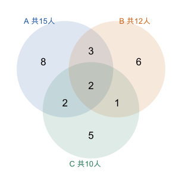

# 第 11 课：集合圈

**提高选学**：先会读分类记录和两步加减。这课用圈图解决重复计数，不要求背两圈、三圈公式；三圈题可以跳过。

数一共有多少人，每个人都只能算一次。两类人有重叠，就要把多算的那一次减掉。

## 两种都喜欢的人算了几次

把“喜欢苹果的人”和“喜欢香蕉的人”分别装进两个圈，两个圈会有交叉的部分：既喜欢苹果又喜欢香蕉的人。

如果直接把两个圈的人数相加，交叉部分被算了两次：

- 只喜欢苹果的人，算在第一个圈；
- 只喜欢香蕉的人，算在第二个圈；
- 两种都喜欢的人，两个圈各算了一次。

要求“至少喜欢一种”的人数，就要把多算的一次减掉：

至少一种 = 喜欢苹果 + 喜欢香蕉 − 两种都喜欢。

这就是“不重不漏”：每个人只算一次，一个人也不能漏掉。

## 例子

### 例 1：30 人，喜欢苹果 18 人，喜欢香蕉 15 人，两种都喜欢 7 人

至少喜欢一种：18+15−7=26 人。
两种都不喜欢：30−26=4 人。

可以分成四块检查：

| 只喜欢苹果 | 两种都喜欢 | 只喜欢香蕉 | 两种都不喜欢 |
|---|---|---|---|
| 18−7=11 | 7 | 15−7=8 | 4 |

11+8+7+4=30，正好是全班人数。

### 例 2：20 人，喜欢猫 12 人，喜欢狗 9 人，至少喜欢一种的有 17 人

两种都喜欢：12+9−17=4 人。

检查：只喜欢猫 12−4=8 人，只喜欢狗 9−4=5 人，8+5+4=17 人；两种都不喜欢 20−17=3 人。

### 例 3：为什么减一次

7 个两种都喜欢的人，在 18 里出现一次，在 15 里又出现一次。总共被数了两次，实际只能算一次，所以减去 7。

## 易错

- 直接把两个圈的人数相加，忘记减去重叠部分。
- 减错对象：减的是“两种都喜欢”的人数，不是“只喜欢一种”的人数。
- 求“两种都不喜欢”时，直接用总人数减去两个圈的和，忘了两个圈相加已经把重叠算了两遍。
- 把“只喜欢苹果”和“喜欢苹果”混为一谈。喜欢苹果的 18 人里，包含两种都喜欢的 7 人。
- 填表时把“喜欢苹果的 18 人”直接填进“只喜欢苹果”，忘记其中还有 7 人两种都喜欢。

## 减去重叠，是把人赶出去吗

喜欢苹果的 18 人和喜欢香蕉的 15 人相加后，再减去两种都喜欢的 7 人。这 7 人最后还算在“至少喜欢一种”的人里吗？

看解释

还算在里面。相加时他们每人被记了两次，减的是多记的一次；每人还保留一次。把两次都减掉，才会漏掉这 7 人。

## 练习

1. 25 人，喜欢足球 16 人，喜欢篮球 14 人，两项都喜欢 8 人。至少喜欢一项的有多少人？两项都不喜欢的有多少人？
2. 一班 40 人，参加美术 22 人，参加音乐 18 人，两项都参加 6 人。至少参加一项的有多少人？两项都没参加的有多少人？
3. 喜欢苹果 20 人，喜欢香蕉 17 人，两种都喜欢 9 人。至少喜欢一种的有多少人？
4. 30 人，会游泳 19 人，会骑车 15 人，每人至少会一项。两项都会的有多少人？
5. 判断：喜欢苹果的 20 人加喜欢香蕉的 17 人，就是至少喜欢一种的人数。
6. **选做：三个圈。** 先能独立解释两圈重叠，再做本题，不作为本课基础过关要求。喜欢 A 15 人，喜欢 B 12 人，喜欢 C 10 人；A、B 都喜欢 5 人，A、C 都喜欢 4 人，B、C 都喜欢 3 人，三个都喜欢 2 人。各“两种都喜欢”的人数都包含“三个都喜欢”的人。至少喜欢一种的有多少人？

## 答案

1. 16+14−8=22 人；25−22=3 人。
2. 22+18−6=34 人；40−34=6 人。
3. 20+17−9=28 人。
4. 19+15−30=4 人。
5. 错。若有 9 人两种都喜欢，20+17 把这 9 人算了两次，至少一种应是 20+17−9=28 人。只有两种没人同时喜欢时，才是 20+17=37 人。
6. 先从最中间填 2 人，再填只喜欢两种的人：只 A、B 为 5−2=3 人，只 A、C 为 4−2=2 人，只 B、C 为 3−2=1 人。只 A 为 15−3−2−2=8 人，只 B 为 12−3−1−2=6 人，只 C 为 10−2−1−2=5 人。七块互不重叠，共 8+6+5+3+2+1+2=27 人。

也可以写 15+12+10−5−4−3+2=27。三个都喜欢的人先算三次，再被减三次，需要加回一次。先看清各区，不必只背算式。
