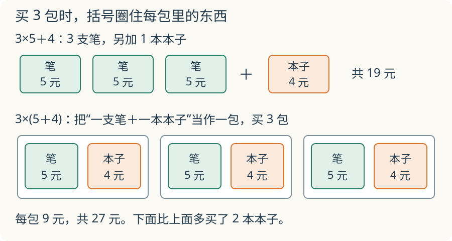

# 第 13 课：混合运算与括号

3 支笔每支 5 元，另外买一本 4 元的本子。“3×5＋4”和“3×(5＋4)”买的是一样多的东西吗？

## 买笔的钱，先算哪一步



3 支笔，每支 5 元，再买一本 4 元的本子，一共多少钱？

写成算式是 `3×5+4`。

- 先算 3 支笔的钱：3×5=15（元）。
- 再加一本本子的钱：15+4=19（元）。

如果先算 5+4，再乘 3，就把一本本子的钱也算了 3 次。

再看 `4+3×5`：本子的钱写在前面，还是要先算 3×5，再加 4。这里就不能从左往右一路算。

**有乘除，也有加减时，先算乘除，再算加减。** 这是大家共同遵守的运算顺序。

## 小括号让哪一步先算

```
(3+4)×5
=7×5
=35
```

先算小括号里的 3+4，再乘 5。

去掉小括号，变成 `3+4×5`，就要先算 4×5：

```
3+4×5
=3+20
=23
```

小括号指定先算哪一部分，结果可能因此改变。但加了括号，结果不一定变。例如 `3+4+5` 和 `(3+4)+5` 都等于 12。

## 什么时候从左往右算

没有括号，只有加减，或者只有乘除时，从左往右算。

```
100-40+25
=60+25
=85
```

这里先减 40，再加 25。如果先把 40+25 算成 65，再从 100 里减去，就变成减去 65，意思变了。

```
24÷3×2
=8×2
=16
```

乘除在同一级，这里先除以 3，再乘 2。不能因为有乘号，就把后面的 3×2 抢先算掉。

## 例子

### 例 1：先乘后减

```
50-5×6
=50-30
=20
```

### 例 2：小括号优先

```
48÷(8-2)
=48÷6
=8
```

不加括号时，`48÷8-2=6-2=4`，要先算除法。

### 例 3：先算的部分藏在题目里

有 18 个红气球、12 个蓝气球，平均分给 5 个小组，每组几个？

要先算一共有几个气球，再平均分：

```
(18+12)÷5
=30÷5
=6（个）
```

### 再多想一步：两样东西各买几份

3 支笔，每支 5 元；2 本本子，每本 4 元。一共多少钱？

```
3×5+2×4
=15+8
=23（元）
```

这道题比前面的多一步：先分别算笔和本子的钱，再合起来。

## 易错

- 看到加法在前面，就先算加法，没有看后面是否还有乘除。
- 把“先乘除”记成“先乘后除”。乘除同级，要从左往右算。
- 忘记小括号里的一部分要先算。
- 说“加了括号，答案一定变了”，没有实际算一算。
- 写中间步骤时，把还没算的部分漏掉了。

## 括号圈住的是哪一包

给“3×5＋4”和“3×(5＋4)”各画一幅购物图，用小方框代表笔和本子。两幅图会差什么？

<details>
<summary>看解释</summary>

前一幅有 3 支 5 元的笔，另加 1 本 4 元的本子，共 19 元。后一幅把一支笔和一本本子当成一包，买 3 包，共 27 元，多买了 2 本本子。括号改变了被重复的那一组。

</details>

## 练习

1. 计算：`7+3×6`。
2. 计算：`64-6×8`。
3. 计算：`(9+6)×3`。
4. 计算：`56÷(10-3)`。
5. 计算：`90-24+14`。
6. 在 `4+5×6` 里加一对小括号，使结果变成 54。
7. 小红买 4 本本子，每本 6 元，付了 30 元。应找回多少元？列出一个综合算式。

## 答案

1. 7+18=25。
2. 64-48=16。
3. 15×3=45。
4. 56÷7=8。
5. 66+14=80。
6. `(4+5)×6=9×6=54`。
7. 30-4×6=30-24=6（元）。先算买本子的钱，再算找回的钱。

## 提高选学：从最后一步往回想

一盒彩笔，先拿出 8 支，把剩下的平均分给 3 人，每人 6 支。原来有几支？先别猜，从已经知道的“每人 6 支”往回走：

```text
顺着分：原来？支 → 拿出 8 支 → 剩下？支 → 平分给 3 人 → 每人 6 支
倒着想：原来26支 ← 放回 8 支 ← 剩下18支 ← 合起 3 份  ← 每人 6 支
```

先把三份合起来，6×3=18 支；再放回拿出的 8 支，18＋8=26 支。检查时顺着做：`（26−8）÷3=6`，和题目相同。

倒着想时，**先撤回最后一步，再撤回前一步**。如果先算 6＋8，再乘 3，就把拿出的 8 支也算了三遍。

**自己试一试**

1. 一个数先乘 4，再减 7，结果是 29。原来是多少？
2. 一袋糖先取出 12 颗，剩下的平均装进 5 个小袋，每袋 7 颗。原来多少颗？

**核对**

1. 先补回 7，再除以 4：`（29＋7）÷4=9`。顺着检查：9×4−7=29。
2. 先合起五袋，再放回 12 颗：7×5＋12=47 颗。顺着检查：（47−12）÷5=7。
