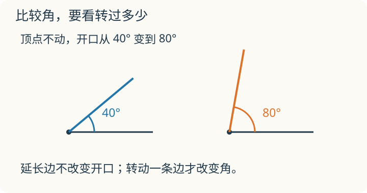
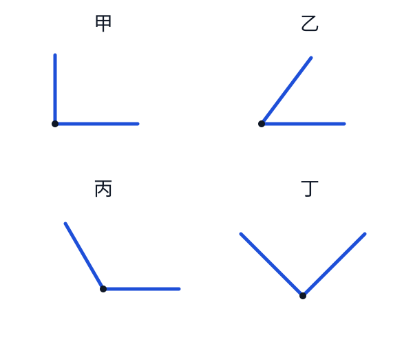

# 第 15 课：角与直角

两条直直的边从同一个点出发，就能画出一个角。角的大小看两条边张开多少，和边画得长不长无关。

## 找到顶点和两条边



先比较两边张开的大小即可。图中的“度”用来记录角的大小，量角器和角度的读法在后面的角的度量课学习。


```
       边
        \
         \
          ● 顶点
         /
        /
       边
```

两条边相接的这个点叫顶点。一个角有一个顶点和两条边。

纸上只能画出边的一部分，边可以继续向外画。只要两条边的方向没有变，把边画长一些，角也不会变大。

把两根纸条的一端连在一起，固定其中一根，再转动另一根，开口才会变大或变小。

## 怎样比较两个角

把两个角的顶点叠在一起，再让一条边重合。两个角的开口要放在这条边的同一侧，然后看另一条边：

- 第二个角的另一条边落在第一个角的里面，第二个角就小。
- 第二个角的另一条边落在第一个角的外面，第二个角就大。
- 两条边都能重合，两个角就一样大。

不能因为边画得长，就说那个角大。

## 用直角来比一比

三角尺上有一个直角，长方形纸的四个角也是直角。可以拿它们来比：顶点对准顶点，一条边对齐，再看另一条边。

- **直角**：两条边都能和三角尺上的直角重合。
- **锐角**：张开得比直角小。
- **钝角**：张开得比直角大，还没有张成一条直线。

这里比较的是两条边之间较小的开口。

## 例子

### 例 1：直角可以斜着放

把一本长方形的书转个方向，书角仍然是直角。判断时要比开口，不能只看边是不是横着或竖着。

### 例 2：画一个直角

1. 先画一条直直的边。
2. 把三角尺的直角顶点对准边的端点，一条直角边与画好的边对齐。
3. 沿三角尺的另一条直角边画出角的另一条边。

### 例 3：边变长，开口没变

小明画了一个直角，又把两条边都往外画长了一些。再用三角尺去比，两条边仍能对齐，所以还是直角。

### 例 4：钟面上的角

看时针和分针之间**较小的角**：

- 3 时整，两针分别指向 3 和 12，是直角。
- 2 时整，较小的开口比直角小，是锐角。
- 4 时整，较小的开口比直角大，还没张成一条直线，是钝角。

## 易错

- 认为边画得越长，角就越大。
- 认为斜着放的角不可能是直角。
- 比角时只对齐顶点，没有对齐一条边。
- 只凭眼睛估，没有用三角尺或长方形纸的角核对。
- 认为纸上画出的边有尽头，角的边就不能继续向外画。

## 哪一种动作真的把角变大了

甲把角的两条边都画长；乙固定一条边，把另一条向外转开一些；丙把整张纸转了方向。哪些动作改变了角的大小？

<details>
<summary>看解释</summary>

只有乙改变了两条边之间的开口。甲只延长边，丙把整个角一起转动，原来的开口都没有改变。可以把顶点和一条边对齐，再核对另一条边。

</details>

## 练习

1. 一个角有一个（ ）和两条（ ）。
2. 判断：把一个角的两条边都画长，角就变大了。（ ）
3. 看下图，用三角尺或长方形纸的角比一比，甲、乙、丙、丁中哪些是直角？哪些是锐角、钝角？



4. 画一个直角，再画一个比它小的角。
5. 3 时整，时针和分针之间较小的角是什么角？
6. 小红画了一个角，小明把同样的角转了个方向再描下来。两个角的大小一样吗？为什么？

## 答案

1. 顶点；边。
2. 错。边的方向没有变，张开的大小就没有变。
3. 甲、丁是直角，乙是锐角，丙是钝角。丁虽然斜着放，开口也和三角尺上的直角一样大。
4. 先用三角尺画直角。再从同一个顶点出发，在两条边中间画一条新边；新边和原来的一条边围出的较小角是锐角。核对时要有一个直角和一个锐角。
5. 直角。
6. 一样大。转动只改变朝向，没有改变两条边张开的大小。
