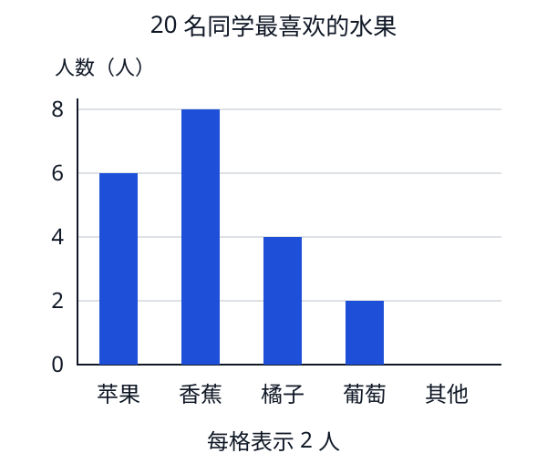

# 第 16 课：调查与记录

想知道同学们喜欢什么，要先问清楚，再把每个人的回答记下来。一个一个核对，才不容易数重或漏掉。

## 先把问题说清楚

这次要问 25 名同学：“你最喜欢哪种水果？每人只选一种。”

先列出苹果、香蕉、橘子、葡萄，再加一栏“其他”。喜欢的水果不在前四种里，就记在“其他”，不用勉强选一种。

调查时做三件事：

1. 记清参加调查的是哪些同学，共多少人。
2. 每听到一个人的回答，记在对应的水果下面，再在名单上做个记号，表示已经问过他。
3. 全部问完后，数出每类有多少人，并和名单核对。

如果有人还没回答，先在名单上记好，等问清以后再填，不能替他猜。

## 一个“正”字怎样记五个人

每听到一个回答，就在对应类别下面，按笔顺给“正”字添一笔。第一个人写一横，五个人写满一个“正”；第六个人再开始写下一个“正”。

下面这份记录里，25 名同学都已经回答：

```
苹果：正
香蕉：正正
橘子：正
葡萄：正
其他：没有
```

一个“正”表示 5 人。苹果、橘子、葡萄各 5 人，香蕉 10 人，“其他”是 0 人。

## 把记录整理成表

| 水果 | 人数 |
|---|---:|
| 苹果 | 5 |
| 香蕉 | 10 |
| 橘子 | 5 |
| 葡萄 | 5 |
| 其他 | 0 |
| 合计 | 25 |

这次每人只选一种，每个人都已记录，所以各类人数相加应当等于 25。

不过，**合计对了，也要检查名单**。如果漏记小明一次，又把小红记了两次，总数仍可能对得上，记录却错了。

## 例子

### 例 1：从表里能看出什么

另一次调查，问了 20 名同学，每人也只选一种。结果如下：

| 水果 | 人数 |
|---|---:|
| 苹果 | 6 |
| 香蕉 | 8 |
| 橘子 | 4 |
| 葡萄 | 2 |
| 其他 | 0 |
| 合计 | 20 |

6+8+4+2+0=20。

这 20 名同学里，选香蕉的人最多，选苹果的人比选香蕉的少 2 人。只问了这些同学，就只能说这次调查的结果，不能说全校也一定一样。

### 例 2：合计少了一个

这次问了 20 人，每人选一种，合计却只有 19。

可能有人漏记，也可能数画记或抄表时出了错。先按名单和原记录逐项查，不能随便给某一类补上 1 人。

### 例 3：喜欢几种，和最喜欢一种不同

如果改问“你喜欢哪些水果，可以选好几种”，同一个人就可能记在几类里。这时各类人数相加，可能超过参加调查的人数。

所以记数前，要说清这次是“只选一种”还是“可以选好几种”。

## 再看一张条形图（选学）

把例 1 的表画成条形图，就能看出各类人数的多少。



横着看，知道每根直条表示哪种水果；竖着看人数刻度。图上从 0 到 2 是一格，**每格表示 2 人**。

香蕉的直条有 4 格，表示 4×2=8（人）。不能把 4 格直接读成 4 人。

比较同一张图里的直条：香蕉比苹果多 1 格，也就是多 2 人。直条高，只能说明这一类选的人多，不能说明每个人都选了它。

## 易错

- 题目说每人只选一种，却把同一个人的回答记进两类。
- 没问完所有参加调查的人，就急着算合计。
- 喜欢的东西不在选项里，就不记录这个人。
- 只检查合计，没有和名单、原始画记核对。
- 把“这次调查中选的人最多”说成“所有人都喜欢”。
- 读条形图时，没有看清一格表示几人。

## 练习

1. 调查最喜欢的运动，只列了足球和篮球。小明最喜欢跳绳，该怎样记录？
2. 某一类写了两个完整的“正”字，又接着写了三笔，共记录了多少人？
3. 调查 20 人，每人只选一种。苹果 7 人、香蕉 6 人，其余都选橘子。选橘子的有几人？
4. 判断：人数最多的那一类，一定是每个人都喜欢的。（ ）
5. 每人只选一种，合计和总人数一样，就能肯定没有数重或漏记吗？举一个例子。
6. 选学：读上面的条形图，选香蕉的比选橘子的多几人？

## 答案

1. 增加“跳绳”这一类，或者提前设好“其他”一类，把小明的回答记进去。不能漏掉他，也不能让他随便改选足球或篮球。
2. 5+5+3=13（人）。
3. 20-7-6=7（人）。
4. 错。只说明这一类人数最多。
5. 不能。例如漏记小明一次，同时把小红多记一次，合计没变，但记录已经错了。
6. 香蕉 8 人，橘子 4 人，8-4=4（人）；也可以看出相差 2 格，每格 2 人，2×2=4（人）。
