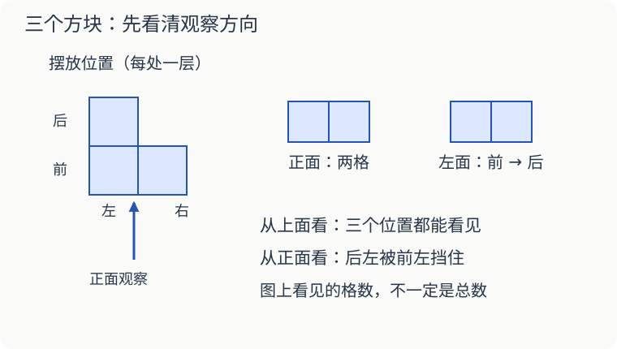

# 第 17 课：换个位置看物体

桌上放着一个杯子。你看见杯把，同桌却说没看见。先别急着争：你们可能站在杯子的两边。

## 人换了位置，看到的样子也会变

观察时，先固定物体，只让人换位置。站在正前面、侧面、上面，看到的部分可能不同。不能把“我没看见”说成“它没有”。

来看三个一样大的小方块：前排并排放两个，左边那个后面再放一个。每处只有一层。

从正面看，后面的方块被前面的挡住，只看见两个正方形。站到上面往下看，三个位置都能看见，像一个转了方向的 L。从左面看，分得清前后两个位置，右边的方块被挡住了。

注意：上面图的下边表示前面；左面图里，左边表示前面。先看图上的方向说明，再比较。

## 一张图不一定能告诉你有几个方块

正面看见两个并排的正方形，可能只有两个方块，也可能后面还藏着一个。想知道总数，得换个方向看，或查看题目给的摆放条件。

如果题目说“所有方块都在同一排，只有一层”，正面两个就对应两个方块。这是多了一条有用的条件。

## 再试一种摆法

四个方块在桌面上摆成两排，每排两个，只有一层。从上面看是四个小正方形组成的大正方形；从正面、左面看，都只有两个正方形并排。三个方向看到的格子数不能加起来当作方块数，同一个方块可能在几张图里都出现。

## 自己试一试

1. 看本课配图，从上面能看见几个位置？实际有几个方块？
2. 在图中的“后右”空位补上一个方块，仍只有一层。正面图会改变吗？上面图会改变吗？
3. 沿配图的方向，把三个方块左右并排摆成一排，只有一层。从正面、左面分别看见几个正方形？
4. 正面看见三个并排的正方形，就能断定一共三个方块吗？说出两种可能。
5. 小明把杯子转了一下，小红换了站的位置。两次看到的杯子都可能变化吗？

## 答案与说明

1. 三个位置，三个方块。本题说明每处只有一层。
2. 正面仍是两个并排，不变；上面多出后右的一格，变成两排、每排两格。
3. 正面三个，左面一个。这里“同一排”指左右并排，观察方向沿用配图。
4. 不能。可以是三个并排，也可以在其中一个后面再放一个，共四个。
5. 都可能。第一次是物体转动，第二次是人换位置。比较两次观察结果时，要说清谁动了。

想继续研究藏住的方块，可以在学过这课后读[观察物体](../../五下/L04-观察物体/讲授稿.md)。
