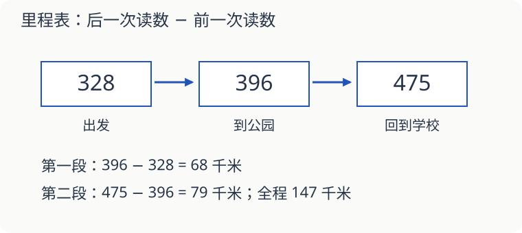

# 第 18 课：里程表上的数不是今天走的路

汽车早上出发时，里程表显示 328 千米；傍晚显示 475 千米。它今天走了 475 千米吗？

## 两次读数之间，才是这次走的路

里程表把以前走过的路也累计在里面。今天开始前已经有 328 千米，结束时增加到 475 千米，所以今天走了：

`475−328=147（千米）`。

中午读数是 396 千米。上午走了 `396−328=68` 千米，下午走了 `475−396=79` 千米。两段相加 `68+79=147` 千米，和全天的路程相同。

## 三位数加减，别丢了进位和退位

算 `368+257`：个位 `8+7=15`，写 5，向十位进 1；十位 `6+5+1=12`，写 2，向百位进 1；百位 `3+2+1=6`。结果是 625。

算 `604−278`：个位不够减，十位又是 0。把一个百换成十个十，再拿出一个十换成十个一。604 就暂时写成 5 个百、9 个十、14 个一。

依次算 `14−8=6`、`9−7=2`、`5−2=3`，得到 326。检查：`326+278=604`。

估算也能帮忙：600−300 大约是 300，326 在附近；如果算出 926，就应该停下来检查。

### 连着两个 0，怎样退位

算 1000−368，个位、十位和百位都没有现成的单位可减，要从千位拆起：

| 拆到哪一步 | 千 | 百 | 十 | 一 |
|---|---|---|---|---|
| 原来 | 1 | 0 | 0 | 0 |
| 把 1 个千换成 10 个百 | 0 | 10 | 0 | 0 |
| 再把 1 个百换成 10 个十 | 0 | 9 | 10 | 0 |
| 再把 1 个十换成 10 个一 | 0 | 9 | 9 | 10 |

每一行合起来都是 1000，只是分法变了。最后从 9 个百、9 个十、10 个一中减去 368，得到 632。检查：632＋368=1000。

**试一试**：计算 1000−457，用加法检查。哪些位留下 9，哪一位留下 10？

**核对**：结果是 543，543＋457=1000。相减前百位和十位各有 9 个单位，个位有 10 个一，不能把三位都写成 10。

## 同一个地点，也可以用“距起点多远”来标

从学校出发，图书馆在路程标记 240 米处，体育馆在同一路线的 680 米处。两地之间是 `680−240=440` 米，不是 `680+240` 米。两个数字都从同一起点量起，先找清它们表示哪一段。

## 自己试一试

1. 一辆车出发时读数 586 千米，结束时 734 千米，这次走了多少千米？
2. 早上读数 248 千米，上午走 85 千米，下午再走 67 千米。晚上应显示多少千米？
3. 计算 `487+268`，写出进位过程。
4. 计算 `703−486`，再用加法检查。
5. 沿同一路线，甲站距起点 315 米，乙站距起点 702 米。甲站到乙站多少米？
6. 小红说：“里程表显示的数字越大，今天走的路就越多。”一定对吗？

## 答案与说明

1. `734−586=148（千米）`。
2. `248+85+67=400（千米）`。今天走了 152 千米，但晚上读数是 400。
3. 755。个位写 5 进 1，十位 `8+6+1=15` 写 5 进 1，百位 `4+2+1=7`。
4. 217。703 换成 6 个百、9 个十、13 个一后相减；`217+486=703`。
5. `702−315=387（米）`。
6. 不一定。它还包含以前走的路。今天的路程要用今天结束读数减去出发读数。
