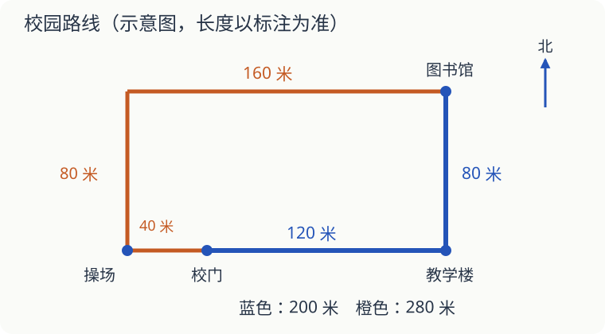

# 第 19 课：校园里怎样量、怎样走

**综合实践**：先会米与厘米的换算，并能在图上辨认东、南、西、北；还不熟悉方向时，可先看[方向](../../三下/L08-方向/讲授稿.md)的四方向部分。

想告诉新同学从校门走到图书馆，光说“走一会儿就到了”可不够。要说清往哪走，每一段多长。

## 先看方向，再看路线

下面是一张校园示意图，上北下南、左西右东。路上的数字是实际距离，不能拿尺子量屏幕上的线，再把它当成校园距离。

路线一：从校门向东走 120 米到教学楼，再向北走 80 米到图书馆，共 `120+80=200` 米。

路线二：从校门向西走 40 米到操场，再向北走 80 米，最后向东走 160 米到图书馆，共 `40+80+160=280` 米。路线一少走 80 米。

“少走 80 米”比较的是两条完整路线。只挑各路线里短的一段来比，会漏掉另一段。

## 尺子没从 0 开始，也能量

一支笔的一端对着直尺的 2 厘米刻度，另一端对着 9 厘米刻度。笔长 `9−2=7` 厘米。读末端的 9 之前，还要看起点在哪里。

量教室可以用米，量课本厚度可以用毫米。要把 3 米 40 厘米写成厘米，先换 3 米：`300+40=340（厘米）`。

## 估测时，要承认它是“大约”

小林先在一段 10 米的平路上走了 20 步，再按差不多的步子走一条小路，共走 60 步。60 步是 20 步的 3 倍，所以小路大约 30 米。

走路时每步不可能完全一样，这个结果是估测。需要准确尺寸时，换卷尺测量，不能把“大约 30 米”写成“一定 30 米”。

## 自己试一试

1. 按图走路线一，从图书馆原路回校门，应先朝什么方向、再朝什么方向？
2. 从校门按路线一去图书馆，再按路线二返回，一共多少米？
3. 纸条两端分别对着 3 厘米、11 厘米刻度，它长多少厘米？
4. 把 2 米 8 厘米改写成厘米。
5. 小林走 20 步大约 10 米。按同样大小的步子走 100 步，大约多少米？这个办法能直接用来估算小红走的路吗？
6. 路线一正在维修，不能通行。去图书馆还应该选路线一吗？

## 答案与说明

1. 先向南走 80 米，再向西走 120 米。
2. `200+280=480（米）`。
3. `11−3=8（厘米）`。
4. `200+8=208（厘米）`，不是 280 厘米。
5. 100 步是 20 步的 5 倍，大约 50 米。不能直接用于小红，她的步长可能不同，要先量她自己的步子。
6. 不应该。先确认能走，再比较路程；此时可选路线二。
