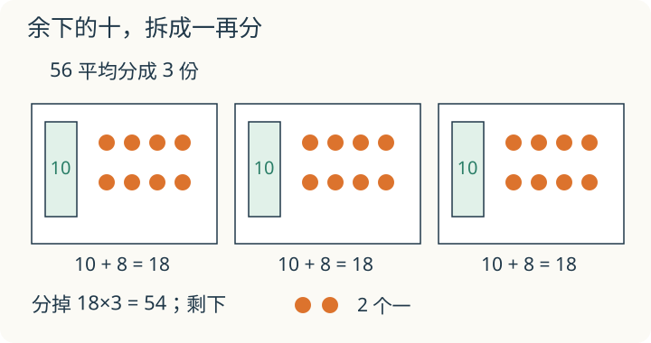

# 第 1 课：除法竖式

56 根小棒平均分给 3 人。先分整捆的小棒，剩下的两捆怎么办？把它们拆开，才能接着分。

## 为什么先从高位分




48÷2，意思是把 48 平均分成 2 份。

48 是 4 个十和 8 个一。先分 4 个十：每份 2 个十。再分 8 个一：每份 4 个一。合起来每份 24。

先从个位分，48÷2 也能得到 24。但 56÷3 会麻烦：个位 6÷3=2，十位 5÷3 余 2 个十；这 2 个十还要拆成 20 个一，回头再分。高位迟早要分，先分高位，余下的十直接拆给个位，已经写好的商不用改。

从高位开始，每一步都是“把当前位分完，余下的拆成下一级单位”：

- 5 个十 ÷ 3，每份 1 个十，余 2 个十；
- 2 个十换成 20 个一，加上原来的 6 个一，是 26 个一；
- 26÷3，每份 8 个一，余 2 个一。

所以 56÷3=18 余 2。验算：18×3+2=56。

余数必须比除数小。余数如果等于或大于除数，说明每份还能再分到 1 个，除法还没做完。

## 例子

### 例 1：48÷2

```
  2 4
 ┌────
2│4 8
 │4
 │──
 │  8
 │  8
 │  ──
 │  0
```

十位：4÷2=2，商 2 写在十位上。个位：8÷2=4，商 4 写在个位上。48÷2=24。

### 例 2：56÷3

```
  1 8
 ┌────
3│5 6
 │3
 │──
 │2 6
 │2 4
 │──
 │  2
```

十位：5÷3=1，余 2；把 2 个十拆成 20 个一，和个位的 6 合起来是 26。个位：26÷3=8，余 2。所以商 18，余 2。

### 例 3：312÷3

百位：3÷3=1，商 1 写在百位。十位：1÷3 不够商 1，十位写 0 占位。把 1 个十拆成 10 个一，和个位 2 合起来是 12；12÷3=4，商 4 写在个位。

312÷3=104。验算：104×3=312。

## 易错

- 从个位开始除，高位没分完就拆，竖式对不上。
- 余数比除数大，或者等于除数，还在往下写。
- 商中间的 0 漏写：312÷3 写成 14。
- 高位余下的数没有落下来，直接丢掉。
- 验算只乘商，忘了加余数。

## 余下的 2，表示什么

56÷3 的竖式里，分完十位余 2，最后也余 2。这两个 2 一样大吗？

<details>
<summary>看解释</summary>

不一样。前一个是 2 个十，也就是 20；后一个是 2 个一。竖式中的位置告诉我们正在分哪一种单位。

</details>

## 练习

1. 84÷4
2. 72÷3
3. 92÷4
4. 618÷6
5. 一个数除以 5，商是 17，余数是 3，这个数是多少？
6. 判断：余数可以和除数一样大。

## 答案

1. 21。
2. 24。
3. 23。
4. 103。6÷6=1，余 0；落下 1，1÷6 不够商 1，十位写 0；再落下 8，18÷6=3。验算：103×6=618。
5. 17×5+3=88。
6. 错。余数等于除数时，每份还能再分 1 个，说明商小了；余数必须比除数小。
