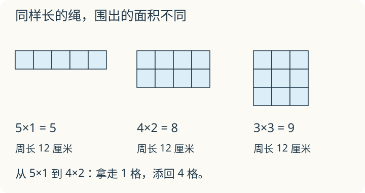

# 第 4 课：周长与面积

**应用与提高**：先会计算长方形、正方形的周长和面积。比较两种量是基础，列全围法、找最大面积可分开选做。

一根 12 厘米长的绳子围成长方形。把长缩短一点、宽加长一点，绳子没有变长，里面的地方会怎样变？

## 周长相同，面积也相同吗

周长算的是沿边走一圈有多长，面积算的是里面有多大。它们量的东西不同，单位也不同。

周长是 12 厘米的长方形，长和宽都是整厘米。因为周长=(长+宽)×2，所以长+宽=6 厘米。形状不同的围法只有三种（长≥宽）：

| 长 | 宽 | 周长 | 面积 |
|---|---|---|---|
| 5 | 1 | 12 | 5 |
| 4 | 2 | 12 | 8 |
| 3 | 3 | 12 | 9 |

周长都是 12 厘米，面积却从 5 平方厘米变到 9 平方厘米。

看 5×1 怎样变成 4×2：先把长缩短 1 厘米，拿掉的是 1×1 的小块；再给剩下的 4×1 添一整排，添上的是 4×1。拿掉 1 平方厘米，添上 4 平方厘米，面积就多了 3。

从 4×2 到 3×3，拿掉 1×2，再添上 3×1，面积又多了 1。长和宽的和始终是 6。这里把整厘米的围法列全了，可以确定 3×3 最大。

反过来，面积相同，周长也可以不同。面积都是 6 平方厘米：

| 长 | 宽 | 面积 | 周长 |
|---|---|---|---|
| 6 | 1 | 6 | 14 |
| 3 | 2 | 6 | 10 |

所以“周长相等”推不出“面积相等”，“面积相等”也推不出“周长相等”。

## 例子

### 例 1：长 7 厘米、宽 3 厘米

周长：(7+3)×2=10×2=20（厘米）。
面积：7×3=21（平方厘米）。

### 提高选学例：周长 16 厘米的长方形

长+宽=16÷2=8（厘米）。整厘米的围法：

| 长 | 宽 | 面积 |
|---|---|---|
| 7 | 1 | 7 |
| 6 | 2 | 12 |
| 5 | 3 | 15 |
| 4 | 4 | 16 |

最大面积是 16 平方厘米，此时是边长 4 厘米的正方形。

### 提高选学例：面积 24 平方厘米的长方形

长×宽=24。整厘米的围法可以是 6×4、8×3、12×2、24×1。

其中 6×4 的周长最短：(6+4)×2=20（厘米）。长和宽越接近，周长越短。

## 易错

- 认为周长相等，面积一定相等。
- 认为面积相等，周长一定相等。
- 算长方形周长只算长+宽，忘记乘 2。
- 周长写成平方厘米，面积写成厘米，单位用反。
- 比较面积时只看长，不看宽。

## 练习

1. 长 7 厘米、宽 3 厘米，周长和面积各是多少？
2. 面积 24 平方厘米的长方形，长 6 厘米，宽是多少？周长是多少？
3. 【提高选做】周长是 16 厘米的长方形（长、宽为整厘米），把所有围法列出来，哪种面积最大？
4. 判断：两个长方形周长相等，面积一定相等。
5. 一个正方形周长 20 厘米，面积是多少？
6. 【提高选做】12 个 1 平方厘米的小正方形，整边相接、不重叠、不留空，能拼成几种长方形（转向算同一种）？周长各是多少？

## 答案

1. 周长 20 厘米；面积 21 平方厘米。
2. 宽 24÷6=4 厘米；周长 (6+4)×2=20 厘米。
3. 长+宽=16÷2=8：7×1、6×2、5×3、4×4，面积分别是 7、12、15、16 平方厘米；4×4 最大，面积 16 平方厘米。
4. 错。周长都是 12 厘米时，5×1 的面积是 5，3×3 的面积是 9。
5. 边长 20÷4=5 厘米；面积 5×5=25 平方厘米。
6. 三种：12×1，周长 26 厘米；6×2，周长 16 厘米；4×3，周长 14 厘米。
