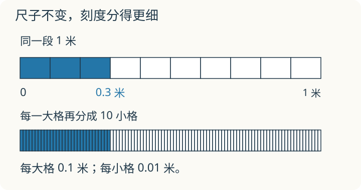

# 第 6 课：小数的诞生

**学习安排**：先用元、角和米、分米认识一位小数，再学一位小数加减。百分位和 0.3=0.30 是继续细分的选学内容，不要求这次一起掌握。

一根 1 米长的尺子，走到 1 分米的位置，还不到 1 米。用“米”作单位，该怎样写这个长度？

## 把一米再分成十份




要表示比 1 小的量，就把 1 再细分。

把 1 米平均分成 10 段，每段是 1 分米。1 分米写成米，就是 0.1 米：

```
0        0.1       0.2                 1（米）
├─────────┼─────────┼───── ... ────────┤
          1 分米
```

0.1 米=1 分米=10 厘米。它不是 1 厘米，也不是 1 米。

所以：

- 0.1 读作“零点一”，表示十分之一，0.1=1/10；
- 0.3 是 3 个 0.1，也就是 3/10。

小数点右边第一位叫十分位，表示有几个十分之一。

钱也一样：1 元=10 角，1 角=0.1 元。先看配图上面的一米尺，下面继续细分的尺留到文末选学。

## 例子

### 例 1：3 分米是多少米

1 分米=0.1 米，3 分米是 3 个 0.1 米，所以 3 分米=0.3 米。

### 例 2：2 元 3 角是多少元

2 元不变；3 角=0.3 元；合起来是 2.3 元。

## 易错

- 看到 0.1 里的 1，就以为是 1。
- 认为 0.1 米=1 厘米；0.1 米是 1 分米，也就是 10 厘米。
- 比较小数时只看数字长短，不看数位。

## 接着学：一位小数的加减

2.6 元加 1.8 元，就是 26 角加 18 角，共 44 角，等于 4.4 元。写成竖式时，小数点对齐，元与元、角与角对齐：

```text
   2.6
 + 1.8
 -----
   4.4
```

十分位 6+8=14，满 10 个十分之一就进成 1 个一，写 4、进 1；个位 2+1+1=4。

3.2−1.7，可以想成 32 角减 17 角得 15 角，即 1.5。十分位 2 不够减 7，从个位借 1 个一，换成 10 个十分之一：12−7=5；个位借走 1 后，2−1=1。

**自己练一练**

1. 1.7+2.5；
2. 5.0−2.8；
3. 一支笔 2.6 元，一块橡皮 1.5 元，付 5 元，应找回多少元？写出两步或综合算式。

**答案与解释**

1. 4.2；
2. 2.2；
3. 合计 2.6+1.5=4.1 元，找回 5.0−4.1=0.9 元，也可写 5.0−(2.6+1.5)=0.9 元。每一步都按相同单位计算。

## 练习

1. 1/10 写成小数是多少？
2. 0.7 表示几个十分之一？
3. 3 分米等于多少米？
4. 6 角等于多少元？
5. 在 0.3、0.8、0.5 中，最大的是哪一个？
6. 1.4 米等于几米几分米？

## 答案

1. 0.1。
2. 7 个十分之一，也就是 7/10。
3. 0.3 米。
4. 0.6 元。
5. 0.8。
6. 1 米 4 分米。

<details>
<summary>后续选学：把十分之一再分成十份</summary>

再把 0.1 平均分成 10 份，每份是 0.01，读作“零点零一”，表示百分之一。小数点右边第二位叫百分位；0.07 表示 7 个 0.01，也就是 7/100。完整的小数位值学习属于五至六年级的基础内容，这里只作提前体验。

看配图下面的尺：每个十分之一再分十份，整米共有 100 小格，所以 0.01 米=1 厘米。上面涂了 3 个大格，下面涂了 30 个小格，长度都是 0.3 米，因此 0.3=0.30。

钱也可以继续细分：1 元=100 分，1 分=0.01 元。0.5 元是 5 角，0.05 元是 5 分，两者不同。

**试一试**：① 8 分等于多少元？② 把 0 到 1 米之间的十个大格再各分十份，整段会变成 10 米吗？每小格表示多少米？

<details>
<summary>看解释</summary>

① 0.08 元，是 8 个百分之一元。② 整段仍是 1 米，只是分得更细；现在有 100 个相等的小格，每格是 0.01 米。小格的数量变多，每格表示的长度变小。

</details>

本课视频也讲到这部分。第一次只学一位小数时，可先完成上面的基础练习，再看继续细分的画面。

</details>
