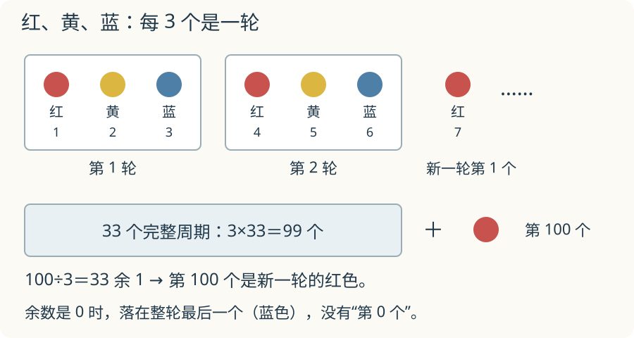

# 第 11 课：周期

**轻奥选学**：先会有余数的除法。先圈出每轮，再用余数找位置；星期题还要分清日期与经过天数。

红、黄、蓝，红、黄、蓝……排到第 100 个，要从头数到 100 吗？先把每轮三个圈在一起，看看能圈出多少整轮。

## 第 100 个，要从头数吗

一排图形按固定顺序重复，比如红、黄、蓝、红、黄、蓝……每 3 个一循环，周期是 3。

问第 100 个是什么颜色，先看 100 里面有多少个完整的 3：

100÷3=33 余 1。

33 个完整周期用掉 99 个，第 100 个是下一轮的第 1 个，所以是红色。

余数的作用，就是把前面完整的周期全部去掉，只看最后不满一轮的部分。

- 余 1：新一轮第 1 个；
- 余 2：新一轮第 2 个；
- 余 0：正好排完整轮，是这一轮最后一个。

求“前 100 个里有几个红”，每个完整周期有 1 个红，33 个周期有 33 个；余下的 1 个是红，再添 1 个，共 34 个。

## 例子

### 例 1：红、黄、蓝循环，第 100 个

100÷3=33 余 1，第 100 个是红色。

前 100 个里：红 33+1=34 个，黄 33 个，蓝 33 个。34+33+33=100。

### 例 2：2、4、6、8 循环，第 30 个

周期是 4。30÷4=7 余 2，第 30 个是第 8 轮的第 2 个，也就是 4。

前 30 个里有多少个 8？7 个完整周期有 7 个 8；余下的 2 个是 2、4，没有 8。所以一共 7 个。

### 例 3：A、B、C、D 循环，第 26 个

26÷4=6 余 2，第 26 个是 B。

前 26 个里有多少个 A？6 个完整周期有 6 个 A；余下 2 个是 A、B，再添 1 个 A，共 7 个。

## 易错

- 余数是 0 时，说成“第 0 个”；应该是周期最后一个。
- 周期数错，比如红黄蓝蓝四个一循环，却按 3 个算。
- 起点没看清，把第二个当成第一个。
- 数个数时只算完整周期，忘了余数里的。
- 求第几个和求“有几个”混在一起：前者看余数，后者要加上完整周期的数量。

## 练习

1. 按红、黄、蓝、绿循环，第 38 个是什么颜色？
2. 按 1、3、5、7 循环，第 50 个数是多少？
3. 按 A、B、C 循环，前 20 个里有几个 A？
4. 按 2、4、6 循环，第 27 个是多少？
5. 2026 年 1 月 1 日是星期四，1 月 25 日是星期几？
6. 一串珠子按 3 红 2 白循环，第 40 颗是什么颜色？

## 答案

1. 38÷4=9 余 2，是黄色。
2. 50÷4=12 余 2，是 3。
3. 20÷3=6 余 2，6 个完整周期有 6 个 A，余下 2 个是 A、B，再添 1 个，共 7 个。
4. 27÷3=9 余 0，是这一轮最后一个，也就是 6。
5. 从 1 日到 25 日经过 24 天；24÷7=3 余 3，星期四往后数 3 天是星期日。
6. 周期是 3+2=5；40÷5=8 余 0，是这一轮最后一个，白色。
