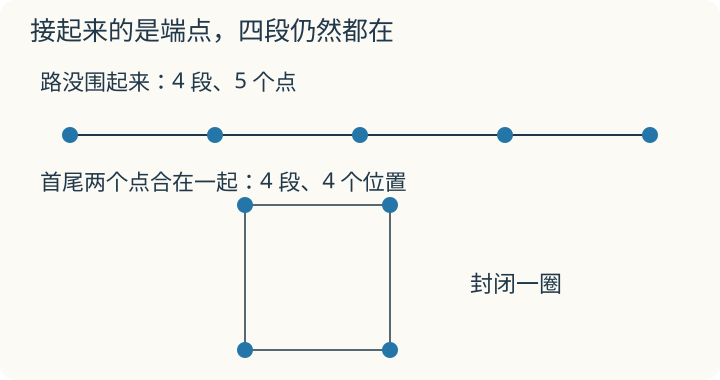

# 第 12 课：植树

**提高选学**：先会等分和有余数除法。先画点和段，再计算；植树、锯木、上楼可以分开做，不要求一次记住所有题型。

四段路的两端和连接处都种树，要种几棵？先画四段，再数树的位置。把路围成一圈后，数量还一样吗？

## 四段路需要几个点




一条路被树分成一段一段。段数由总长和间隔决定：

本课每个间隔都一样长，总长恰好能分成这些完整的间隔，所以：段数=总长÷间隔。若最后还剩一小段，就要另画图检查，不能直接套下面的棵数关系。

关键是点和段的关系。画一条 4 段的路：

```
两端都种：●───●───●───●───●
只种一端：●───●───●───●───┤
两端不种：├───●───●───●───┤
```

（├、┤ 表示路的两端，不种树。）

两端都种，5 个点，4 段，点多 1。
只种一端，4 个点，4 段，点和段一样多。
两端都不种，3 个点，4 段，点少 1。

所以先算段数，再按“两端种不种”加减 1。不要一上来就背棵数。

封闭图形不一样。圆形池塘周围种树，第一棵和最后一棵是同一棵，没有“两端”：

```
●───●───●
│       │
●       ●
│       │
●───●───●
```

点数和段数相等，棵数=段数，不加也不减。

## 例子

### 例 1：20 米小路，每隔 5 米种一棵

段数：20÷5=4（段）。

- 两端都种：4+1=5（棵）；
- 只种一端：4（棵）；
- 两端都不种：4−1=3（棵）。

### 例 2：圆形花坛，周长 40 米，每隔 5 米种一棵

段数：40÷5=8（段）。

首尾相接，棵数和段数相等：8 棵。

### 例 3：锯木头

一根木头锯成 6 段，每次只锯开一段木头，不叠在一起锯；每锯一次要 3 分钟，不计休息时间。

锯一次多一段，锯成 6 段需要 6−1=5 次。
5×3=15（分钟）。

## 易错

- 算出段数就直接当棵数，忘记看两端。
- 两端都不种还加 1。
- 封闭图形也加 1，多算一棵。
- 锯木头把段数当次数：锯 6 段只要 5 次。
- 上楼梯把楼层数当层数：从 1 楼到 5 楼只走了 4 层。
- 道路两旁都种，只算了一边。

## 首尾接起来会怎样

一条绳上有 5 个标记点，分出 4 段。把两端的标记点合在一起，围成一圈，段数和不同的标记位置各有几个？

<details>
<summary>看解释</summary>

仍有 4 段，但两个端点合成同一个位置，现在有 4 个不同的标记位置。闭合一圈后，每个点都能对应紧接着的一段，所以点数与段数相等。

</details>

## 练习

1. 一条 30 米的小路，每隔 5 米种一棵，两端都种，共种多少棵？
2. 一条 24 米的走廊，每隔 4 米放一盆花，两端都不放，共放几盆？
3. 一个圆形花坛周长 36 米，每隔 6 米种一棵，共种多少棵？
4. 一根木头锯成 5 段，每次只锯开一段木头，每锯一次用 4 分钟，不计休息，共需多少分钟？
5. 相邻两层之间台阶数相同，上楼速度不变，中途不停。从 1 楼走到 4 楼用了 36 秒，从 1 楼走到 6 楼要多少秒？
6. 一条 40 米的路两旁都种树，每隔 8 米种一棵，两端都种，共种多少棵？

## 答案

1. 30÷5=6 段，6+1=7 棵。
2. 24÷4=6 段，6−1=5 盆。
3. 36÷6=6 段，封闭图形棵数=段数，6 棵。
4. 5−1=4 次，4×4=16 分钟。
5. 1 楼到 4 楼是 3 层，36÷3=12 秒一层；1 楼到 6 楼是 5 层，5×12=60 秒。
6. 40÷8=5 段，每边 5+1=6 棵；两旁 6×2=12 棵。
