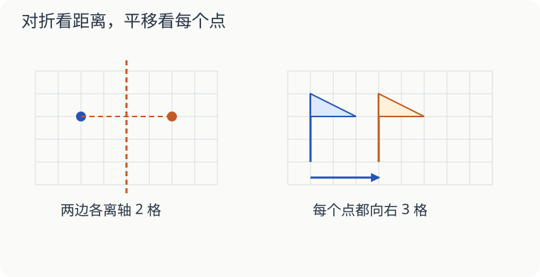

# 第 13 课：对折和滑动有什么不同

把一张纸对折，再展开，折痕两边可能留下相同的图案。把纸平放在桌上向右推，图案也换了位置。这两种变化一样吗？

## 对折，要能完全重合

沿一条直线对折，两边的图形能完全重合，这个图形就是轴对称图形，折痕所在的直线叫对称轴。

图中蓝点离对称轴两格，另一边与它对应的点也要离轴两格，而且在同一横行。不能只说“画到右边去”：还得数它到轴有多远。

长方形沿长边或短边的中间对折，都能重合。普通长方形沿对角线对折，却不一定重合；正方形沿对角线也能重合。

## 平移，每个点都朝同一方向走同样远

小旗向右平移三格，旗尖向右三格，旗杆上下两个端点也都向右三格。平移后大小和朝向不变。

数格时数“跨过几条小格边”，不是数起点和终点一共碰到几个点。沿着格线从一个交点走到旁边的交点，是一格。

如果只是把旗尖移过去，旗杆留在原处，小旗就被拉变形了，这不是平移。

## 自己试一试

1. 一个点在竖直对称轴左边三格，与它对应的点应在哪里？
2. 一个不是正方形的长方形，有几条对称轴？
3. 正方形有几条对称轴？
4. 小旗先向右平移五格，再向左平移两格。与开始相比，它在哪里？
5. 平移时，图形的大小和朝向会变吗？
6. 一只小蝴蝶的一边翅膀比另一边大，沿身体中线对折后不能重合。能仅凭“看起来像蝴蝶”就说这个图形轴对称吗？

## 答案与说明

1. 在轴右边三格，与原点处在同一横行。
2. 两条，分别连接两组对边的中点。
3. 四条：连接两组对边中点的两条，以及两条对角线。
4. 在原位置右边三格，`5−2=3`。
5. 都不变。所有点朝同一方向移动同样的距离。
6. 不能。要用能否完全重合来判断，不能只根据物体名称。

想在方格纸上继续画，可以做[图形运动里的作图题](../../四下/L08-图形运动/讲授稿.md)。
