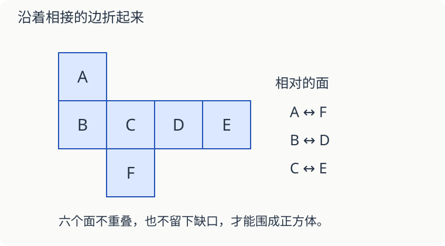

# 第 14 课：六个正方形能围成盒子吗

**提前体验，选学**：先会辨认正方形、长方体和正方体。这课用实物折盒子，理解相邻面与相对面；展开图的系统学习在后面的立体图形课程，不作为三年级基础过关要求。

一个正方体有六个面。把六个一样大的正方形连起来，就一定能折成正方体吗？先看它们怎样连接。

## 折起来，六个面要各在一个位置

把下面的图想象成剪开的纸盒。每个字母都表示一个正方形，连着的边先不剪开。

先让 C 平放。把 B、D、F 竖起来，再把连着 B 的 A 和连着 D 的 E 折过去，可以围成盒子。折好后，A 和 F 相对，B 和 D 相对，C 和 E 相对。

相对的两个面不挨着，没有公共边。展开图上看起来隔得远，不一定折起来也相对；要跟着折的方向想。

## 为什么六个面排一长条不行

把六个正方形全排成一行，沿相邻边折，四个面能围出一圈。但后面的面会接着绕这圈，不能同时补上上、下两个洞。它不符合正方体六个面的位置关系。

检查展开图要看两件事：折好有没有重叠，有没有缺口。只数出六个面还不够。

## 长方体的面不一定全一样

鞋盒通常是长方体，相对的面同样大。画它的展开图时，还要检查连接的边能不能对齐。一个长 6 厘米、宽 4 厘米的底面，周围连接的四个侧面，底边应依次是 6、4、6、4 厘米。

## 自己试一试

1. 配图中，与 C 相对的是哪个面？
2. 与 B 相对的是哪个面？A 和 F 能在盒子上相邻吗？
3. 六个相同的正方形排成一行，一定能折成正方体吗？
4. 一个正方体盒子拿掉上盖，还剩几个面？
5. 长方体底面长 8 厘米、宽 5 厘米，四个侧面与底面相接的边分别长多少厘米？
6. 小明说：“图中六个面的面积相同，所以肯定能折。”这句话少检查了什么？

## 答案与说明

1. E。
2. D。A 与 F 相对，不能相邻。
3. 不能，折起来不能同时封住上下两面。
4. 五个面。
5. 两条 8 厘米，两条 5 厘米，绕底面依次是 8、5、8、5。
6. 要检查连接方式，折起后是否重叠、是否留下缺口。面积相同只是一个条件。
