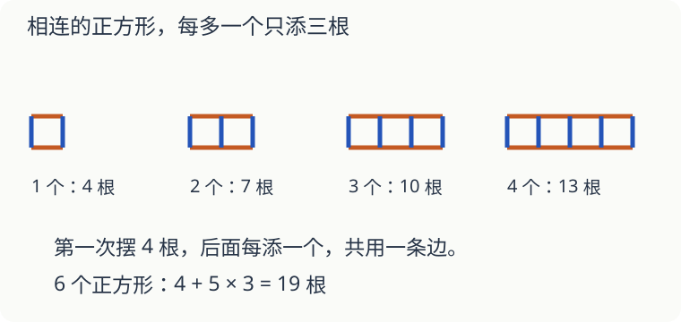

# 第 15 课：不把每道题算完，也能找到规律

一排摆一个小正方形要四根小棒。再在右边接一个，需要再添四根吗？

## 先找哪些小棒共用

每个小正方形边长都是一根小棒，彼此并排，共用一条边。

第一个用四根。以后每接一个，都和前一个共用一根，只需添三根。

| 正方形个数 | 小棒根数 |
|---|---:|
| 1 | 4 |
| 2 | 7 |
| 3 | 10 |
| 4 | 13 |

摆六个时，第一个用 4 根，后面五个各加 3 根：`4+5×3=19（根）`。

也可以先按每个四根算，再扣掉五条共用边：`6×4−5=19（根）`。扣的是重复数的那一根，不是把整条边拆掉。

## 算式里的变化也有原因

`38+25` 与 `38+26` 相比，第一个加数没变，第二个多了 1，和就多 1。

`60−27` 与 `60−28` 相比，总量不变，拿走的多了 1，剩下的反而少 1。看见一个数增大，不能不分加减就说结果增大。

找规律时，要能说明每次为什么这样变。只看见几个数，还可能有别的接法；本课的小棒图明确规定了“每次向右接一个正方形”。

## 自己试一试

1. 按图中的摆法，五个小正方形用几根小棒？
2. 从五个增加到八个，要再添几根？
3. 用 25 根小棒，按这种办法最多摆几个完整的正方形？
4. 已知 `47+36=83`，不重新竖式计算，求 `47+39`。
5. 已知 `82−29=53`，求 `82−31`，并说理由。
6. 把四个正方形分开摆，彼此不共边，也用 13 根吗？

## 答案与说明

1. `4+4×3=16（根）`。
2. 多三个，每个添三根，共 9 根。
3. 第一个用 4 根，还剩 21 根，能再接 7 个，共 8 个。
4. 86。第二个加数多了 3，和也多 3。
5. 51。多减了 2，差少 2。
6. 不一样，要 `4×4=16` 根。13 根的规律只适用于图中共边相连的摆法。
