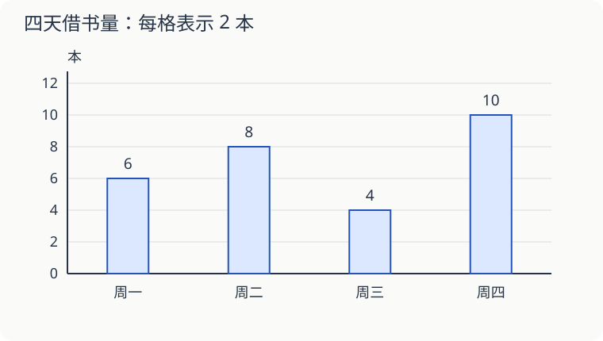

# 第 16 课：统计图里的一格是几个

图书角记录了四天借出的图书数量。周二的直条有四格，是借出四本吗？先看图上每一格表示几本。

## 读图先看三处

图名告诉你统计什么，横边告诉你每根直条对应哪一天，竖边的刻度告诉你数量。这里每格表示 2 本。

周二有四格，表示 `4×2=8` 本；周四有五格，表示 10 本。周四比周二多一格，也就是多两本。

四天借出总数是 `6+8+4+10=28（本）`。不能把四个直条的高度相加后，忘记每格还表示 2 本。

## 反过来，能补出缺少的数据吗

另一个书柜三天共借出 30 本，前两天分别借出 9 本、12 本。第三天借出 `30−9−12=9` 本。

如果图上每格表示 3 本，第三天的直条应该画三格，不能画九格。

## 图能告诉你的，也有边界

这张图记录的是这四天的借书数量。周四最多，不等于“以后每个周四都最多”。同一本书也可能在归还后又被借出，所以累计借书次数不一定等于不同图书的本数。

## 自己试一试

1. 配图中，周一和周三一共借出几本？
2. 周四比周三多几本？相差几格？
3. 每格改成表示 1 本，周二应画几格？实际借书量变了吗？
4. 三天共借出 36 本，前两天分别是 8 本、13 本，第三天几本？
5. 一张图每格表示 5 人，某一类有四格，是几人？
6. 只看这四天，能肯定下周四也借出 10 本吗？

## 答案与说明

1. `6+4=10（本）`。
2. `10−4=6（本）`，相差三格。
3. 八格。借书量仍是 8 本，只是图上的单位格改变了。
4. `36−8−13=15（本）`。
5. `4×5=20（人）`。
6. 不能。下周四的数量还没有发生，也没有记录。
