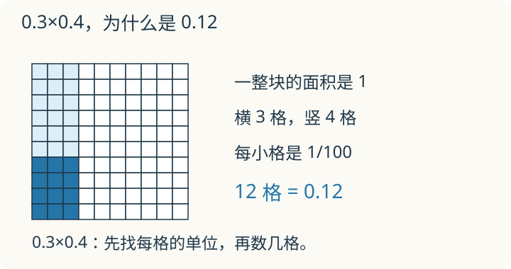

# 第 1 课：小数乘法

边长 1 的正方形里，长 0.3、宽 0.4 的小长方形占多大？先把它画进方格，再决定 3×4 得到的 12 表示什么。

## 积的小数点应该点在哪里

把边长为 1 的正方形作为一整块，它的面积是 1。把每条边都平均分成 10 段，再画格线，整块被分成 10×10=100 个相同的小格。每个小格的边长是 0.1，面积是整块的 1/100，也就是 0.01。

现在从左下角圈出长 0.3、宽 0.4 的长方形。横着占 3 格，竖着占 4 格，一共 12 格。每格面积是 0.01，所以这一块面积是 12×0.01=0.12。这就看到了 0.3×0.4=0.12。

也可以把乘 0.4 看作取原来数量的十分之四：先取整块的 0.3，再从这一部分里取十分之四，得到的仍是整块的 0.12。比较前后两次取到的量时，“一整块”始终是最初那个正方形，不能中途换掉。

再看 2.4×1.3。先把两个因数都乘 10，变成 24×13=312。长和宽都变成原来的 10 倍，面积就变成原来的 100 倍；要找原来的积，应把 312 除以 100，得到 3.12。

一位小数去掉小数点，相当于乘 10；两位小数相当于乘 100。因此计算有限小数的乘法时，可以先按整数乘，再把积除以两个放大倍数的乘积。这就是“两个因数的小数位数相加”的来历。先点好小数点，再去掉末尾的 0。

算完还可以检查大小：0.3×0.4 是取 0.3 的一部分，应小于 0.3；1.2 显然太大了。

## 例子

### 例 1：2.4×1.3

先算 24×13=312。

2.4 有 1 位小数，1.3 有 1 位，一共 2 位。从 312 右边数 2 位，点上小数点，得 3.12。

估算：2.4×1.3 比 2.4×1=2.4 大一些，3.12 合理。

### 例 2：0.25×0.4

先把整块平均分成 4 份，取 1 份，是 0.25；再把这一份平均分成 10 份，取其中 4 份。整块相当于 40 个这样的小份，取 4 份就是 4/40=1/10，所以结果是 0.1。

笔算核对：25×4=100。0.25 有 2 位小数，0.4 有 1 位，一共 3 位。从 100 右边数 3 位，得 0.100，去掉末尾的 0，是 0.1。

先点小数点，再去 0。若先把 100 末尾的两个 0 去掉成 1，再点三位，会得到 0.001，就错了。

### 例 3：每千克 8.6 元，买 2.4 千克

8.6×2.4。

先算 86×24=2064。两个因数共有 2 位小数，所以积是 20.64。总价 20.64 元。

估算：8.6×2.4 约 9×2.4=21.6，20.64 合理。

## 易错

- 只算 3×4=12，就写 0.3×0.4=1.2。两个因数共有 2 位小数，积应是 0.12。
- 数错小数位数：看两个因数的小数位数和，不是看积有几位，也不是从左边数。
- 积的位数不够时不补 0。0.2×0.03：2×3=6，共有 3 位小数，写成 0.006，不是 0.6。
- 先去掉末尾的 0 再点小数点。顺序应是先点小数点，再化简。
- 把小数乘法和小数加减法混在一起。加减要小数点对齐，乘法不靠对齐，靠数位数。
- 认为积一定比因数小。对两个正数，只有两个因数都小于 1 时，积才比每个因数都小；1.5×2=3，比两个因数都大。含 0 时另看：0×0.5=0，并不小于因数 0。

## 另一次短课：把运算律用到小数

先会整数乘法分配律，再看小数。2.5×3.6+2.5×6.4 表示两部分都含有 2.5，可以合起来算：

2.5×(3.6+6.4)=2.5×10=25。逐项乘再加也正确，合并只是更简便。反过来，1.25×8.8 可以把 8.8 拆成 8+0.8，得 10+1=11。

**自己练一练**

1. 0.8×7.5+0.8×2.5；
2. 3.6×99；
3. 小明把 2.5×3.6+2.5 写成 2.5×(3.6+2.5)，漏看了什么？
4. 每千克 7.8 元，买 1.25 千克，应付多少元？金额按四舍五入保留两位小数。

**答案与解释**

1. 0.8×10=8；
2. 3.6×(100−1)=360−3.6=356.4；
3. 后一项是 2.5×1，应合成 2.5×(3.6+1)=11.5；
4. 7.8×1.25=9.75 元。取近似数时先算出积，再按金额要求保留，不提前把单价或质量取整。

## 练习

1. 0.6×0.7
2. 1.5×0.4
3. 0.25×8
4. 0.03×0.4
5. 2.4×1.25
6. 每千克 6.8 元，买 1.5 千克，应付多少元？

## 答案

1. 6×7=42，共有 2 位小数，0.42。
2. 15×4=60，共有 2 位小数，0.60=0.6。
3. 25×8=200，共有 2 位小数，2.00=2。
4. 3×4=12，共有 3 位小数，0.012。
5. 24×125=3000，共有 3 位小数，3.000=3。
6. 68×15=1020，共有 2 位小数，10.20=10.2 元。
