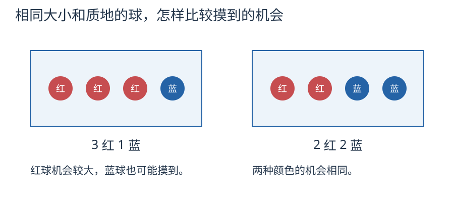

# 第 5 课：可能性

## 基础：先判断能不能发生，再比较机会大小

袋里有 3 个红球、1 个蓝球。球的大小、形状和质地相同，装进不透明的袋子，摇匀后不看着摸。这样每个球被摸到的机会相同。

- 袋里全是红球，摸到红球一定会发生，摸到蓝球不可能发生。
- 袋里有红球也有蓝球，两种颜色都可能摸到。
- 3 红 1 蓝，红球比蓝球多，摸到红球的可能性更大。
- 2 红 2 蓝，两种颜色的球一样多，摸到它们的可能性相同。

“可能性大”不等于“一定”。即使红球多，也可能连续几次摸到蓝球。反过来，连续摸到红球，也不能证明袋里没有蓝球。

图画出袋内的组成。实际摸取要用不透明袋，球的大小、形状和质地相同，摇匀后不看着摸；多次实验每次放回。

### 例 1：把每次摸到的颜色记下来

用 3 红 1 蓝的袋子，每次摸一个，记录颜色，然后放回、摇匀，再摸下一次。做 20 次，数一数红球和蓝球各摸到多少次。

这次可能红球多，也可能蓝球多。不同小组做出的记录不必相同，更不用为了“红球应该多”而改记录。把各组在相同条件下的记录合起来，可以观察次数较多时的情况，但不能据此保证下一次摸到什么。

### 例 2：怎样让游戏公平

两人各选一种颜色，只摸一次，摸到谁的颜色谁赢。放 2 红 2 蓝，两人机会相同；放 3 红 1 蓝，选红的人机会更大。公平要看双方获胜的机会，不能只看是不是都有一种颜色。

### 例 3：比较两个袋子

一个袋子 5 红 1 蓝，另一个袋子 3 红 1 蓝，哪袋摸到红球的机会更大？

先看蓝球。两个袋里都只有 1 个蓝球，混在 6 个球中，比混在 4 个球中更不容易摸到。其余全是红球，所以 5 红 1 蓝的袋子摸到红球的机会更大。这个比较可以用实物理解，不需要先算分数。

### 基础练习

以下各题都按球相同、随机摸取的条件讨论；多次摸球时每次放回并摇匀。

1. 3 红 1 蓝，哪种颜色的机会大？蓝球有可能摸到吗？
2. 2 红 2 蓝，两人各选一种颜色，摸一次决定输赢，公平吗？
3. 全是红球，摸到蓝球可能吗？摸到红球呢？
4. 连摸 5 次都是红球，能断定袋里没有蓝球吗？
5. 5 红 1 蓝和 3 红 1 蓝，哪袋摸到红球的机会大？
6. 3 红 1 蓝，摸 20 次，能事先保证红球恰好出现某个次数吗？

### 基础答案

1. 红球的机会大；蓝球也可能摸到。
2. 公平，双方的球一样多，机会相同。
3. 蓝球不可能，红球一定。
4. 不能。连续摸到红球可能只是这几次碰巧；蓝球只要还在袋里，就有机会摸到。
5. 5 红 1 蓝，理由见例 3。
6. 不能。红球出现的次数会有变化，要如实记录。

高年级兴趣拓展：用分数表示机会，以及估计次数

先学过分数的意义和比较，再看这一部分。小学基础学习不要求计算概率或期望次数。以下例子独立选学。

袋里红球多，摸到红球的可能性就大，但下一次也可能摸到蓝球。只看一次的结果，不能知道袋里哪种球多。

## 红球多，就一定摸到红球吗

认识几分之一、会比较份数，就可以读这一部分。需要通分的比较，可以学过五下 10 后再做。

袋里有 3 个红球、1 个蓝球，四个球大小、质地相同，摸完放回并摇匀。每个球被摸到的机会一样，红球占 3 份，蓝球占 1 份。

下面用分数表示机会大小，接着比较分数和估计次数。

在每个球机会相同的条件下，摸到红球的可能性是 3/4，摸到蓝球的可能性是 1/4。这里比较的是“很多次里大约占多少”，不是“下一次一定是什么”。

单次摸球的结果不确定。红球多，这一次也可能摸到蓝球；蓝球少，也不是永远摸不到。连摸 5 次都是红球，只能说明这 5 次碰巧，不能说明袋里没有蓝球。

要让比较有意义，每次的条件必须一样：球的大小质地相同、摸完放回、摇匀。没有放回时，袋里的组成可能改变；没有摇匀或能凭手感挑球，也不能保证每个球机会相同。

“可能”“很可能”“一定”“不可能”要分开说：

- 袋里全是红球：摸到红球是一定的，摸到蓝球不可能；
- 3 红 1 蓝：红很可能，蓝也可能；
- 2 红 2 蓝：两种颜色可能性一样。

在同样的条件下，摸很多次，红球出现的次数所占比例通常会接近 3/4。不过，20 次不一定正好摸到 15 次红球；次数少时，比例可能相差不少。次数多了，比例通常会更稳定，但不保证每增加一次就更接近 3/4。

## 例子

### 例 1：3 红 1 蓝，摸 20 次

如果用袋中份数作估计，把 20 分成 4 份，每份 20÷4=5；红球占 3 份，对应 5×3=15 次，蓝球占 1 份，对应 5 次。这是估计值，不是对这 20 次的保证。

这只是“大约”。实际可能是 14 次红、6 次蓝，也可能 17 次红、3 次蓝。不能因为不是正好 15 次，就说红球不是 3/4。

### 例 2：2 红 2 蓝的公平游戏

两人各选一种颜色，只摸一次，摸到谁的颜色谁赢。红、蓝各 2 个，摸到红和摸到蓝的可能性都是 2/4=1/2，机会相等，游戏公平。

如果改成 3 红 1 蓝，红 3/4、蓝 1/4，选红的人明显占优，不公平。

### 例 3：5 红 1 蓝和 3 红 1 蓝

5 红 1 蓝：红球占 5/6，蓝球占 1/6。
3 红 1 蓝：红球占 3/4，蓝球占 1/4。

可以先比蓝球。两个袋里都只有 1 个蓝球：一个袋有 6 个同样机会的球，另一个只有 4 个，蓝球在 6 份中占 1 份，比在 4 份中占 1 份的机会小。剩下的都是红球，所以 5 红 1 蓝的袋子摸到红球的机会更大。这个比较不需要先学通分。

## 易错

- 认为红球多，下一次一定摸到红。红球多只表示机会大，单次仍可能摸到蓝。
- 连摸几次红，就断定袋里红球一定多。次数少，可能只是碰巧；要增加次数，并保持放回、摇匀。
- 认为可能性小就是不可能。只要蓝球还在袋里，就有可能摸到。
- 比较时不放回、不摇匀。条件变了，每次的比例不一样，不能直接比较。
- 要求 20 次正好 15 次红。3/4 是长期比例，短期有波动。
- 把“公平”理解成颜色种数相同。公平要看两种结果的可能性是否相等；3 红 1 蓝虽然有两种颜色，却不等可能。
- 用一次结果反推袋里的球数。一次或几次的结果，信息不够。

## 练习

1. 袋里 3 红 1 蓝，摸到哪种颜色的机会大？【选做】用分数表示两种机会。
2. 袋里 2 红 2 蓝，两人各选一种颜色，只摸一次，摸到谁的颜色谁赢，公平吗？
3. 袋里全是红球，摸到蓝球可能吗？摸到红球呢？
4. 小明连摸 5 次都是红球，他说“袋里一定没有蓝球”。这样说对吗？
5. 5 红 1 蓝和 3 红 1 蓝，哪个袋子里摸到红球的可能性大？
6. 3 红 1 蓝的袋子摸 20 次，一定正好 15 次红吗？

## 答案

1. 红球 3/4，蓝球 1/4。
2. 公平。红、蓝各 2 个，摸到的可能性都是 1/2。
3. 摸到蓝球不可能；摸到红球一定。
4. 不对。5 次太少，可能只是碰巧；蓝球只要在袋里，就有可能被摸到。
5. 5 红 1 蓝更大。先比较蓝球：同样只有 1 个蓝球，在 6 个球中摸到它比在 4 个球中机会小；其余都是红球，所以前一个袋子摸到红球的机会更大。
6. 不一定。15 是按 20÷4×3 算出的平均预期，实际次数会有波动。

