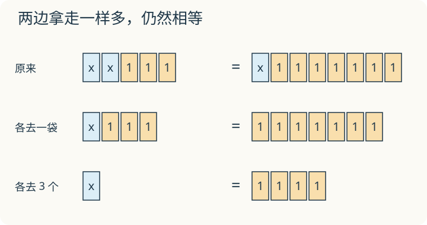

# 第 7 课：相等关系与未知数

## 基础：先用实物和算术找出不知道的数

这一部分只需要会加减乘除。等号表示两边一样多或一样重；空格、方框或字母都可以用来记下暂时不知道的数。

一个小袋和 3 个单位砝码合起来，与 8 个单位砝码一样重。先从 8 中去掉已知的 3，剩下 8−3=5，小袋就相当于 5 个单位砝码。放回检查，5+3=8。

两个一样重的小袋共相当于 10 个单位砝码。平均分成两份，每袋相当于 10÷2=5 个。这里能平分，是因为两个袋子一样重。

### 两边怎样一起变，还能保持相等

天平左边放两袋和 3 个砝码，右边放一袋和 7 个砝码，正好平衡。两边各拿走一个一样重的小袋，剩下的仍一样重；再各拿走 3 个砝码，就看到一袋与 4 个砝码一样重。这一段可以直接摆物品理解，不必先写方程。

相等的两边同时加上或减去相同的量，结果还相等。把两边各复制成同样的几份，或把两边都平均分成同样的几份，结果也相等。例如 2+3=5，两边都乘 2 得到 10=10；两边都除以 5 得到 1=1。除数不能是 0。这些操作说明了等式的基本性质。

也可以用 x 表示一袋的质量，以一个砝码的质量作单位，把关系记成 x+3=8 或 2x=10。本课基础只要求看懂关系、用算术求数并代入检查，不要求写解方程的变形步骤。

### 自己试一试

1. □+4=9，□里填几？
2. 三个相同的小袋共重 12 个单位，每袋重几个单位？
3. 一个数减去 2 等于 6，原来是多少？
4. 两个相同小袋加 1 个单位，共重 11 个单位，每袋重多少？
5. 5+4=9 与 x+4=9，哪一个含有还不知道的数？
6. 把 5 填入 □+3=8，怎样检查？

### 答案与说明

1. 9−4=5。
2. 12÷3=4 个单位。
3. 6+2=8。
4. 先去掉已知的 1，11−1=10；再平分，10÷2=5 个单位。
5. x+4=9。x 表示还不知道的数；5+4=9 两边的数都已给出。
6. 算 5+3，得到 8，与右边相同。

基础部分到这里即可。下面保留另一种记录和推算方法，适合高年级有兴趣时选学或初中衔接，不作为小学基础练习要求。

高年级选学／初中衔接：等式性质与解方程

## 从实物关系走向方程

左边放两个一样重的小袋和 3 个单位砝码，右边放一个同样的小袋和 7 个单位砝码，天平正好平衡。一个小袋相当于几个单位砝码？

## 等式两边怎样一起变

用 x 表示一个小袋的质量，以一个砝码的质量作单位。相同的小袋用同一个 x 表示。左边是 2x+3，右边是 x+7，平衡就写成：

2x+3=x+7。

先从左右两边各拿走一个小袋。拿走的质量相同，天平仍平衡，左边剩一个小袋和 3 个砝码，右边剩 7 个砝码：

x+3=7。

再从两边各拿走 3 个砝码，左边只剩一个小袋，右边剩 4 个砝码，所以 x=4。放回原来的情境检查：左边 2×4+3=11，右边 4+7=11，确实一样重。

这两步没有把东西偷偷从一边搬到另一边。每一步都在两边拿走同样多，原来的相等关系才保得住。

如果是 2x=10，可以把两边都平均分成 2 份：一袋对应 5 个单位砝码，x=5。等式两边同时加减同一个数，或乘除同一个非零数，可以帮助我们一步步找出 x。

两边同乘 0 虽然会得到 0=0，却把原来的信息全抹掉了，不能据此求出 x；也不能再除以 0 还原。因此解方程不用这一步。天平帮助理解本课的正数量关系；更一般的数还要按等式性质来处理。

含有未知数的等式叫方程。x+3 只是式子，没有等号；5+4=9 是等式，没有未知数；x+3=8 才是方程。

## 例子

### 例 1：x+3=8

两边同时减 3：

x+3−3=8−3

x=5

检验：5+3=8。

### 例 2：2x=10

两边同时除以 2：

2x÷2=10÷2

x=5

检验：2×5=10。

### 例 3：2x+3=x+7

两边先同时减 x：

2x+3−x=x+7−x

x+3=7

两边再同时减 3：

x=4

检验：左边 2×4+3=11，右边 4+7=11，相等。

## 易错

- 两边做了不同的运算。把 x+3=8 写成 x=8+3，是左边减了 3，右边却加了 3。应两边同时减 3，得 x=5。
- 把 x+3 叫方程。没有等号，它只是式子。
- 把 5+4=9 叫方程。它是等式，但没有未知数。
- 两边同除以 0。0 不能作除数，这一步没有意义。
- 用同乘 0 来“解”方程。0=0 虽然成立，但信息丢了，求不出 x。
- 移项时符号弄反。x−2=6，两边同时加 2，x=8；不是 x=4。
- 解完不检验。代回原方程，两边相等才算解对。
- 只对等式一边的某一项做除法。2x+3=11，先减 3 再除以 2 很简便；也可以两边整体先除以 2，得 x+1.5=5.5，再减 1.5 得 x=4。不能只除 2x 而留下 3 不变。

## 练习

1. x+4=9
2. 3x=12
3. x−2=6
4. 2x+1=11
5. 5x−5=20
6. 2x+3=x+7

## 答案

1. 两边减 4，x=5。检验：5+4=9。
2. 两边除以 3，x=4。检验：3×4=12。
3. 两边加 2，x=8。检验：8−2=6。
4. 两边减 1，2x=10；再除以 2，x=5。检验：2×5+1=11。
5. 两边加 5，5x=25；再除以 5，x=5。检验：5×5−5=20。
6. 两边减 x，x+3=7；再减 3，x=4。检验：左边 2×4+3=11，右边 4+7=11。

