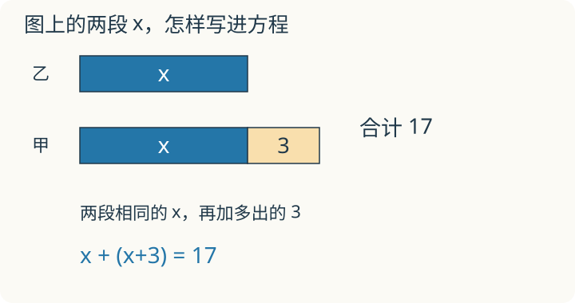

# 第 8 课：画线段，找数量关系

## 基础：相同的一段算一份

甲比乙多 3 个，两人共有 17 个。先画乙，再给甲画一段同样长的线段，并添上多的 3。线段只表示数量关系，长短不必按实际个数精确绘制。

```text
乙：|——相同的一份——|
甲：|——相同的一份——|—3—|
两人合起来：17 个
```

把甲多出来的 3 去掉，两人剩下的就一样多了。17−3=14，是相同的两份，所以乙有 14÷2=7 个；甲有 7+3=10 个。检查两个条件：10−7=3，10+7=17。

### 倍数关系也能画成份数

甲是乙的 3 倍，共 24 个。乙画一份，甲画同样长的三份，总数对应 1+3=4 份。一份是 24÷4=6 个，所以乙有 6 个，甲有 18 个。这里的 3 倍包括整整三份，不能只画比乙多出来的两份就当作甲。

### 两边之间搬东西，总数不变

两个书架共 42 本，从甲架拿 3 本到乙架后一样多。搬完每架有 42÷2=21 本。倒着想：甲原来多 3 本，是 24 本；乙原来少 3 本，是 18 本。搬一本时，一架减一、另一架加一，差就缩小两本。

### 自己试一试

画图或写算式即可，不要求列方程。

1. 甲比乙多 3 个，共 17 个，各有多少个？
2. 男生比女生多 5 人，共 31 人，各有多少人？
3. 一根绳子剪成两段，长段比短段多 6 米，全长 24 米，各长多少米？
4. 甲是乙的 3 倍，共 24 个，各有多少个？
5. 一个数加上 8 等于 20，这个数是多少？
6. 小红比小明少 4 张卡片，两人共 20 张，各有多少张？

### 答案与说明

1. 乙：(17−3)÷2=7 个；甲 10 个。
2. 女生：(31−5)÷2=13 人；男生 18 人。
3. 短段：(24−6)÷2=9 米；长段 15 米。
4. 乙：24÷(1+3)=6 个；甲 6×3=18 个。
5. 20−8=12。
6. 小红：(20−4)÷2=8 张；小明 12 张。

每题都要回到原题检查总数，以及相差多少或几倍。字母可以把这些关系简记下来；系统解方程留在下面的选学部分。

<details>
<summary>高年级选学／初中衔接：列方程，年龄与盈亏问题</summary>

先完成上一课的等式性质选学。本部分含两边都有未知数、括号和多步变形，可以分几次学习。

甲比乙多 3 个，两人共有 17 个。画两条从同一位置开始的线段：乙的一条多长还不知道，但甲多出来的那一小段已经知道是 3。

## 把题里的两个条件写进等式




算术方法常常要逆推。比如“甲比乙多 3，两人一共 17 个”，先想 17−3=14，把多的 3 去掉，再 14÷2=7。为什么要先减、再除，需要事先想清楚。

方程换一种写法：把不知道的乙设成 x，甲比乙多 3，甲就是 x+3。题目说两人一共 17，顺着写：

x+(x+3)=17

这个等式直接把“甲比乙多 3”和“一共 17”两个条件都写进去了，不需要先决定先减还是先除。

在图上，乙的整条线段是 x，甲与乙一样长的部分也是 x，甲多出来的一段是 3。总数 17 包含两段 x 和一段 3，所以 x+(x+3)=17 也能写成 2x+3=17。

先从总数中去掉多的 3，剩下两段一样长的 x：2x=14；再平均分成两份，x=7。图上的去掉与平分，正好对应等式两边减 3、再除以 2。算出后仍要检查总数和差，最后回答题目问的是谁。

设谁为 x 会影响式子的难易。通常设较小的量或作为比较标准的量为 x，其他量用 x 加、减、乘表示。设甲为 x 也能做，但乙要写成 x−3，验算时容易混。

x+3 是甲的数量，加入总数时可以用括号把它标清：x+(x+3)。如果写成 x+x+3，数值上一样，但意思不如带括号清楚；遇到“2 倍”时，括号更不能省。

## 例子

### 例 1：甲比乙多 3，共 17

设乙有 x 个，则甲有 x+3 个。

x+(x+3)=17

2x+3=17

2x=14

x=7

乙有 7 个，甲有 7+3=10 个。

检验：10−7=3，10+7=17，两个条件都满足。

### 例 2：甲是乙的 3 倍，共 24

设乙是 x，则甲是 3x。

x+3x=24

4x=24

x=6

乙是 6，甲是 3×6=18。

检验：18÷6=3，18+6=24。

### 例 3：两根绳子，长段比短段多 6 米，全长 24 米

设短段长 x 米，则长段长 x+6 米。

x+(x+6)=24

2x+6=24

2x=18

x=9

短段 9 米，长段 9+6=15 米。

检验：15−9=6，15+9=24。

## 另一次短课：年龄关系

题目按整岁、同一日期比较年龄。爸爸今年 35 岁，孩子 5 岁，几年后爸爸年龄是孩子的 3 倍？

设 x 年后达到条件，两人都增加 x 岁：35+x=3(5+x)。右边先展开成 15+3x，得 35+x=15+3x；两边减 x 再减 15，得 20=2x，所以 x=10。

检验：10 年后爸爸 45 岁、孩子 15 岁，45=15×3，年龄差仍是 30 岁。也可用差倍法：那时孩子是 30÷(3−1)=15 岁，再减现在的 5 岁。

**自己练一练**

妈妈今年 34 岁，女儿 10 岁。几年后妈妈年龄是女儿的 2 倍？为什么不能列 34=2(10+x)？

答案：34+x=2(10+x)，得 x=14；那时妈妈 48 岁，女儿 24 岁。错误式漏掉了妈妈也会增加 x 岁。算术方法同样可接受。

## 另一次短课：盈亏与两次分配差

同一批本子分给同一组同学。每人 3 本多 5 本；每人 4 本少 3 本。设有 x 人，两种安排中的本子总数相同：

3x+5=4x−3，得 x=8；本子总数 3×8+5=29 本。

也可以看看第二种分法比第一种多需要多少本：第一种分法所需本数比现有的少 5 本，第二种比现有的多 3 本，两种分法所需的本数相差 5+3=8 本。每人多分 1 本，8 本对应 8 人。检验：8×4=32，比 29 多 3。

先看两次分完是剩下还是不够。如果两次都有剩余，就算剩余数量的差；一次剩下、一次不够，才把剩下的数量和缺少的数量相加。

**自己练一练**

1. 每人 4 枚贴纸多 6 枚，每人 5 枚少 2 枚，有几人、几枚贴纸？
2. 每人 2 本书多 12 本，每人 3 本仍多 4 本，有几人、几本书？

**答案与解释**

1. (6+2)÷(5−4)=8 人，4×8+6=38 枚；
2. (12−4)÷(3−2)=8 人，2×8+12=28 本。方程分别为 4x+6=5x−2、2x+12=3x+4，解法不限，但都要代回两种分配检验。

## 易错

- 设了 x，却忘了它表示谁。设的是乙，最后把 x 当成甲，答案就反了。
- 漏掉未知量本身。“甲比乙多 3，共 17”写成 x+3=17，只算了甲，漏了乙；应是 x+(x+3)=17。
- 该加括号时没加。甲是 x+3，加入总数可写成 x+(x+3)，也可写成 x+x+3；遇到 2 倍关系时，2(x+3) 和 2x+3 更不是一回事。
- 把“多 3”写成“乘 3”。“甲比乙多 3”是 x+3；“甲是乙的 3 倍”才是 3x。
- 解完不检验。总数、差、倍数都要代回去看。
- 只写方程，不写答句。题目问甲，就要答甲，并带单位。
- 单位不统一。米和厘米要先化成同一单位，再列方程。
- 把方程写成算术链。方程必须有等号，不能只写 17−3=14、14÷2=7 这样的计算过程。

## 练习

1. 甲比乙多 3，共 17。设乙为 x，列方程并求解。
2. 男生比女生多 5 人，共 31 人。设女生为 x，列方程并求解。
3. 一根绳子剪成两段，长段比短段多 6 米，全长 24 米。设短段为 x，列方程并求解。
4. 甲是乙的 3 倍，共 24。设乙为 x，列方程并求解。
5. 一个数加上 8 等于 20。设这个数为 x，列方程并求解。
6. 小明有 x 张卡片，小红比小明少 4 张，两人共 20 张。列方程并求解。

## 答案

1. x+(x+3)=17；2x+3=17；2x=14；x=7。乙 7 个，甲 10 个。检验：10−7=3，10+7=17。
2. x+(x+5)=31；2x+5=31；2x=26；x=13。女生 13 人，男生 18 人。检验：18−13=5，18+13=31。
3. x+(x+6)=24；2x+6=24；2x=18；x=9。短段 9 米，长段 15 米。检验：15−9=6，15+9=24。
4. x+3x=24；4x=24；x=6。乙 6，甲 18。检验：18÷6=3，18+6=24。
5. x+8=20；x=12。检验：12+8=20。
6. x+(x−4)=20；2x−4=20；2x=24；x=12。小明 12 张，小红 8 张。检验：12−8=4，12+8=20。

</details>
