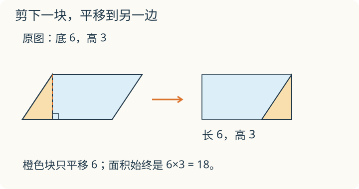

# 第 9 课：平行四边形面积

一个底 6 厘米、高 3 厘米的平行四边形，斜着的那一块能搬到另一边吗？拼成长方形后，原来的哪两个长度保留下来了？

## 剪一块，移到另一边




面积是图形占平面的大小。把一块图形剪下来，平移到别处，只要每块都保留，拼合时没有重叠，所占的总面积就不变。这叫等积变形。

平行四边形有两组平行的对边。选一条边作底，两条平行边之间的垂直距离就是高。以底 6、高 3、上底相对下底向右错开 2 的平行四边形为例：从左上顶点向下底作高，沿高剪下左侧直角三角形，向右平移 6，正好补成一个长方形。这种一刀剪法中，所作的高落在下底上。

```
平行四边形：底 6，高 3
剪下左侧直角三角形，平移到右侧
→ 长方形：长 6，宽 3
面积：6×3=18
```

长方形的长等于平行四边形的底，宽等于平行四边形的高。长方形的面积是长×宽，所以平行四边形的面积是底×高。

高必须垂直于选定的底，不能用斜边代替。斜边通常比高长，底×斜边会把面积算大。

同一个平行四边形，选不同的边作底，就要配对应的另一条高。底变了，高也变，但底×对应的高不变。

## 例子

### 例 1：底 6 厘米，高 3 厘米

面积：6×3=18（平方厘米）。

可以想成剪拼后的长方形：长 6 厘米，宽 3 厘米，面积 18 平方厘米。

### 例 2：面积 24 平方厘米，底 6 厘米

高：24÷6=4（厘米）。

检验：6×4=24。

### 例 3：底 2.5 米，高 1.2 米

面积：2.5×1.2=3（平方米）。

先算 25×12=300，两个因数共有 2 位小数，得 3.00，即 3。

## 易错

- 用底×斜边。斜边不是高，通常比高长，会把面积算大。
- 底和高不配套。高必须垂直于所选的底；换底就要换对应的高。
- 把高量成斜边的长度。高是两条平行底之间的垂直距离。
- 忘记面积单位。底和高用厘米，面积是平方厘米，不是厘米。
- 认为剪拼后形状变了，面积也变。剪拼只是移动位置，面积不变。
- 已知面积求高时，用面积÷底，不要忘记这一步对应的是高。24÷6=4，正确。
- 把平行四边形当成长方形，直接量两条邻边相乘。邻边不一定垂直。

## 斜得更多，面积一定小吗

底仍是 6 厘米、高仍是 3 厘米，让上边沿水平方向移动，图形更斜了。面积会改变吗？如果固定的是斜边长度，高却变小了呢？

<details>
<summary>看解释</summary>

底和高都不变，面积仍是 18 平方厘米。如果只是边长固定，把框架推斜，高会变小，面积也会变小。要分清固定的是高还是斜边。

</details>

## 练习

1. 底 8 厘米，高 5 厘米，面积是多少？
2. 底 6 米，高 3 米，面积是多少？
3. 面积 24 平方厘米，底 6 厘米，高是多少？
4. 面积 36 平方厘米，底 9 厘米。高是多少？如果底不变，高增加 2 厘米，面积变成多少？
5. 一个平行四边形底 10 厘米，斜边 6 厘米，高 4 厘米，面积是多少？
6. 判断：平行四边形的面积=底×斜边。

## 答案

1. 8×5=40（平方厘米）。
2. 6×3=18（平方米）。
3. 24÷6=4（厘米）。
4. 原来高 36÷9=4（厘米）；高增加后是 6 厘米，面积 9×6=54（平方厘米）。
5. 10×4=40（平方厘米）。斜边 6 厘米不参与面积计算。
6. 错。面积=底×对应的高，斜边不是高。
