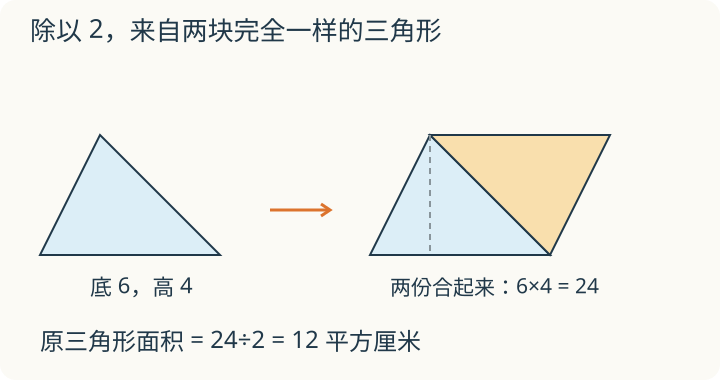

# 第 10 课：三角形面积

把一个三角形复制一份，两份拼成平行四边形。拼好后的底和高分别来自哪里？为什么求原来一份的面积还要除以 2？

## 面积公式为什么要除以 2

选定三角形的一条边作底。复制一个同样的三角形，让副本绕其中一条非底边的中点旋转 180°，两份沿这条边拼在一起，就得到一个平行四边形。原来的一份没有拉伸，但复制后总面积是原来的两倍。

这个平行四边形的底就是三角形的底，高就是三角形的高。平行四边形的面积是底×高，里面正好有两个完全一样的三角形，所以一个三角形的面积是：

底×高÷2

拼成的平行四边形里，正好有两个同样的三角形，所以要除以 2，才得到一个三角形的面积。

三角形有三条边，每条边都可以作底，但每条底对应的高不同。只要底和高配套，算出的面积一样。

高是从对面的顶点向底边作的垂线。钝角三角形的高可能落在底边的延长线上，但仍然是垂直距离。

## 例子

### 例 1：底 6 厘米，高 4 厘米

面积：6×4÷2=12（平方厘米）。

两个这样的三角形拼成底 6 厘米、高 4 厘米的平行四边形，面积 24 平方厘米；一个三角形是 12 平方厘米。

### 例 2：底 8 米，高 5 米

面积：8×5÷2=20（平方米）。

### 例 3：面积 36 平方厘米，底 9 厘米

高：36×2÷9=8（厘米）。

检验：9×8÷2=36。

已知面积求高，先乘 2 再除以底，不能直接用面积除以底。

## 易错

- 忘记除以 2。底×高算的是等底等高平行四边形的面积，三角形是它的一半。
- 用斜边当高。高必须垂直于底，斜边不一定垂直。
- 底和高不配套。换一条底，就要找与它垂直的高。
- 已知面积求高时，直接用面积÷底。应是面积×2÷底；只用面积÷底会得到 36÷9=4，这个 4 不是高，正确答案是 8。
- 面积单位写成长度单位。面积用平方厘米、平方米。
- 认为形状不同的三角形面积一定不同。等底等高的三角形，面积相等。
- 把“÷2”漏在小数计算里。2.4×1.5÷2=1.8，先乘后除，顺序不影响结果，但不能不除。

## 顶点向旁边走

一个三角形的底边不动，对面的顶点沿着与底边平行的直线移动。它的面积会变吗？

看解释

不会。底没有变，顶点到所选底边所在直线的垂直距离也没变，所以底×高÷2 不变。图形可以从锐角变成钝角，高也可能落在底边延长线上。

## 练习

1. 底 8 厘米，高 5 厘米，面积是多少？
2. 底 6 米，高 4 米，面积是多少？
3. 面积 20 平方厘米，底 5 厘米，高是多少？
4. 面积 36 平方厘米，底 9 厘米，高是多少？
5. 一个三角形底 10 厘米、高 4 厘米，另一个底 8 厘米、高 5 厘米，面积相等吗？
6. 小明算三角形面积时，用底×高得到 24 平方厘米，忘了除以 2。实际面积是多少？

## 答案

1. 8×5÷2=20（平方厘米）。
2. 6×4÷2=12（平方米）。
3. 20×2÷5=8（厘米）。
4. 36×2÷9=8（厘米）。
5. 相等。10×4÷2=20，8×5÷2=20，都是 20 平方厘米。
6. 24÷2=12（平方厘米）。
