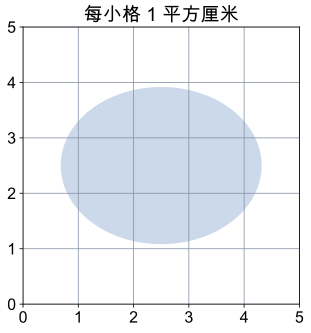

# 第 11 课：梯形面积

两个完全一样的梯形拼成平行四边形，底是上底+下底，高不变；梯形面积是它的一半，所以面积=（上底+下底）×高÷2。

## 两个梯形怎样拼成平行四边形

梯形只有一组对边平行，这两条平行的边分别叫上底和下底，它们之间的垂直距离叫高。

两个完全一样的梯形，把其中一个旋转 180°，再和另一个拼在一起，可以拼成一个平行四边形。

拼成的平行四边形的底，是一段上底加一段下底：

```
底 = 上底 + 下底
高 = 梯形的高
```

平行四边形的面积是（上底+下底）×高。它由两个同样的梯形组成，所以一个梯形的面积是：

（上底+下底）×高÷2

也可以沿梯形的一条对角线把它分成两个三角形：

- 一个三角形以 a 为底，高是 h，面积 a×h÷2；
- 另一个三角形以 b 为底，高也是 h，面积 b×h÷2。

两个三角形合起来：（a+b）×h÷2，和拼平行四边形的结果一样。

高必须垂直于两条底，不能用腰代替。腰是斜的，长度通常比高长。

如果上底和下底相等，梯形变成平行四边形，公式变成（a+a）×h÷2=a×h，正好是平行四边形面积。这个公式把平行四边形的面积公式也包含进去了。

## 例子

### 例 1：上底 3 厘米，下底 5 厘米，高 4 厘米

面积：（3+5）×4÷2=8×4÷2=16（平方厘米）。

沿对角线分成两个三角形验证：3×4÷2=6，5×4÷2=10，6+10=16。

### 例 2：上底 6 米，下底 10 米，高 5 米

面积：（6+10）×5÷2=16×5÷2=40（平方米）。

### 例 3：面积 30 平方厘米，上底 4 厘米，下底 8 厘米

高：30×2÷（4+8）=60÷12=5（厘米）。

检验：（4+8）×5÷2=30。

已知面积求高，先乘 2，再除以上底与下底的和。

## 易错

- 把上底和下底相乘。公式里是相加，不是相乘。
- 用腰当高。高是两条底之间的垂直距离，腰不一定垂直。
- 忘记除以 2。两个完全一样的梯形才拼成一个平行四边形。
- 上底、下底写反。加法交换，结果不变，但要认清哪条是哪条，别把数据抄错。
- 已知面积求高时，直接用面积÷（上底+下底）。应先乘 2，再除。
- 面积单位写成长度单位。面积用平方厘米、平方米。
- 认为上底一定比下底短。上底、下底只是两条平行边的名称，不一定谁长谁短。
- 把梯形的高和腰混在一起。直角梯形中垂直于底的那条腰才是高，另一条腰不是。

## 另一次短课：弯弯的边，怎样估面积

有的图形不能直接套已学的多边形公式。可以在方格上数完整格，再估不足一格的部分。图中每小格面积为 1 平方厘米：



中间一行有 3 个格被图形完全盖住，边上还有 12 个格只盖住了一部分。只算铺满的格，是 3 平方厘米，会少算；把边上的格也都算成整格，是 15 平方厘米，会多算。实际面积就在这两个数之间。

粗估时若把 12 个不足一格的部分平均按半格算，得到 3+12÷2=9 平方厘米。这只是估计，不表示每一块都恰好半格；可以观察、拼补这些部分，或用更细的方格改进估计，不能把“约 9”写成精确的 9。

**自己试一试**

1. 小明把所有碰到的格都算整格，宣称面积“恰好 15”，哪里不对？
2. 仅凭 3 到 15 的范围，能判定面积小于 10 吗？
3. 若图形在格子里的样子不变，每格边长改成 2 厘米，只算完整格是多少？把碰到的格都算整格又是多少？按半格粗估呢？

**答案与解释**

1. 15 是把面积往大估的结果，边缘的格子并没有铺满。
2. 不能，这个范围还包含大于 10 的数，需要进一步估测。
3. 每格面积变为 4 平方厘米，只算完整格是 12，把碰到的格都算整格是 60，粗估约 36 平方厘米；边长变两倍，面积变四倍。估的方法不同，得到的近似值也可能不同。把自己的估法说清楚，合理的结果都可以；答案不一定只能是“9”。

## 练习

1. 上底 3 厘米，下底 5 厘米，高 4 厘米，面积是多少？
2. 上底 6 米，下底 10 米，高 5 米，面积是多少？
3. 面积 24 平方厘米，上底 2 厘米，下底 6 厘米，高是多少？
4. 面积 30 平方厘米，上底 4 厘米，下底 8 厘米，高是多少？
5. 一个梯形上底 4 厘米、下底 8 厘米、高 3 厘米；另一个上底 5 厘米、下底 7 厘米、高 3 厘米。面积相等吗？
6. 一个梯形上底 4 厘米、下底 8 厘米、高 5 厘米、腰 6 厘米，面积是多少？

## 答案

1. （3+5）×4÷2=16（平方厘米）。
2. （6+10）×5÷2=40（平方米）。
3. 24×2÷（2+6）=48÷8=6（厘米）。
4. 30×2÷（4+8）=60÷12=5（厘米）。
5. 相等。（4+8）×3÷2=18，（5+7）×3÷2=18，都是 18 平方厘米。
6. （4+8）×5÷2=30（平方厘米）。腰 6 厘米不是高，不参与计算。
