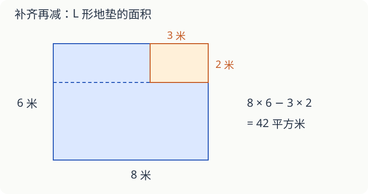

# 第 13 课：缺了一角，面积怎么算

一块 L 形地垫，没有现成的面积公式。把它看成几个熟悉的图形，就能算了。

## 先把图上的长度认清

外面的长方形长 8 米、宽 6 米，右上角缺了一块长 3 米、宽 2 米的长方形。图中所有拐角都是直角。

可以先补齐，再减去缺角：8×6−3×2＝42（平方米）。

也可以沿缺口往左画一条横线，把地垫分成上下两块。下面一块高 6−2＝4 米，面积是 8×4＝32 平方米；上面一块长 8−3＝5 米，高 2 米，面积是 5×2＝10 平方米。合起来仍是 42 平方米。

两种分法算的是同一块地垫。分开算时，每个地方只能算一次，也不能漏。

## 面积减了，周长也减吗

缺口从外框上拿走了 3 米和 2 米的边，又添了同样长的两条边。所以这个图形的周长仍是（8＋6）×2＝28 米。

这只是在长方形角上切去小长方形的情况。如果从一条边的中间挖进去，周长可能增加。别把这一题的结果用到所有缺口上。

## 自己试一试

1. 用“外框减缺角”算配图的面积。
2. 如果沿缺口向下分成左右两块，两块面积各是多少？
3. 外框长 10 米、宽 7 米，右上角缺去长 4 米、宽 3 米的一块，剩下多少平方米？
4. 第 3 题剩下图形的周长是多少米？
5. 一块长方形与一块三角形拼成地垫，没有重叠。长方形长 6 米、宽 4 米；三角形底 6 米，对应高 3 米。总面积是多少？
6. 两块板的面积分别为 20、15 平方厘米，叠放后有 4 平方厘米重叠。它们盖住桌面的面积是多少？

## 答案与说明

1. 8×6−3×2＝42 平方米。
2. 左边 5×6＝30 平方米，右下边 3×4＝12 平方米，共 42 平方米。
3. 10×7−4×3＝58 平方米。
4. （10＋7）×2＝34 米。缺口新添的两条边恰好补回原来去掉的边长。
5. 6×4＋6×3÷2＝33 平方米。
6. 20＋15−4＝31 平方厘米。直接相加把重叠部分算了两次，要减掉一次。

## 动手验证

在方格纸上按每格边长1厘米画一个8×6长方形，从右上角剪掉3×2的一块。分别沿缺口向左和向下画分割线，数格核对两种分法。答案：剩42平方厘米，两个方向的分块分别为32+10和30+12。量周长仍为28厘米。
