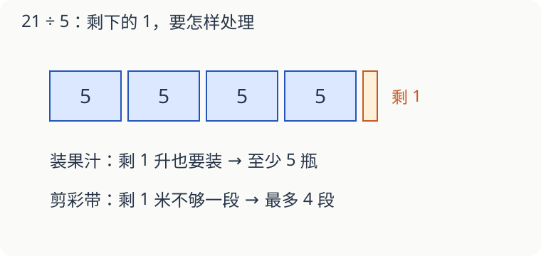

# 第 14 课：有时要进一，有时要舍去

算出 4.2 以后，答案一定写成 4 吗？先看看这个数表示什么。

## 一样的商，两个答案

21 升果汁，每瓶最多装 5 升。21÷5＝4.2，装满四瓶后还有 1 升。要把果汁全部装下，至少需要 **5 瓶**。

21 米彩带，每段长 5 米。也有 21÷5＝4.2，但剩下的 1 米不够再剪一段。最多能剪 **4 段**。

需要装下全部，没装完就要再添一个容器；只要完整的几段，不够一段的不能算。这里的取整由事情决定。

## 四舍五入回答的是另一种问题

把 4.26 保留一位小数，看百分位上的 6，得到 4.3。把 4.26 保留整数，看十分位上的 2，得到 4。

如果测量结果是 4.26 米，要求精确到 0.1 米，就写约 4.3 米。这里没有“装完”或“剪够”的要求。

9.96 保留一位小数，十分位上的 9 还要进一，结果是 **10.0**。末尾这个 0 表明保留到十分位。

## 自己试一试

1. 4.263 保留两位小数是多少？
2. 7.98 保留一位小数是多少？
3. 43 人乘车，每辆最多坐 8 人，至少需要几辆？
4. 43 米绳子，每根剪 8 米长，最多剪几根？
5. 24 千克面粉，每袋装 6 千克，需要几袋？还用多准备一袋吗？
6. 一支笔 2.4 元，带 10 元最多能买几支？

## 答案与说明

1. 4.26，看千分位上的 3。
2. 8.0，看百分位上的 8，进位后仍保留一位小数。
3. 43÷8＝5……3，五辆还剩 3 人，至少六辆。
4. 43÷8＝5……3，剩下 3 米不够一根，最多五根。
5. 24÷6＝4 袋，正好装完，不用再添一袋。
6. 四支。2.4×4＝9.6 元，买五支要 12 元，钱不够。

## 动手验证

用43颗棋子表示43人，每8颗围成一组，模拟每车最多8人的乘车方案。整组5组，剩3颗，给剩下的再画一辆车，共6辆。再用43格纸条每8格剪一段，只能得5个完整段。记录同一个除法为什么要答不同的整数。
