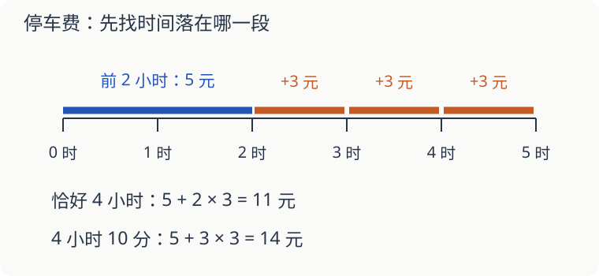

# 第 15 课：超过两小时的部分怎么算

停车场的价目表有两句话：前 2 小时收费 5 元；超过 2 小时的部分，每小时 3 元，不满 1 小时按 1 小时收费。这是本题的约定。

## 把时间分成两段

停车 4 小时，前 2 小时是 5 元，后 2 小时是 3×2＝6 元，共 11 元。

不能用 4×3，因为 3 元只用于超过 2 小时的部分。

停车 4 小时 10 分，超过的时间是 2 小时 10 分，要按 3 小时收费，共 5＋3×3＝14 元。

恰好 4 小时收费 11 元；只多停 1 分钟，就进入下一个计费小时，收费 14 元。遇到分段题，分界点要单独看。

## 反过来，知道钱能知道时间吗

收费 8 元，说明超过部分收了 8−5＝3 元，也就是一个计费小时。因此停车时间是 **超过 2 小时、不超过 3 小时**。可能停了 2 小时 20 分，也可能正好 3 小时，不能断定一定停了 3 小时。

## 自己试一试

以下都按同一张价目表计算，停车时间大于 0。

1. 停车 1 小时、2 小时，各收费多少？
2. 停车 2 小时 1 分，收费多少？
3. 停车 3 小时、3 小时 1 分，各收费多少？
4. 停车 5 小时 20 分，收费多少？
5. 收费 11 元，停车时间在哪个范围？
6. 小林用“5＋4×3”算停车 4 小时的费用，错在哪里？

## 答案与说明

1. 都是 5 元，都没有超过 2 小时。
2. 8 元。多出的 1 分钟也按 1 小时收 3 元。
3. 分别是 8 元和 11 元。
4. 超过部分是 3 小时 20 分，按 4 小时收，5＋4×3＝17 元。
5. 超过 3 小时、不超过 4 小时。超出前两小时的部分按两个小时收费。
6. 把前两小时也按 3 元算了一遍。应算 5＋（4−2）×3＝11 元。
