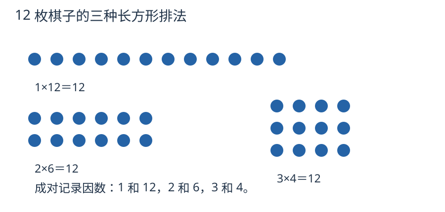

# 第 1 课：因数与倍数

12 枚棋子要摆成整齐的长方形，每行一样多，不能剩。能摆几行？每行又有几枚？把这些排法记下来，就是在找 12 的因数。

## 先把自然数分成奇数和偶数

把棋子每 2 枚分一组，没有剩下的，这个数就是偶数；最后剩 1 枚的，就是奇数。换成除法来说，能被 2 整除的自然数叫偶数，不能被 2 整除的自然数叫奇数。例如 8÷2=4，8 是偶数；9÷2=4……1，9 是奇数。0÷2=0，所以 0 也是偶数。

试一试：把 0、1、2、7、12、15 分类，再说说 2 是奇数还是偶数。

核对：偶数有 0、2、12；奇数有 1、7、15。2 是偶数，也是一会儿要认识的质数。“奇偶”看能不能被 2 整除，“质数、合数”看因数个数，分法不同。

## 用棋子摆出不同的长方形

下面研究因数与倍数时，只讨论非零自然数。列倍数时从乘 1 开始；旋转后相同的长方形，只算一种形状。

把一个数写成两个自然数相乘，就像用同样多的棋子摆长方形。12 可以写成 1×12、2×6、3×4，所以 12 有 1、2、3、4、6、12 六个因数，能摆出三种长方形。13 只能拆成 1 和 13 相乘；1 行 13 个和 13 行 1 个，转一下就是同一个长方形，所以只有一种排法。13 只有 1 和 13 两个因数，是质数。15=1×15=3×5，有四个因数，是合数。

因数成对出现：找到 2，就同时找到 6。因数的个数有限，因为因数不会超过这个数本身；倍数可以一个接一个乘下去，所以无限多。

每幅图都是12枚棋子；旋转后相同的长方形算同一种形状。行数和每行枚数就是一对因数。

1 只有一个因数，既不是质数也不是合数。2 是最小的质数，也是唯一的偶质数。

## 例子

### 例 1：找 18 的因数

从 1 开始成对找：

- 1×18；
- 2×9；
- 3×6。

4 不能整除 18；如果一对因数都至少是 5，乘积就至少为 25，超过 18。因此继续往后找到的因数，只会与前面的小因数配成已经记过的一对。所以 18 的因数是 1、2、3、6、9、18。

### 例 2：判断 17 是不是质数

试到 4 就够了，因为 4²=16<17，而 5²=25>17。如果 17 有一个大于 4 的因数，和它配对的因数就会小于 4。

检查 17 的因数：2、3 都不能整除 17；4 也不能，因为能被 4 整除就一定能被 2 整除。若两个因数都至少是 5，乘积至少为 25，已超过 17。因此不必再往后找，17 只有 1 和 17 两个因数，是质数。“不能整除”指商不是整数，不是说不能算成有限小数：17÷2=8.5。

### 例 3：6 为什么不是质数

6=1×6=2×3。除了 1 和 6，6 还有 2 和 3 两个因数，一共四个。质数要求“只有两个因数”，所以 6 是合数。

## 易错

- 把因数和倍数说反。用 3×4=12 固定：3、4 是 12 的因数，12 是 3 和 4 的倍数。
- 认为一个数的因数有无限个。因数成对且不超过它本身，个数有限；倍数才无限。
- 把 1 当质数。1 只有一个因数，既不是质数也不是合数。
- 认为偶数都是合数。2 是偶数，但只有 1 和 2 两个因数，是质数。
- 找因数漏掉成对的。从 1 开始一对一对找，写到两个因数相遇为止。

## 正方形那一对，算几次

36=6×6。写 36 的全部因数时，要写两个 6 吗？为什么有些数的因数个数是单数？

看解释

只写一个 6，因为列的是不同的因数。通常因数一大一小配成一对；平方数中有一对相等，只算一次，所以它的因数个数是单数。

## 练习

1. 写出 24 的全部因数。
2. 29 是质数还是合数？说明理由。
3. 写出 7 的前 5 个倍数。
4. 36 有多少个因数？
5. 一个数恰好有 3 个因数，最小的这样的数是多少？再举一个。
6. 判断：所有的偶数都是合数。

## 答案

1. 1、2、3、4、6、8、12、24。
2. 质数。5²=25<29<6²=36，试到 5 就够；29 不能被 2、3、5 整除。
3. 7、14、21、28、35。
4. 1、2、3、4、6、9、12、18、36，共 9 个。
5. 最小是 4（1、2、4）；9（1、3、9）也符合。这样的数是某个质数的平方。
6. 错。2 是偶数，但只有 1 和 2 两个因数，是质数。
