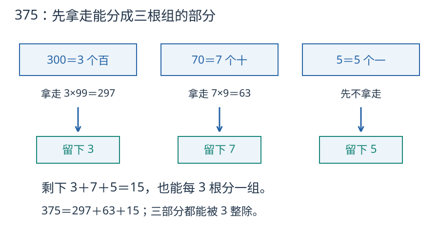

# 第 2 课：2、5、3 的倍数

把 375 根小棒每 3 根一组。整百和整十里，能先拿走多少个完整的三根组？剩下的小棒又与数字 3、7、5 有什么关系？

## 为什么有的看个位，有的看数字和

一个多位数可以拆成整十、整百、整千加个位。比如 375=300+70+5。

100、10 都能被 2 和 5 整除，所以整百、整十部分不影响余数，只看个位。个位是 0、2、4、6、8，就是 2 的倍数；个位是 0 或 5，就是 5 的倍数。

3 不一样：每个十可以拿走 9，剩 1；每个百可以拿走 99，也剩 1。375 中的 3 个百各留下 1，7 个十各留下 1，再加原来的 5 个一，共留下 3+7+5=15。拿走的 3×99 和 7×9 都能分成完整的三根组，因此只需检查剩下的 15。

三个百各剩1，七个十各剩1，再加5个一，剩下15。拿走的297和63都是3的倍数，因此只检查剩下的15。

10÷3 余 1，100÷3 余 1，1000÷3 也余 1。所以 375 除以 3 的余数，等于 3+7+5=15 除以 3 的余数。15 能被 3 整除，375 就能。9 同理，因为 10、100、1000 除以 9 都余 1。

## 例子

### 例 1：判断 472 是不是 3 的倍数

4+7+2=13，13÷3 余 1，所以 472 不是 3 的倍数。

除法核对：472÷3=157 余 1。

### 例 2：判断 375 是不是 2、5、3 的倍数

个位是 5：不是 2 的倍数，是 5 的倍数。

3+7+5=15，15 是 3 的倍数，所以 375 是 3 的倍数。核对：375÷5=75，375÷3=125。

### 例 3：4□2 是 3 的倍数，□ 里填几

4+2=6，再加 □ 要能被 3 整除。□ 可以是 0、3、6、9。

核对：402÷3=134，432÷3=144，462÷3=154，492÷3=164。

## 易错

- 判断 3 的倍数也只看个位。12 的个位是 2，却能被 3 整除；13 的个位是 3，却不能被 3 整除。要看各位数字的和。
- 把数字和算错。4+7+2 是 13，不是 11 或 12。
- 判断 9 的倍数只看是不是 3 的倍数。12 是 3 的倍数，但 1+2=3，不是 9 的倍数。
- 同时是 2 和 5 的倍数，个位只能是 0，不是 5。
- 4 的倍数看个位。100 能被 4 整除，整百不影响，要看末两位。

## 练习

1. 下面哪些是 2 的倍数？234、305、470、591。
2. 下面哪些是 5 的倍数？25、32、80、91。
3. 下面哪些是 3 的倍数？123、246、350、471。
4. 一个三位数 4□2 是 3 的倍数，□ 里可以填哪些数字？
5. 判断 234、567、890 是不是 9 的倍数。
6. 一个四位数 2□34 是 3 的倍数，□ 里可以填哪些数字？

## 答案

1. 234、470。
2. 25、80。
3. 123（1+2+3=6）、246（2+4+6=12）、471（4+7+1=12）；350 的数字和是 8，不是。
4. 0、3、6、9。
5. 234：2+3+4=9，是；567：5+6+7=18，是；890：8+9+0=17，不是。
6. 2+3+4=9，□ 可以是 0、3、6、9。
