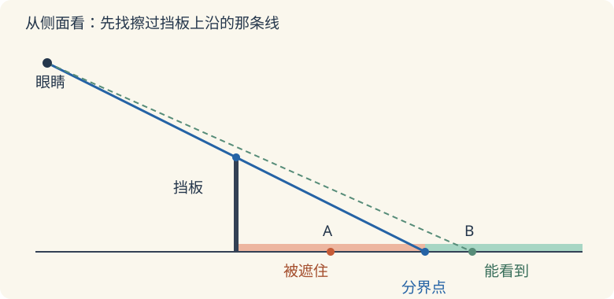

# 第 4 课：观察物体

从一个方向看，有些方块会被挡住。把正面、上面和左面看到的图放在一起看，才能知道更多位置上有没有方块。

## 从一个方向看，哪些方块会被挡住

从正面看，能分清左右和高低，前后的方块可能互相遮挡；从上面看，能分清左右和前后，却看不出一摞有多高；从左面看，能分清前后和高低，左右的方块可能互相遮挡。只看一张图，总有一些位置看不到。

比如正面看到 3 个正方形排成一行，可能只是 3 个方块并排，也可能在它们后面还藏着方块。后面的方块被前面的挡住，正面图上看不出来。所以“正面 3 个”不等于“只有 3 个方块”。

即使有三个方向的完整图，也不一定只有一种摆法，但图已经限制了前后、左右和高度的范围，不能任意往后加。还要检查是否允许悬空、哪些位置必须有方块。只有像“只给正面图、允许往后任意摆”这样的题，才可能没有有限的最大个数。

## 例子

### 例 1：4 个方块的 T 形

摆法：前排左、中、右各 1 个，中间那个的后面再放 1 个。

```
上面看（下为前）：
      [后中]
[左]  [中]  [右]

正面看：
[左]  [中]  [右]

左面看（前在左，后在右）：
[前]  [后]
```

正面看到 3 个一排；上面看到 4 个，呈 T 形；左面看到同一行的 2 个正方形，高度都是 1 个方块。前后距离在左视图中沿水平方向表示，不能画成上下两层。

### 例 2：由视图数方块

另一个几何体，从上面看还是这 4 个位置：

```
      [后中]
[左]  [中]  [右]
```

从正面看，三列高度分别是 1、2、1。每个位置最高 2 层，方块不能悬空。

最少：4 个位置先各放 1 个，共 4 个；中间列要从高度 1 变成 2，至少在“中”或“后中”加 1 个，所以最少 5 个。

最多：左、右两列的要求高度都是 1，不能再加高；只有中间两个位置可以到 2 层，所以最多 4+2=6 个。

## 易错

- 把正面看到的小正方形个数当方块总数。后面可能还有方块。
- 画上面图时前后方向反了。先约定“前面在下、后面在上”。
- 认为三视图一定唯一确定形状。有些不同摆法的三视图相同。
- 求最多方块数不限条件。只给正面图、又允许往后任意摆时，可以一直往后加；不能把这个结论套到给齐三个方向完整图的题里。
- 忽略“不能悬空”。方块必须放在桌面或已有方块上。

## 练习

1. 只给正面图：3 个正方形排成一行。方块最少几个？如果允许往后任意摆，最多几个？
2. 从上面看是 4 个正方形排成一行，从正面看也是 4 个正方形排成一行，每个位置高度相同。用了几个方块？
3. 从上面看是 2×2 的 4 个位置，从正面看两列高度都是 2。每个位置最高 2 层，不能悬空。最少几个？最多几个？
4. 判断：三个视图一定能把几何体唯一确定。
5. 一个几何体从正面看是 2 个正方形排成一行，从左面看也是 2 个正方形排成一行。它一定用了 2 个方块吗？

## 答案

1. 最少 3 个；允许往后任意摆时，没有有限的最大值。
2. 4 个。上面 4 个位置，正面每列高度都是 1，每个位置只能 1 层。
3. 最少 6 个：4 个位置各 1 个，两列各有一个位置加到 2 层；最多 8 个：4 个位置都放 2 层。
4. 错。存在不同摆法得到相同的三个视图，还要看题目条件。
5. 不一定。可能是前排左、后排右斜着放 2 个；也可能放 3 个或 4 个，正面和左面看到的影子仍然各是 2 个。

## 再看一个问题：挡板后面能看到哪里

前面的题，把物体从正面、上面和侧面画出来。这次换成一只眼睛站在固定位置，看看挡板会遮住地面的哪一段。



把尺子的一边贴住“眼睛”和“挡板上沿”两点，沿着它画直线，延长到地面。这个交点就是本图的分界。挡板后面、分界点前面的地面被遮住；再远一些的地面，视线能越过挡板上沿。本图只讨论侧面这一条地面，不能从挡板两侧绕着看。

找一块纸板竖在桌面上，在它后面近处和远处各放一枚小棋子。闭上一只眼，先从较低的位置看，再把头抬高一些。保持纸板和棋子不动，留意哪枚棋子先露出来。

**自己试一试**

1. 配图中，A、B 两点哪个被挡住？在图上用尺子连一连眼睛和这两个点，检查视线会不会穿过挡板。
2. 眼睛只往上移动，挡板和前后位置都不变，地面上被遮住的那一段变长还是变短？画一条新的分界线。
3. 只把挡板加高，眼睛位置不动，而且眼睛仍高于挡板上沿，被遮住的那一段怎样变？

**核对**

1. A 被挡住，B 能看到。连向 A 的线穿过挡板，连向 B 的线越过上沿。
2. 变短。新的分界点更靠近挡板，原来藏住的部分地面露出来。
3. 变长。新的分界点离挡板更远。结论要带着题目的条件，不能只记“站高看得多”一句话。
