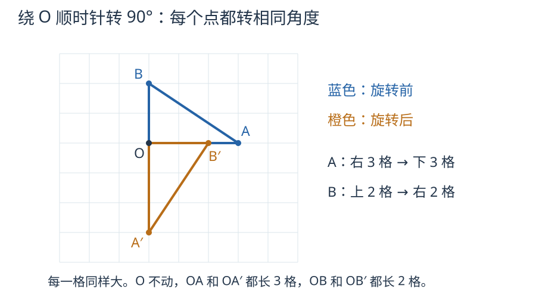

# 第 5 课：旋转

旋转是图形绕一个固定点，按指定方向转过指定角度；中心不动，形状和大小不变，位置和方向改变。

## 绕哪个点，朝哪边，转多少

旋转中心是那个不动的点。其他点沿着以它为圆心的圆弧运动：转 90°，对应点与中心的连线也转过 90°；转 180°，两条连线成一条直线。转动时，每个点到中心的距离不变，而且所有点同时朝同一方向转过相同角度。这样对应边长和角的大小才都保持不变。

描述一次旋转必须说清三件事：绕哪个点、顺时针还是逆时针、转多少度。少一件，结果就可能不同。

在方格纸上记方向：绕 O 顺时针转 90°，O 右边的点转到 O 的下边，O 上边的点转到 O 的右边；逆时针则相反。转 180°，右边的点转到左边，上边的点转到下边。

## 例子

### 例 1：一个点的 90° 和 180°

点 A 在 O 的右边 3 格。

绕 O 顺时针转 90°，A 到 O 的下边 3 格；
绕 O 逆时针转 90°，A 到 O 的上边 3 格；
绕 O 转 180°，A 到 O 的左边 3 格。

三种转法，A 到 O 的距离始终是 3 格。

### 例 2：一个三角形的旋转

三角形 OAB，O 是旋转中心，A 在 O 右边 3 格，B 在 O 上边 2 格。

绕 O 顺时针转 90°：

- A 从“右 3 格”到“下 3 格”；
- B 从“上 2 格”到“右 2 格”。

OA 变成 OA'，长度仍是 3 格；OB 变成 OB'，长度仍是 2 格；AB 的长度也不变。三角形只是转了个方向。

对照例2：先找到不动的O，再分别追踪A到A′、B到B′。两条边都顺时针转90°，长度保持不变。

### 例 3：连续转两次

绕同一点 O 顺时针转 90°，再顺时针转 90°，一共转了 180°。最终位置和一次绕 O 转 180° 相同。

旋转不是翻折：旋转是在平面内转过去，翻折是沿一条直线把图形翻到另一面。转 180° 后图形方向变了，却没有被“翻面”。

## 易错

- 只说“转一下”，不说中心、方向、角度。三件事缺一不可。
- 认为旋转会改变图形大小。对应点到中心的距离、对应边长度都不变。
- 把旋转和翻折混为一谈。旋转绕点，翻折沿直线；旋转不翻面。
- 旋转中心找错。先找那个固定不动的点，再看其他点是否绕它转。
- 顺时针、逆时针说反。可以对照钟面：针走的方向是顺时针。

## 各转各的，还是整个图形旋转吗

A、B 都保持到 O 的距离不变，但 A 转 90°，B 只转 45°。能把这说成三角形 OAB 绕 O 的一次旋转吗？

看解释

不能。一次旋转中，所有点要绕同一中心、朝同一方向转相同的角度。A、B 各转各的，会改变两条边的夹角，图形就变了。

## 练习

1. 点 A 在 O 的右边 4 格。绕 O 顺时针转 90°、转 180°、逆时针转 90°，A 分别在哪里？
2. 点 B 在 O 的上边 2 格。绕 O 顺时针转 90°，B 在哪里？
3. 描述一次旋转，必须说清哪三件事？
4. 一个图形绕 O 顺时针转 90°，再顺时针转 90°，相当于绕 O 转多少度？
5. 判断：旋转后图形的形状不变，大小改变。
6. 点 C 在 O 的右边 5 格。绕 O 转 180° 后，C 到 O 的距离是多少格？

## 答案

1. 顺时针 90°：O 的下边 4 格；180°：O 的左边 4 格；逆时针 90°：O 的上边 4 格。
2. O 的右边 2 格。
3. 旋转中心、旋转方向、旋转角度。
4. 180°。
5. 错。形状和大小都不变，变的是位置和方向。
6. 5 格。旋转不改变点到中心的距离。
