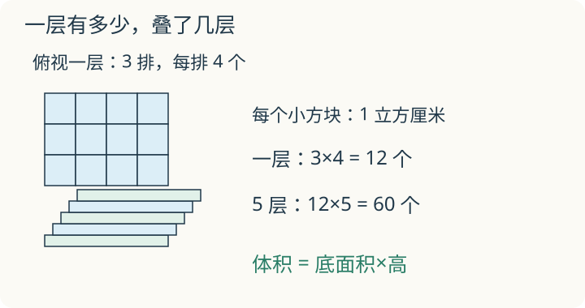

# 第 8 课：体积与容积

一个盒子，一层能放 3 排、每排 4 个单位小正方体，能叠 5 层。一层的个数和层数分别对应盒子的哪些长度？

## 一层放多少，能放几层

把长方体装满棱长 1 cm 的小正方体：长×宽算出一层能放几个，高说明能叠几层，所以总个数是长×宽×高。每个小正方体是 1 cm³，个数就是体积的数值。

体积和容积不是一回事。体积看物体从外面占多大空间；容积看容器里面能装多少。容器有壁厚时，容积要用内长、内宽、内高，不能用外面的尺寸。

边长 1 分米的正方体，沿每个方向都能排 10 个边长 1 厘米的小正方体。一层有 10×10=100 个，10 层共有 1000 个，所以 1 dm³=1000 cm³。

棱长 1 米的正方体，体积是 1 立方米，写作 1 m³。可以在地面摆出长、宽各 1 米的正方形，再想象它向上延伸 1 米：整个空间才是 1 立方米。因为 1 米=10 分米，沿长、宽、高都能排 10 个棱长 1 分米的小正方体，所以 1 m³=10×10×10 dm³=1000 dm³。相邻两个常用体积单位之间是 1000 倍，不能照搬长度单位的 10 倍关系。

常用关系：1 L=1 dm³=1000 mL，1 mL=1 cm³，1 m³=1000 L。用排水法量不规则物体，物体完全浸没、没有溢水且物体不吸水时，它的体积等于水面上升那部分空间的体积。

量小橡皮占的空间，常用立方厘米；量鞋盒占的空间，常用立方分米；量一间教室内部的空间，常用立方米。描述一瓶水能装多少，常用毫升或升。单位要让数值容易读懂，也要看清量的是物体体积还是容器容积。

### 单位小练习

1. 2 m³ 等于多少 dm³？3500 dm³ 等于多少 m³？
2. 给合适的单位填空：一块橡皮体积约 8（　）；一瓶水约 500（　）；一个水箱容积约 2（　），可装约 2000 升水。

核对：1. 2000 dm³；3.5 m³。2. 立方厘米；毫升；立方米。水箱的 2 m³=2000 dm³=2000 L。

## 例子

### 例 1：3×4×5 的长方体

底层放 3×4=12 个 1 cm³ 小正方体；叠 5 层，共 12×5=60 个。体积是 60 cm³。

用公式：3×4×5=60 cm³。

### 例 2：1 L 有多大

内部棱长 10 cm 的正方体容器，容积为 10×10×10=1000 cm³。装满时能装 1 L 水，所以 1 L=1000 cm³=1 dm³。这里给的是内部尺寸，不是盒子的外部尺寸。

### 例 3：有壁厚的盒子

一个有盖的长方体盒子，外面长 10 cm、宽 8 cm、高 6 cm，盖、底和侧壁都厚 1 cm，盖合上后不伸入内腔。里面每个方向都要去掉两边各 1 cm：

内长 10−2=8 cm，内宽 8−2=6 cm，内高 6−2=4 cm。
容积：8×6×4=192 cm³。

如果换成同样外部尺寸的无盖盒子，底和侧壁仍厚 1 cm，内高只减底厚，变成 6−1=5 cm，容积是 8×6×5=240 cm³。有没有盖，会改变内高的计算。

## 易错

- 体积和容积混用。体积看占空间，容积看里面能装多少。
- 有壁厚仍用外尺寸。容积要用内长、内宽、内高。
- 把 1 L 写成 1000 cm。1 L=1000 cm³，是体积单位。
- 排水法忘记看水位差。物体体积等于原水面与新水面之间那层空间的体积，水量本身没有增加；计算用水位差，不是最后的水深。
- 体积单位写成 cm²。体积用 cm³、dm³、m³。

## 只加高，还是三个方向都翻倍

一个长方体只把高变成 2 倍，体积怎样变？如果长、宽、高都变成 2 倍呢？

看解释

只把高变成 2 倍，每层个数不变，层数翻倍，体积是 2 倍。三个方向都翻倍，每层是 2×2=4 倍，再叠原来 2 倍的层数，体积是 8 倍。

## 练习

1. 长 5 cm、宽 4 cm、高 3 cm 的长方体，体积是多少？
2. 棱长 4 cm 的正方体，体积是多少？
3. 一个长方体水箱，里面长 8 dm、宽 5 dm、水深 3 dm，水的体积是多少升？
4. 一个有盖长方体盒子外面长 12 cm、宽 10 cm、高 8 cm，盖、底和侧壁都厚 1 cm，盖不伸入内腔，容积是多少？
5. 一块不吸水的石头完全浸没在装有 200 mL 水的量杯中，没有溢水，水面升到 350 mL。石头体积是多少？
6. 1.5 L 等于多少 mL？等于多少 cm³？

## 答案

1. 5×4×3=60 cm³。
2. 4×4×4=64 cm³。
3. 8×5×3=120 dm³=120 L。
4. 内长 10 cm、内宽 8 cm、内高 6 cm；10×8×6=480 cm³。
5. 350−200=150 mL=150 cm³。
6. 1.5 L=1500 mL=1500 cm³。
