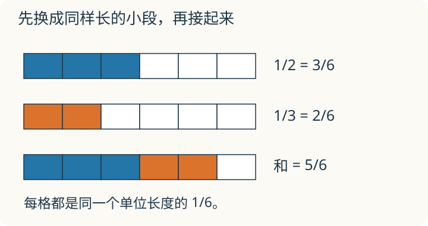

# 第 11 课：分数加减

半米长的绳子接上三分之一米，共有多长？这两段不能直接当成“两份”，因为一份半米，另一份只有三分之一米。

## 先把每一份变成同样大




1/2 的分数单位是 1/2，1/3 的分数单位是 1/3。一个是“半个”，一个是“三分之一”，单位不同，不能把分子直接相加。就像 3 米不能直接和 2 厘米相加，要先换成同一单位。

把 1/2 和 1/3 都化成分母 6：1/2=3/6，1/3=2/6。现在都是“六分之一”，3 个 1/6 加 2 个 1/6，等于 5 个 1/6，也就是 5/6。

所以异分母分数加减的步骤是：先找分母的一个公倍数作公分母，通分；再按同分母分数加减，分母不变，分子相加减；最后能约分的要约成最简分数。用最小公倍数通常更简便，其他公倍数也可以。

## 例子

### 例 1：1/2+1/3

2 和 3 的最小公倍数是 6。
1/2=3/6，1/3=2/6。
3/6+2/6=5/6。

```
1/2  [■■■|···]
1/3  [■■|····]
和   [■■■■■|·]
```

每一格是 1/6。1/2 是 3 格，1/3 是 2 格，合起来 5 格，就是 5/6。

### 例 2：5/6−3/8

6 和 8 的最小公倍数是 24。
5/6=20/24，3/8=9/24。
20/24−9/24=11/24。
11 和 24 只有公因数 1，已经是最简分数。

### 例 3：1/2+1/4+1/8

分母 2、4、8 的最小公倍数是 8。
1/2=4/8，1/4=2/8，1/8=1/8。
4/8+2/8+1/8=7/8。
和小于 1，因为还差 1/8。

## 易错

- 分母不同直接把分子分母相加。1/2+1/3≠2/5。
- 通分后只改分母，忘了改分子。分母乘几，分子也要乘几。
- 把 48 说成 6 和 8 的最小公倍数。最小公倍数是 24；但用 48 通分并没有错，例如 5/6−3/8=40/48−18/48=22/48=11/24，只是数较大。
- 结果不约分。能约到最简的要约分。
- 同分母加减时把分母也相加。分母不变，只算分子。

## 不用最小公倍数，可以吗

把 1/2 米和 1/3 米都改用 1/12 米的小段来量，能求总长吗？与用 1/6 米小段相比，哪里变了？

<details>
<summary>看解释</summary>

能。两段分别有 6 小段和 4 小段，共 10/12 米，约分为 5/6 米。实际绳长没变，变的是每个小段的长度与小段个数。用 1/6 米计算时数字较小。

</details>

## 练习

1. 1/3+1/4。
2. 3/4−1/6。
3. 5/8+1/4。
4. 1−2/5。
5. 2/9+1/6。
6. 判断：1/2+1/3=2/5。

## 答案

1. 12 为公分母：4/12+3/12=7/12。
2. 12 为公分母：9/12−2/12=7/12。
3. 8 为公分母：5/8+2/8=7/8。
4. 1=5/5，5/5−2/5=3/5。
5. 18 为公分母：4/18+3/18=7/18。
6. 错。分母不同，不能直接加分子和分母。通分后 1/2=3/6，1/3=2/6，和是 5/6。

## 动手验证

剪两条与1米参考尺对应的纸带，长度分别为半米和三分之一米，首尾相接。把参考尺六等分，核对两段各占3格和2格，合计5格，也就是5/6米。换成十二等分尺再量，得到10/12米，实际长度相同。
