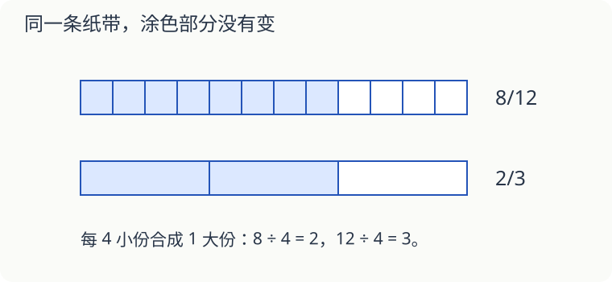

# 第 13 课：换一种分法，还是那么多

同一块蛋糕，吃了十二小块中的八块，也可以说吃了三大份中的两份。每大份由四小块拼成，吃掉的蛋糕没有变。

## 约分：把小份合成大份

8/12＝（8÷4）/（12÷4）＝2/3。分子、分母同时除以同一个不为零的数，分数大小不变。

2 和 3 没有大于 1 的公因数，2/3 已是最简分数。约分时只除分子，或只除分母，都会改变大小。

## 通分：先让每一份同样大

比较 3/4 和 5/6，可以把同样大的整块都分成 12 份：3/4＝9/12，5/6＝10/12。所以 3/4＜5/6。

12 是 4 和 6 的最小公倍数，用它作公分母，数比较小。用 24 也行，结果仍是 18/24＜20/24。

如果是不同大小的蛋糕，只比较分数还不能知道谁吃得更多。本课比较的是分数本身，或同样大的整体。

## 加减前也要认清每份多大

1/3＋1/4＝4/12＋3/12＝7/12。不能把分母也相加写成 2/7，因为三分之一和四分之一不是同样大的份。

## 自己试一试

1. 把 18/24 约成最简分数。
2. 比较 7/10 和 2/3 的大小。
3. 比较 5/8 和 3/4 的大小。
4. 计算 1/6＋1/4。
5. 计算 5/6−1/3。
6. 2/3 和 4/6 大小相等，为什么分子、分母不同？

## 答案与说明

1. 分子、分母同时除以 6，得到 3/4。
2. 7/10＝21/30，2/3＝20/30，所以 7/10＞2/3。
3. 3/4＝6/8，所以 5/8＜3/4。
4. 2/12＋3/12＝5/12。
5. 5/6−2/6＝3/6＝1/2。
6. 分成的份数不同。每个三分之一再分成两份，就变成两个六分之一，涂色总量没变。

## 动手验证

把同长纸带分成12格，一条涂8格。每4格圈成一大组，涂色占3组中的2组，说明8/12=2/3。再用同长的另两条纸带分别涂9格和10格，对应3/4与5/6，后者多1/12。
