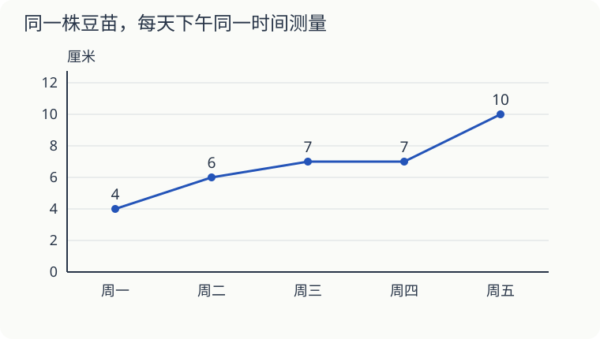
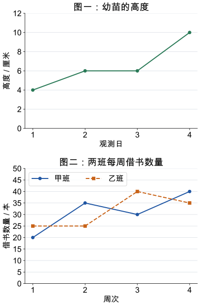

# 第 14 课：折线向上，就一定涨得快吗

小禾从周一到周五，每天下午同一时间测量豆苗的高度，依次是 4、6、7、7、10 厘米。

## 一个点对应一天的高度

横轴是日期，纵轴是高度，纵轴每格表示 2 厘米。先找日期，再找到对应高度，把相邻两天的点连起来。

周二比周一长高了 6−4＝2 厘米；周三比周二长高 1 厘米；周三到周四的线是平的，表示这两次测得的高度相同。周四到周五长高 3 厘米，是这几段里增长最多的。

周五的 10 厘米是当时的高度，不是周五一天长高了 10 厘米。五天的高度不能相加当作豆苗长了多少；从周一测量时到周五测量时，一共长高 10−4＝6 厘米。

## 比较两张图，先看刻度

把同一张图的纵轴拉长，线会更陡，豆苗却没多长一点。只有坐标刻度、间隔一致时，才方便用线的陡缓比较增长快慢。最稳妥的办法，是读出两个数再求差。

## 自己试一试

1. 周三测得的豆苗有多高？
2. 哪两次相邻测量之间增长最多？多了多少厘米？
3. 哪段折线是水平的？说明什么？
4. 周一到周五，豆苗共长高多少厘米？
5. 能断定周六一定有 13 厘米高吗？
6. 另一株豆苗周一高 5 厘米，周五高 12 厘米。在这段时间里，哪株长得更多？

## 答案与说明

1. 7 厘米，落在 6 和 8 厘米中间。
2. 周四到周五，10−7＝3 厘米。
3. 周三到周四。两次读数都是 7 厘米，按本次测量精度没有观察到高度增加。
4. 10−4＝6 厘米。
5. 不能。上一次长高 3 厘米，不代表下一次也长这么多。
6. 第二株。它长高 12−5＝7 厘米，比第一株多 1 厘米。

## 再比较两组数据：单式与复式折线图

会读条形图、会用减法算相差多少，就可以单独学这一段，不用等学完异分母分数加减。这次看的是数据怎样随着时间变化。

图一只表示一株幼苗，是单式折线图。横轴是观测日，纵轴每大格 2 厘米。先找到第 2 天，再向上找到点，读出 6 厘米。第 2 天和第 3 天一样高，连线是水平的，表示这两个观测时刻的高度相同。

图二的蓝实线圆点表示甲班，橙虚线方点表示乙班，是复式折线图。纵轴每大格 5 本；同一周比较要沿同一条竖线读两个点。第 2 周甲班 35 本、乙班 25 本，相差 10 本。

**自己试一试**

1. 图一第 1 天到第 4 天共长高多少？相邻两次观测中，哪段长得最多？
2. 图二第 3 周哪个班多，多多少？第 2 周到第 3 周，两班各怎样变化？
3. 甲班哪两个相邻周之间借书数量增加最多？写出增加量，不只看斜线。
4. 能确定乙班第 5 周借多少本吗？这两张图能说明图上时刻之间每一分钟都按直线变化吗？

**答案与解释**

1. 10−4=6 厘米；第 3→4 天增加 4 厘米，最多。
2. 乙班多 40−30=10 本；甲减少 5 本，乙增加 15 本。
3. 第 1→2 周，35−20=15 本。
4. 不能；图只给已记录的数据，未来数量不能由连线确定，点之间连线便于观察，也不证明每一时刻都匀速变化。

比较线段的陡缓前，先看横轴每格的时间、纵轴每格表示的数量是否相同。两种刻度都相同时，线更陡，表示这段时间里变化更快。要比数值大小，还得看点的位置；不同图上的线，也不能只凭看起来陡不陡来比较。

## 动手验证

根据4、6、7、7、10厘米五个数据自己画图：横轴每天间隔相同，纵轴每格2厘米。用不同颜色标出四段的增量2、1、0、3厘米。把纵轴改成每格1厘米重画，数据不变，折线看起来会更陡。
