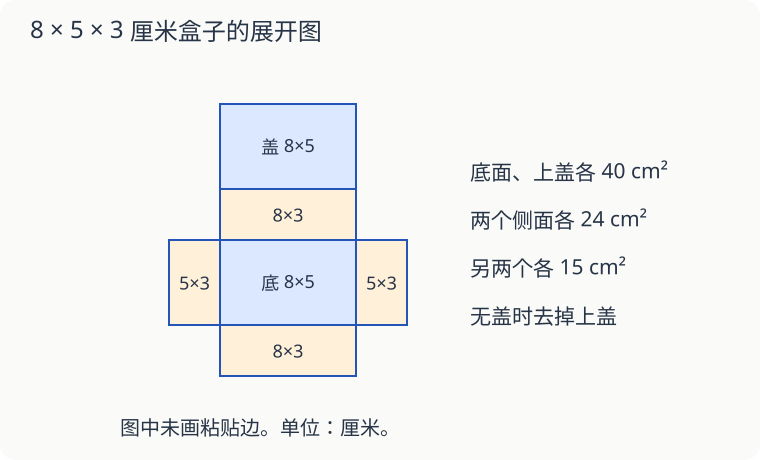

# 第 15 课：做盒子，要准备多大一张材料

一个长方体盒子，长 8 厘米、宽 5 厘米、高 3 厘米。把它沿着棱剪开、铺平，六个面的面积会改变吗？不会，改变的是摆放方式。

## 六个面分成三对

上、下两面各是 8×5＝40 平方厘米；前、后两面各是 8×3＝24 平方厘米；左、右两面各是 5×3＝15 平方厘米。

六个面的面积合计：（40＋24＋15）×2＝158（平方厘米）。

图中每条相接的边必须一样长。面积合计相同的六块长方形，不一定能随便拼成盒子。

## 没有上盖，减去哪一面

做成无盖收纳盒，就去掉上面那块 8×5 的长方形，剩下 158−40＝118 平方厘米。不是减去任意一面，也不是把六面平均分成六份再去一份。

这里算的是盒子各个面的总面积。真正剪纸还可能需要粘贴边，裁剪也可能有余料；题目没有给这些信息时，不把它们猜进去。

如果明确说粘贴边一共另需 12 平方厘米，无盖盒所用材料面积就是 118＋12＝130 平方厘米。至于要买多大的整张纸，还要看展开图能否放得下。

## 自己试一试

1. 配图盒子的两个最大面，合计面积是多少？
2. 配图盒子的四个侧面，合计面积是多少？
3. 长 10、宽 6、高 4 厘米的无盖长方体盒，五个面的面积是多少？
4. 第 3 题的盒子另需 20 平方厘米粘贴边，共用多少平方厘米材料？
5. 一个棱长 4 厘米的正方体盒子不带盖，五个面的总面积是多少？
6. 小华说：“材料面积够，纸就一定能剪出这张展开图。”一定对吗？

## 答案与说明

1. 8×5×2＝80 平方厘米。
2. （8×3＋5×3）×2＝78 平方厘米。
3. 10×6＋10×4×2＋6×4×2＝188 平方厘米。
4. 188＋20＝208 平方厘米。
5. 4×4×5＝80 平方厘米。
6. 不一定。纸的长、宽以及展开图的形状也要合适。很窄很长的纸，面积虽然大，仍可能放不下展开图。

## 动手验证

按每厘米1格，在方格纸上描配图展开图，先不剪掉上盖，标出三对面。再用另一种颜色圈去上盖，核对面积158−40=118平方厘米。剪下折合检查相邻边是否对齐；粘贴边另画，不能占用盒面的面积。
