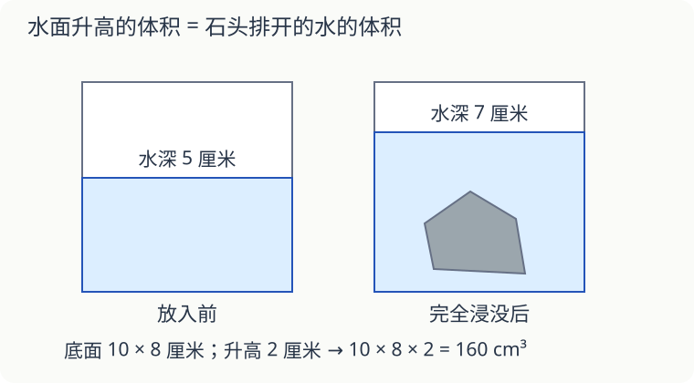

# 第 16 课：水面升高，能告诉我们什么

一块形状不规则的石头，长、宽、高不好量。把它完全浸入水中，水面会升高，升高的这一层水就能帮忙。

## 石头占了多少空间

水槽内部是长方体，底面长 10 厘米、宽 8 厘米。石头放入前，水深 5 厘米；放入后，水深 7 厘米。

水面升高 7−5＝2 厘米。石头挤占的空间等于升高的这一层的体积：10×8×2＝160（立方厘米）。

10×8×7 算的是水和石头在水面以下合占的空间，不能全算成石头的体积。

## 先检查三个条件

石头必须完全浸没，不能有一半露出水面；石头不吸水、不溶解；水没有洒出或溢出。还要使用直壁容器，保证升高这一层的底面积不变。

如果水槽原本装满水，放入石头后把溢出的水全部接住，也可以量这部分水。溢出 160 毫升，对应石头体积 160 立方厘米。

“水面升高多少”和“溢出多少水”是两种测量办法，不要同时把两份数加起来。

## 换个宽水槽，石头变小了吗

同一块石头完全浸没，先放进底面积 80 平方厘米的直壁水槽，水面升 2 厘米；再放进底面积 160 平方厘米的水槽。其他测量条件相同，水面升多高？

看解释

石头体积是 80×2=160 立方厘米，不会随水槽改变。新水槽底面积是 160 平方厘米，上升高度为 160÷160=1 厘米。水面升得少，不代表石头小了。

## 自己试一试

1. 配图中石头的体积是多少？
2. 另一水槽底面积 120 平方厘米，放入完全浸没的铁块后水面升高 1.5 厘米，铁块体积是多少？
3. 底面积 60 平方厘米的直壁水槽，放入体积 90 立方厘米的石头，完全浸没且不溢水，水面升高多少厘米？
4. 装满水的容器放入完全浸没的玻璃球，收集到 35 毫升溢水。玻璃球体积是多少？
5. 海绵放进水里会吸水，能直接用本课方法测它的体积吗？
6. 一块石头只有一半浸在水里，算出的排水体积能当作整块石头的体积吗？

## 答案与说明

1. 10×8×（7−5）＝160 立方厘米。
2. 120×1.5＝180 立方厘米。
3. 90÷60＝1.5 厘米。
4. 35 立方厘米，1 毫升＝1 立方厘米。
5. 不能直接这样算。海绵吸水、可能变形，水面变化不只由它挤占空间造成。
6. 不能，排水体积只对应浸入水中的那部分。
