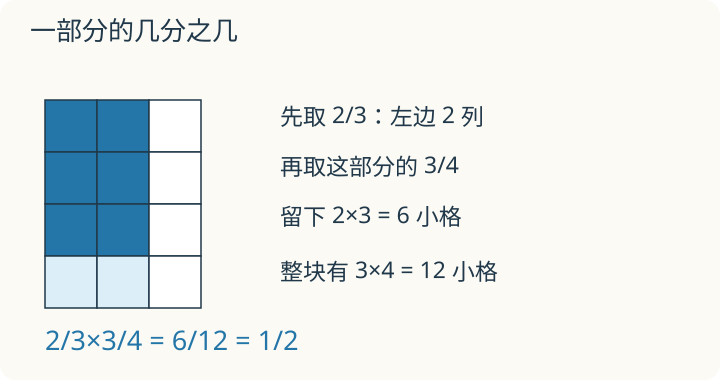

# 第 1 课：分数乘法

一张纸先取 2/3，再取这部分的 3/4。最后取到的，究竟是原纸的多少？画图时一直保留原来整张纸的边框。

## 涂色重叠的部分占多少




先看 2/3×3/4。

把一个正方形看作单位“1”。竖着平均分成 3 份，取其中 2 份，就是 2/3；再用横线把已取的这部分平均分成 4 份，留下其中 3 份。把横线延伸到整张纸上，便于用原来整张纸作单位数小格。两次划分把整个正方形分成 3×4=12 个小格，两次涂色的重叠部分是 2×3=6 个小格。

```
竖分 3 份，取 2 份  →  2 列
横分 4 份，取 3 份  →  3 行
重叠部分：2×3=6 格
全部小格：3×4=12 格
```

所以 2/3×3/4=6/12=1/2。

分母相乘，是因为第二次平均分要把第一次的每一份再细分，份数从 3 份变成 3×4 份；分子相乘，是因为取的列数和行数也要相乘。分子表示“取了几份”，分母表示“一共分成几份”，用取到的 6 格与整张纸的 12 格相比，得到的积是 6/12。

也可以从分数单位看：

```
2/3 = 2 个 1/3
3/4 = 3 个 1/4
2/3×3/4 = (2×3) 个 (1/3×1/4) = 6 个 1/12 = 6/12
```

分数乘整数，同样只把分子和整数相乘，分母不变。12×3/4 表示 12 的 3/4：12÷4=3，3×3=9。

## 例子

### 例 1：3/5×2/3

分子相乘：3×2=6；分母相乘：5×3=15。

3/5×2/3=6/15=2/5。

### 例 2：12 千克的 3/4

12×3/4=12÷4×3=3×3=9（千克）。

“12 的 3/4”就是把 12 平均分成 4 份，取 3 份。

### 例 3：先约分再乘

5/8×7/10。

5 和 10 同时除以 5，分子里的 5 变成 1，分母里的 10 变成 2：

5/8×7/10=7/(8×2)=7/16。

先约分能让数变小，结果不变。

## 易错

- 把分数乘法当成分数加法，先通分。乘法不需要通分，直接分子乘分子、分母乘分母。
- 整数乘分数时，不要把它和分母相乘。3×2/5=6/5，不是 6/15。
- 不能把带分数的整数部分与分数部分各自相乘后随意拼接。可以先化成假分数再乘，也可以按分配律拆开算，例如 (1 又 1/2)×4=1×4+(1/2)×4=6。
- 认为“乘法一定使积变大”。在正数范围内，乘一个真分数，积反而变小，例如 5/6×4/5=2/3。
- 约分不能在分子和分子之间、分母和分母之间进行。必须是一个分子和一个分母之间约去公因数。
- 最后要化成最简分数，不能停在中间结果。

## 两个分数相加，还是相乘

同一张纸，先涂 2/3，再涂“已涂部分的 3/4”，最后这次涂的占整张纸多少？如果题目改成两段绳，分别长 2/3 米和 3/4 米，要接起来呢？

<details>
<summary>看解释</summary>

纸的问题是在一部分里再取一部分，用乘法，得 1/2。接绳是把两段长度合起来，用加法，得 8/12+9/12=17/12 米。图里的动作不同，算式也不同。

</details>

## 练习

1. 计算 2/5×3/4。
2. 计算 3/8×4。
3. 计算 7/9×3/14。
4. 一根绳子长 15 米，用去它的 2/5，用去多少米？
5. 先计算 5/6×4/5，再与 5/6 比较大小。

## 答案

1. 2/5×3/4=6/20=3/10。
2. 3/8×4=12/8=3/2=1 1/2。
3. 7/9×3/14=21/126=1/6。
4. 15×2/5=6（米）。
5. 5/6×4/5=20/30=2/3；2/3<5/6，因为乘的 4/5 小于 1。
