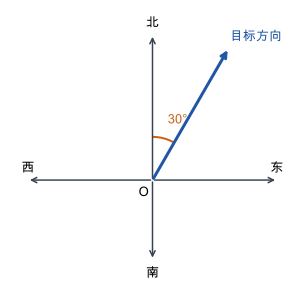

# 第 5 课：位置与方向

确定一个位置要说清观测点、方向和距离；方向用从正北或正南偏向东或西的角度表示。

## 只说方向，能找到位置吗

只说“学校在东边”，不够。东边是一条射线，上面有无数个点，不知道走多远就找不到。

所以确定位置需要三样东西：

```
观测点：从哪里看
方向：往哪条射线走
距离：走多远
```

方向的说法，以正北或正南为起点，向东或向西偏。

“北偏东 30°”的意思是：先面向正北，再向东转 30°。



角度是从正北边开始量的，不是从东边开始量。

“东偏北 30°”则是先面向正东，再向北转 30°。它和“北偏东 30°”不是同一条射线；东偏北 30° 等于北偏东 60°。

方向相同、距离不同的两个点，在同一个方向上，但位置不同。方向不同、距离相同的两个点，到观测点的距离一样，但不在同一个位置。

观测点换了，方向也会变。甲在乙的北偏东 30° 方向 5 千米处，那么乙在甲的南偏西 30° 方向 5 千米处：方向正好相反，角度和距离不变。

描述路线时，每一段都要以当前所在的位置为观测点，不能一直用起点。

## 例子

### 例 1：学校在公园的北偏东 40° 方向 600 米处

从公园出发，先面向正北，向东转 40°，再沿这个方向走 600 米，就到学校。

```
公园 —— 北偏东 40°，600 米 ——> 学校
```

### 例 2：反过来看

甲地在乙地的北偏东 30° 方向 5 千米处。

站在甲地看乙地，方向要反过来：北变成南，东变成西，角度不变。

所以乙地在甲地的南偏西 30° 方向 5 千米处。

### 例 3：描述一段路线

小明从家出发，向东走 300 米到书店，再从书店向北偏东 60° 走 400 米到学校。

全程 300+400=700 米。

原路返回时，先从学校向南偏西 60° 走 400 米回到书店，再从书店向西走 300 米回家。

## 易错

- 把“北偏东 30°”和“东偏北 30°”当成同一条射线。两者的起点边不同，方向相差 30°。
- 量角时从东边或西边起量。北偏东要从正北起量，南偏西要从正南起量。
- 只说方向，不说距离。方向只给出一条射线，不能确定唯一位置。
- 换了观测点，方向却不变。观测点相反时，方向也要反过来。
- 描述路线时，每一段都从起点算方向。应该从当前位置算。
- 把“北偏东 30°”写成“北偏东 30”。角度要带单位“°”。

## 练习

1. 从正北方向向东转 30°，方向怎么说？
2. A 地在 O 地的北偏西 60° 方向 4 千米处。O 地在 A 地的什么方向？距离是多少？
3. 学校在小明家的南偏东 25° 方向 800 米处。小明家在学校什么方向？距离是多少？
4. 判断：北偏东 30° 和东偏北 30° 是同一条射线吗？
5. 两架飞机从同一点起飞，一架沿北偏东 40° 方向飞 10 千米，另一架沿南偏西 40° 方向飞 10 千米。它们在同一方向上吗？相距多远？

## 答案

1. 北偏东 30°。
2. O 地在 A 地的南偏东 60° 方向 4 千米处。
3. 小明家在学校北偏西 25° 方向 800 米处。
4. 不是。东偏北 30° 等于北偏东 60°，与北偏东 30° 相差 30°。
5. 不在同一方向，而在同一条直线的相反方向上；两机相距 10+10=20 千米。
