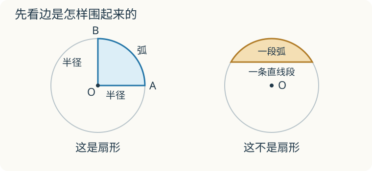

# 第 8 课：认识扇形

把一个圆形纸片沿两条半径剪开，取下一块。这块图形有两条直边，还有一段弯边，它就是扇形。

## 两条半径和一段弧



左图的 O 是圆心。OA、OB 都是半径，弯边 AB 是圆上的一段弧。两条半径在圆心处夹出的角，叫圆心角。

右图也有弯边，但直边没有连到圆心，围成它的不是“两条半径和一段弧”，所以它不是扇形。别只凭“像一块西瓜”来判断。

## 先认图，再比较

把同一个圆平均分成 4 个扇形，每一块都占全圆的四分之一。平均分成 2 个扇形，每一块就是半圆。扇形也可以大于半圆。

在同一个圆里，把两条半径的开口张大，所选那段弧也变长，围住的面积就变大。换成另一个大小不同的圆，只看开口大小便不够了。

## 基础练习

1. 指着左图，说出圆心、两条半径和弧。圆心角的顶点在哪里？
2. 将同一个圆平均分成 4 份，每份是扇形吗？两份合起来占全圆的几分之几？
3. 右图为什么不是扇形？请说图形的组成，不要只说“看着不像”。
4. 同一个圆中的两个扇形，一个占四分之一，一个占二分之一，哪一个面积大？

## 基础练习答案

1. 圆心是 O；半径是 OA、OB；弧是弯边 AB。圆心角的顶点在 O。
2. 沿半径平均分成 4 份，每份是扇形；两份合起来占二分之一。
3. 它由一条直线段和一段弧围成，没有两条半径。
4. 占二分之一的面积大，因为比较的是同一个圆。

<details>
<summary>提高选学：计算扇形面积与弧长</summary>

先学会圆的周长、面积和分数乘法，再读下面的计算。认识扇形不需要先记这些公式。

## 圆心角占整圈的几分之几

整个圆的圆心角是 360°。圆心角是 90° 的扇形，占整个圆的 90/360=1/4；圆心角是 180° 的扇形，占整个圆的 1/2。

例如把同一个圆按圆心角平均分成 4 份，四个扇形绕圆心旋转后能互相重合，面积和弧长都相等。90° 对应其中一份，各占全圆的 1/4。用同样的等分关系，可以理解下面的式子：

```
扇形面积 = 圆的面积 × 圆心角/360
        = πr² × n/360

弧长     = 圆的周长 × 圆心角/360
        = 2πr × n/360
```

其中 n 表示圆心角的度数，本课讨论 0°<n<360° 的扇形。数值题按 π 取 3.14 计算。

扇形有两样“长度”容易混：

- 弧长：只是那段弯边的长度；
- 扇形周长：弧长再加两条半径。

```
扇形周长 = 弧长 + 2r
```

圆心角相同、半径不同的两个扇形，形状相同、大小不同，面积比等于半径的平方比。半径相同、圆心角不同的两个扇形，圆心角越大，面积和弧长都越大。

## 例子

### 例 1：半径 6 厘米、圆心角 90° 的扇形

90/360=1/4。

```
面积：3.14×6²÷4=113.04÷4=28.26（平方厘米）
弧长：3.14×6×2÷4=37.68÷4=9.42（厘米）
周长：9.42+6×2=9.42+12=21.42（厘米）
```

### 例 2：半径 10 厘米、圆心角 72° 的扇形

72/360=1/5。

```
面积：3.14×10²÷5=314÷5=62.8（平方厘米）
弧长：3.14×10×2÷5=62.8÷5=12.56（厘米）
```

### 例 3：半径 3 米、圆心角 120° 的扇形

120/360=1/3。

```
面积：3.14×3²÷3=28.26÷3=9.42（平方米）
弧长：3.14×3×2÷3=18.84÷3=6.28（米）
```

## 易错

- 算扇形面积时忘记乘圆心角/360，直接写成 πr²，算出的是整个圆。
- 把弧长公式和面积公式混用。弧长用 2πr，面积用 πr²。
- 算扇形周长时只算弧长，忘记加两条半径。
- 认为圆心角大的扇形面积一定大。半径不同时不能只比圆心角。
- 认为圆心角不能超过 180°。大于 180° 的扇形也存在，只是占整个圆的比例超过 1/2。
- 圆心角是 90° 时，把面积算成整个圆的 90 倍或 1/90，比例算错。

## 练习

1. 半径 4 厘米、圆心角 90° 的扇形，面积和弧长各是多少？
2. 半径 9 分米、圆心角 120° 的扇形，面积和弧长各是多少？
3. 半径 3 米、圆心角 60° 的扇形，面积和弧长各是多少？
4. 一个扇形占所在圆的 1/8，它的圆心角是多少度？
5. 半径 5 厘米、圆心角 180° 的扇形，周长和面积各是多少？
6. 判断：圆心角越大，扇形面积一定越大。

## 答案

1. 面积 3.14×4²÷4=50.24÷4=12.56（平方厘米）；弧长 3.14×4×2÷4=25.12÷4=6.28（厘米）。
2. 面积 3.14×9²÷3=254.34÷3=84.78（平方分米）；弧长 3.14×9×2÷3=56.52÷3=18.84（分米）。
3. 面积 3.14×3²÷6=28.26÷6=4.71（平方米）；弧长 3.14×3×2÷6=18.84÷6=3.14（米）。
4. 360×1/8=45（度）。
5. 弧长 3.14×5=15.7 厘米，周长 15.7+10=25.7 厘米；面积 3.14×5²÷2=78.5÷2=39.25（平方厘米）。
6. 不一定。只有在半径相同或相等的圆中，圆心角越大，扇形面积才一定越大。

</details>
