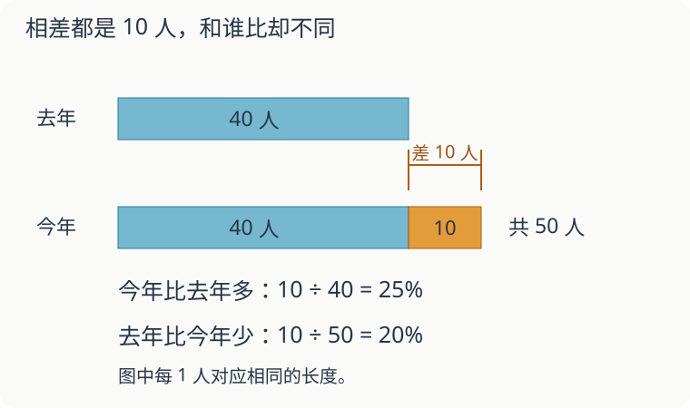

# 第 10 课：百分数应用

去年有 40 人，今年有 50 人，多了 10 人。要说“多了百分之几”，这 10 人该和谁比？

## 先找作为比较起点的量



“今年比去年多百分之几”，把去年的 40 人看作单位“1”。多出来的 10 人占它的 10÷40=25%，所以今年比去年多 25%。

反过来问“去年比今年少百分之几”，比较起点变成今年的 50 人，算的是 10÷50=20%。少掉的人数还是 10，比较的整体变了，百分数也就不同。

## 已知原来的量，求变化以后

80 增加 25%，增加的部分是 80×25%=20，变化后是 80+20=100。也可以把原来的 100% 和增加的 25% 合起来：

80×(1+25%)=100。

200 减少 15%，留下原来的 85%：200×(1−15%)=170。

## 已知变化后的量，找原来的量

一件衣服打八折后卖 200 元。“八折”表示现价是原价的 80%。把原价平均分成 5 份，现价占其中 4 份：每份 200÷4=50 元，原价就是 50×5=250 元。

也可以直接用现价除以所占的比例：200÷80%=250 元。检验：250×80%=200 元。

如果某个数增加 20% 后是 60，那么 60 是原数的 120%，原数是 60÷120%=50。检验 50+50×20%=60。

## 易错

- 把“多百分之几”除以现在的量。先把“和谁比”圈出来。
- 已知现价求原价时再乘一次折扣。原价×折扣=现价，倒着求原价要用除法。
- 把八折理解成便宜 8 元。八折表示原价的 80%，节省的是原价的 20%。

## 练习

1. 80 增加 25% 后是多少？
2. 200 减少 15% 后是多少？
3. 【提高选做】一件商品原价 400 元，先涨价 10%，再降价 10%，现价是多少？
4. 一件商品打七五折后是 180 元，原价是多少元？
5. 甲数是 50，乙数是 40。甲比乙多百分之几？乙比甲少百分之几？
6. 某数增加 20% 后是 60，这个数原来是多少？

## 答案

1. 80×(1+25%)=80×1.25=100。
2. 200×(1−15%)=200×0.85=170。
3. 400×1.1=440，440×0.9=396（元）。
4. 180÷75%=180÷0.75=240（元）。
5. 甲比乙多：(50−40)÷40=25%；乙比甲少：(50−40)÷50=20%。
6. 60÷(1+20%)=60÷1.2=50。

<details>
<summary>提高选学：接连变化两次</summary>

## 涨价和降价，分别按哪个价格算

一件商品原价 100 元，先涨 20%，再降 20%。

先涨 20%：涨的是 100 元的 20%，即 20 元。

```
100×(1+20%)=100×1.2=120（元）
```

再降 20%：这时的基础已经是 120 元，降的是 120 元的 20%，即 24 元。

```
120×(1−20%)=120×0.8=96（元）
```

最后是 96 元，比原价少 4 元，相当于原价的 96%。

```
100×1.2×0.8=96
```

两次变化的百分率不能直接相加减。第一次把 100 元看作单位“1”，第二次把涨后的 120 元看作单位“1”，算的已经不是同一笔钱。

如果先涨 25%，再降 20%，结果会回到原价：

```
100×1.25×0.8=100
```

因为 1.25×0.8=1。涨和降的百分率不一样，乘出来的倍数却可以互相抵消。


也可以接着学[第16课：连续变化与还原](../L16-连续变化与还原/讲授稿.md)。

</details>

<details>
<summary>提高选学：加水、加盐，哪个量没变</summary>

## 提高选学：浓度先找盐和盐水

先会求一个量的百分之几，以及已知部分求整体。这里按质量算盐水浓度：盐的质量÷盐水的总质量×100%。盐水总质量=盐+水，分母不能只写水。以下均假设盐完全溶解，搅拌均匀；蒸发时只减少水，盐没有损失。

原有 200 克、浓度 10% 的盐水，含盐 20 克、水 180 克。下面四种操作分别从这杯原盐水出发：

| 操作 | 操作后的盐 | 操作后的盐水 | 浓度怎样算，什么没变 |
|---|---:|---:|---|
| 加水 50 克 | 20 克 | 250 克 | 20÷250=8%；盐不变 |
| 加盐 25 克 | 45 克 | 225 克 | 45÷225=20%；水不变 |
| 蒸发水 50 克 | 20 克 | 150 克 | 20÷150≈13.3%；盐不变 |
| 加入 100 克、20% 的盐水 | 40 克 | 300 克 | 40÷300≈13.3%；先分别求盐再相加 |

混合时不能直接把 10% 和 20% 平均成 15%，因为两份盐水的质量不同。

**自己练一练**

1. 300 克 10% 的盐水加水后变成 6%，加了多少水？
2. 200 克 20% 与 300 克 10% 的盐水混合，浓度是多少？
3. 150 克 20% 的盐水要加多少克盐，才能变成 25%？

**答案与解释**

1. 盐有 30 克，新盐水 30÷6%=500 克，加水 200 克。
2. 盐 40+30=70 克，盐水 500 克，浓度 14%。
3. 水有 150×80%=120 克，加盐后水没有变。此时水占总质量的 75%，所以新盐水重 120÷75%=160 克，要加盐 160−150=10 克；检验 40÷160=25%。要说明加的是盐还是水，分子和分母分别怎样变化。

## 加水以后，少的是盐吗

200 克、浓度 10% 的盐水，加入 50 克水，浓度降到 8%。盐少了多少克？

<details>
<summary>看解释</summary>

一克也没少。盐仍是 20 克，盐水总质量从 200 克变成 250 克。20÷250=8%，降低的是盐占总质量的比例。

</details>


</details>
