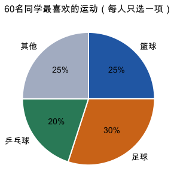

# 第 11 课：扇形统计图

## 一句话

扇形统计图把总量看作整个圆，用扇形的圆心角表示各部分占整体的百分比，所有部分合起来是 100%。

## 为什么

一个圆是 360°，把它看作总数 100%。

```
整个圆：360°  ↔  100%
1%：     3.6°  ↔  1/100
```

某一部分占 25%，它的扇形圆心角就是：

```
360°×25%=90°
```

反过来，看到圆心角是 54° 的扇形，它占整体的：

```
54÷360=0.15=15%
```

扇形统计图适合回答“各部分占整体的多少”。它要求各部分是互斥的：每个人只能选一种，每一份不能重复计算；所有部分还要合起来正好是整体，不能漏掉一类。如果有零散的小类，要加一个“其他”。

扇形统计图通常只显示百分比，不直接显示总数。知道百分比，还要知道总量，才能算出具体数量：

```
某部分的数量=总数×该部分的百分比
```

两个扇形统计图的百分比不能直接当成人数比较。甲班 40 人，男生占 50%，男生 20 人；乙班 50 人，男生占 40%，男生也是 20 人。百分比不同，人数却可能相同。

扇形统计图看的是部分与整体，条形统计图比较各类数量的多少，折线统计图看数量随时间的变化。要回答的问题不同，选的图也不同。

## 例子

### 例 1：60 名同学最喜欢的运动

每人只选一项，先读扇形图，再核对下表。颜色对应项目，标出的百分数对应这一项目在全班中的份额。



| 项目 | 百分比 | 人数 | 圆心角 |
|---|---:|---:|---:|
| 篮球 | 25% | 15 | 90° |
| 足球 | 30% | 18 | 108° |
| 乒乓球 | 20% | 12 | 72° |
| 其他 | 25% | 15 | 90° |
| 合计 | 100% | 60 | 360° |

人数用总数乘百分比：60×25%=15，60×30%=18，60×20%=12，60×25%=15。

圆心角用 360° 乘百分比：360°×25%=90°，360°×30%=108°，360°×20%=72°。

### 例 2：由圆心角求百分比

一个扇形的圆心角是 54°。

```
54÷360=15%
```

这个扇形占整体的 15%。

### 例 3：百分比不同，人数可能相同

甲班 40 人，喜欢足球的占 50%，有 40×50%=20 人。

乙班 50 人，喜欢足球的占 40%，有 50×40%=20 人。

甲班的百分比高，但两个班喜欢足球的人数一样多。比较两个扇形统计图，不能只看百分比。

## 易错

- 把百分比直接当人数。25% 不是 25 人，人数要用总数乘百分比。
- 各部分百分比加起来不等于 100%。画图前要检查是否漏项或重复计算。
- 把圆心角当成百分比。90° 对应 25%，不是 90%。
- 比较两个扇形统计图时，不看两个总量是否相同。
- 用扇形统计图看数量的增减变化。看变化应该用折线统计图。
- 分类不互斥。一个人同时选了两个项目，百分比就会重复计算。

## 独立读图

仍看上面的图，先遮住表格和本段答案。

1. 喜欢足球的比喜欢乒乓球的多多少人？从图中读取所需数据。
2. 小华说：“篮球和其他的扇形一样大，所以人数相同。”这次说法成立吗？理由是什么？
3. 另一班 50 人，篮球占 30%。能仅凭扇形更大就判断那班喜欢篮球的人更多吗？

答案：① 60×(30%−20%)=6 人。② 成立，两部分都属于同一个 60 人整体，比例同为 25%。③ 不能；另一班 50×30%=15 人，本班 60×25%=15 人，人数相同。作答必须说明总量，而不只比较角的大小。

## 练习

1. 一个扇形占整体的 25%，它的圆心角是多少度？
2. 一个扇形的圆心角是 72°，它占整体的百分之几？
3. 总数是 200 人，其中某部分占 35%，这部分有多少人？
4. 扇形统计图中有三部分，前两部分分别占 45% 和 30%，第三部分占百分之几？三部分的圆心角各是多少度？
5. 甲班男生占 60%，乙班男生占 50%。甲班男生一定比乙班男生多吗？
6. 一天有 24 小时，小明睡眠 8 小时。睡眠时间在扇形统计图中占百分之几？圆心角是多少度？

## 答案

1. 360°×25%=90°。
2. 72÷360=20%。
3. 200×35%=70（人）。
4. 第三部分占 100%−45%−30%=25%；圆心角分别是 360°×45%=162°，360°×30%=108°，360°×25%=90°。
5. 不一定。还要知道两个班的总人数，才能算出男生人数。
6. 8÷24=1/3≈33.3%；圆心角 360°×1/3=120°。
