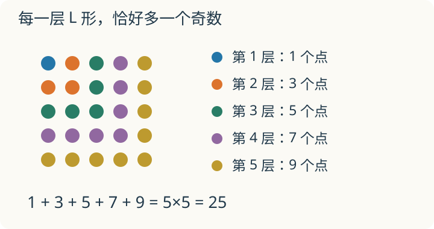

# 第 12 课：数与形

一个点，添上三个，能摆成 2×2 的正方形；再添五个，正好摆成 3×3。接下来该添几个？看每次新添的那一层，就能找到规律。

## 每添一层 L 形，多出几个




先看用点摆正方形：

```
1×1：        ●

2×2：        ● ●
             ● ●

3×3：        ● ● ●
             ● ● ●
             ● ● ●
```

从 1×1 变成 2×2，要在右边和下边各加一层，新加 3 个点。

从 2×2 变成 3×3，再加一层，新加 5 个点。

把每次增加的点数排出来：

| 每边点数 | 总点数 | 这次增加的点数 |
|---:|---:|---:|
| 1 | 1 | 1 |
| 2 | 4 | 3 |
| 3 | 9 | 5 |
| 4 | 16 | 7 |
| 5 | 25 | 9 |

每次增加的点数正好是一个奇数。当 n≥2，从 (n−1)×(n−1) 变成 n×n 时，新的一列有 n 个点，新的一行除去已算过的角上那个点，还有 n−1 个。新增 L 形一共有：

```
n+(n−1)=2n−1
```

2n−1 正是第 n 个奇数。

所以：

```
1=1²
1+3=2²
1+3+5=3²
1+3+5+7=4²
```

一直加下去：

```
1+3+5+…+(2n−1)=n²
```

这里要分清两个数：n 是奇数的个数，也是点阵每边的点数；2n−1 是最后一个奇数。比如 1+3+5+7 有 4 个奇数，和是 4²=16，最后一个奇数是 2×4−1=7。

把点摆成正方形，就能看见这些奇数为什么加起来正好是一个平方数；算式也能帮我们算出一共要摆多少个点。

## 例子

### 例 1：前 5 个奇数的和

```
1+3+5+7+9
```

一共 5 个奇数，所以和是 5²=25。

### 例 2：1+3+5+…+19

最后一个奇数是 19，它排在第几个？

```
(19+1)÷2=10
```

共有 10 个奇数，和是 10²=100。

### 例 3：101+103+…+199

从 101 到 199 的奇数，一共有：

```
(199−101)÷2+1=50（个）
```

前 100 个奇数的和是 100²=10000，前 50 个奇数的和是 50²=2500。

所以 101+103+…+199=10000−2500=7500。

## 易错

- 把最后一个奇数当成奇数的个数。1+3+5+…+19 有 10 个奇数，不是 19 个，和是 100，不是 19²。
- 把 1+3+5+7 算成 4×7=28。应该看个数：4 个奇数，和是 4²=16。
- 认为所有连续自然数的和都是平方数。1+2+3+4=10，不是平方数；平方数对应的是连续奇数的和。
- 求第 n 个奇数时写成 n。第 n 个奇数是 2n−1。
- 数正方形最外层点数时，把四个角重复计算。n≥2 时，n×n 点阵最外层是 4n−4 个点；1×1 只有 1 个点，要单独数。
- 把新增的 L 形与围住四周的外圈混在一起。n×n 点阵由 (n−1)×(n−1) 添 2n−1 个点形成；n≥2 时，四周外圈却有 4n−4 个点。

## 从 3×3 到 5×5

不逐个数，怎样用两层 L 形算出 5×5 比 3×3 多几个点？又怎样用两个总数检查？

<details>
<summary>看解释</summary>

从 3×3 到 4×4 增加 7 个，再到 5×5 增加 9 个，共 16 个。检查：5²−3²=25−9=16。减去里面的正方形，留下的正好是这两层 L 形。

</details>

## 练习

1. 计算 1+3+5+7。
2. 计算 1+3+5+…+11。
3. 计算 1+3+5+…+99。
4. 第 8 个奇数是多少？前 8 个奇数的和是多少？
5. 一个 12×12 的点阵，最外层一共有多少个点？

## 答案

1. 共 4 个奇数，和是 4²=16。
2. 11 是第 (11+1)÷2=6 个奇数，和是 6²=36。
3. 99 是第 (99+1)÷2=50 个奇数，和是 50²=2500。
4. 第 8 个奇数是 2×8−1=15；前 8 个奇数的和是 8²=64。
5. 12×12=144 个点，去掉里面的 10×10=100 个点，最外层有 144−100=44 个点；也可以算 4×12−4=44。
