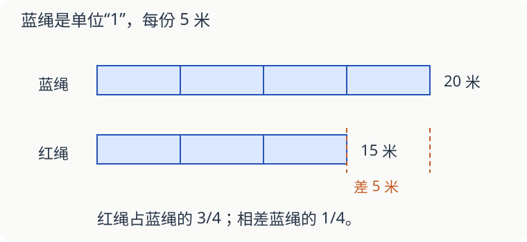

# 第 13 课：这是谁的四分之三

“红绳长是蓝绳的 3/4。”先别急着算，找一找：谁被平均分成了四份？蓝绳。我们把蓝绳的长度看作单位“1”。

## 已知整条，求其中几份

蓝绳长 20 米，把它平均分成四份，每份 5 米。红绳占三份，长 20×3/4＝15 米。

## 已知几份，往回找整条

如果只知道红绳长 15 米，它是蓝绳的 3/4，那么三份是 15 米，一份是 15÷3＝5 米，四份是 5×4＝20 米。合起来可以写成 15÷3/4＝20（米）。

一个乘、一个除，取决于已知的是整条还是其中几份。不能只看到“几分之几”就选乘法。

## 已知相差多少，也能找整条

红绳比蓝绳短 5 米，且红绳是蓝绳的 3/4。两条相差蓝绳的 1−3/4＝1/4，于是蓝绳长 5÷1/4＝20 米。

再换个问法：蓝绳比红绳长几分之几？这次比较的整体换成红绳，要算 5÷15＝1/3。红绳比蓝绳短 1/4，蓝绳比红绳长 1/3，这两个结果并不矛盾。

## 自己试一试

1. 一本书 80 页，读了全书的 3/5，读了多少页？
2. 读了 48 页，正好是全书的 3/5。全书多少页？
3. 一本书还剩 32 页没读，占全书的 2/5。全书多少页？
4. 甲有 24 张卡片，乙比甲多 1/4。乙有多少张？
5. 乙有 30 张卡片，比甲多 1/4。甲有多少张？
6. 甲有 24 张，乙有 30 张。甲比乙少几分之几？

## 答案与说明

1. 80×3/5＝48 页。
2. 48÷3/5＝80 页，也可以先求一份 16 页，再乘 5。
3. 32÷2/5＝80 页。
4. 24×（1＋1/4）＝30 张。
5. 30÷（1＋1/4）＝24 张。这里的 1/4 是甲的 1/4。
6. （30−24）÷30＝1/5。问“比乙少”，要以乙的数量作比较的整体。
