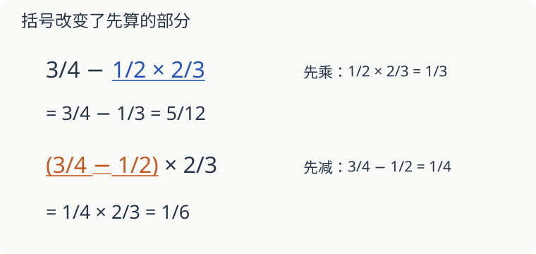

# 第 14 课：分数算式，先算哪一步

一条绳原有 3/4 米。剪掉“1/2 米的 2/3”，与“先剪掉 1/2 米，再取剩下的 2/3”，算的是同一个量吗？

## 先圈出真正要先算的部分

3/4−1/2×2/3，先算乘法：1/2×2/3＝1/3，再算 3/4−1/3＝9/12−4/12＝5/12。

这对应从 3/4 米中剪掉 (1/2×2/3) 米。

如果先剪掉 1/2 米，再取剩余的 2/3，算式就变成（3/4−1/2）×2/3，就要先算 1/4，再乘 2/3，得到 1/6。

## 能约分的，是乘法里的因数

5/6×3/10 可以把分子 5 与分母 10 同时除以 5，把分子 3 与分母 6 同时除以 3，结果是 1/4。

但 5/6＋3/10 中间是加号，不能跨过加号这样约分。要先通分：25/30＋9/30＝34/30＝17/15。

除法也别忘了先变形：3/4÷2/5＝3/4×5/2＝15/8。倒过来的是除数 2/5，前面的 3/4 不动。

## 选择好算的写法

0.75 就是 3/4。0.75＋1/6 写成 3/4＋1/6，通分后是 11/12。把 1/6 写成截断的小数，会丢掉后面的数，不能当作精确结果。

## 自己试一试

1. 1/2＋2/3×3/4。
2. （1/2＋2/3）×3/4。
3. 7/8÷7/12。
4. 5/9×3/10＋1/6。
5. 3/5÷（1−1/4）。
6. 0.25＋2/3 的精确结果是多少？

## 答案与说明

1. 1/2＋1/2＝1。
2. 7/6×3/4＝7/8。
3. 7/8×12/7＝3/2。
4. 1/6＋1/6＝1/3。
5. 3/5÷3/4＝3/5×4/3＝4/5。
6. 1/4＋2/3＝3/12＋8/12＝11/12。
