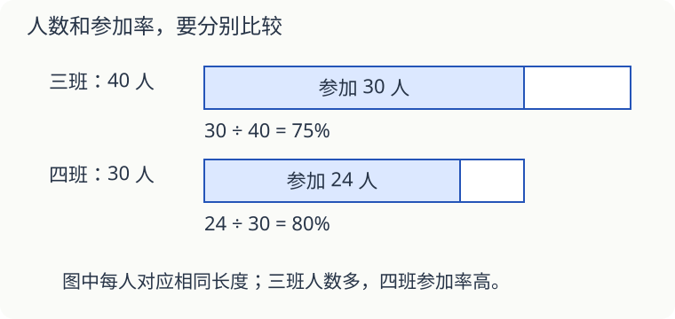

# 第 15 课：人数更多，比例就更高吗

三班有 40 人，30 人参加了阅读活动；四班有 30 人，24 人参加。三班参加的人更多，参加率也更高吗？

## 分母要用各班的总人数

三班参加率是 30÷40＝75%；四班参加率是 24÷30＝80%。四班人数少，但参加的人占全班的比例更高。

参加率＝参加人数÷全班人数。算出百分率后，检查一下：分子真的是分母中的那一部分吗？

## 两个班合起来，不能随便平均百分率

两个班合计参加 30＋24＝54 人，总人数是 40＋30＝70 人。总参加率为 54÷70≈77.1%（保留一位小数）。

（75%＋80%）÷2＝77.5%，不等于这里的总参加率，因为两个班人数不同。两个班总人数相同时，可以这样直接平均。人数不同则应先合计人数，再求参加率；若两个原参加率相同，直接平均也会碰巧算对。

## 选学：从 60% 到 75%，怎么说

两次参加率相差 75%−60%＝15 个百分点。如果问“参加率比原来提高了百分之几”，就还要除以原来的 60%：15%÷60%＝25%。

“相差多少个百分点”和“比原来提高百分之几”问的是两件事，读题时别跳过这几个字。

## 自己试一试

1. 50 粒种子有 46 粒发芽，发芽率是多少？
2. 60 人中有 54 人出勤，出勤率是多少？
3. 甲组 20 人，16 人完成；乙组 30 人，21 人完成。哪组完成率高？
4. 第 3 题两组合计完成率是多少？
5. 【选做】正确率由 80% 升到 90%，增加多少个百分点？相对原来提高百分之几？
6. 某次种子试验发芽率 90%，能保证下次 100 粒恰好发芽 90 粒吗？

## 答案与说明

1. 46÷50＝92%。
2. 54÷60＝90%。
3. 甲组高。甲组 16÷20＝80%，乙组 21÷30＝70%。
4. （16＋21）÷（20＋30）＝37÷50＝74%。
5. 增加 10 个百分点；（90%−80%）÷80%＝12.5%。
6. 不能。这是本次试验的结果，下次的种子和条件可能不同。
